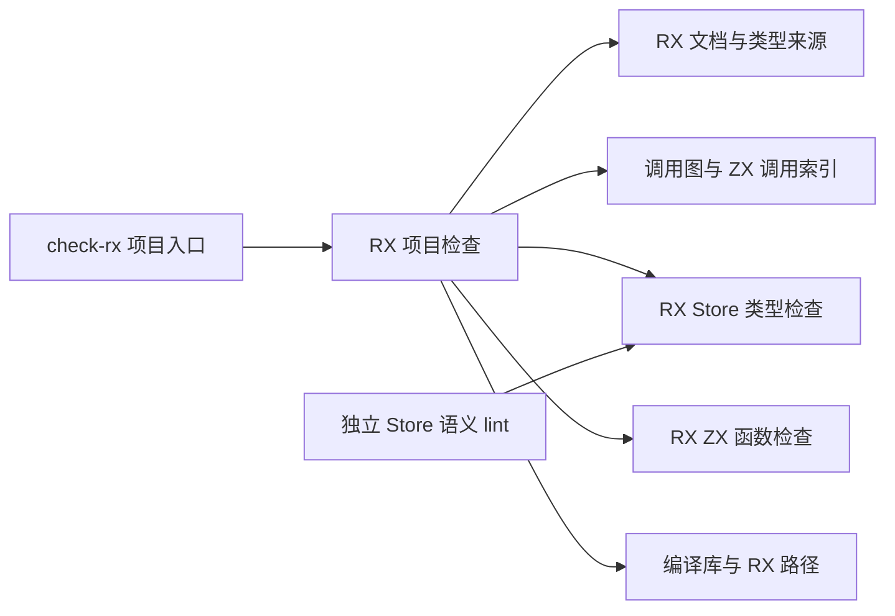
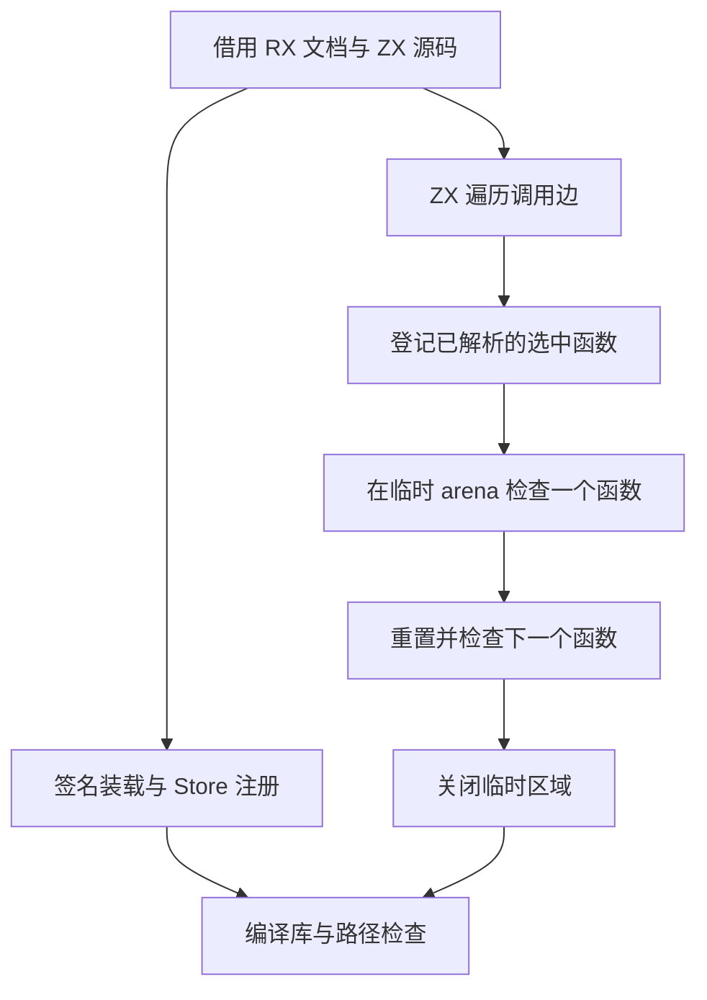

# CLI 的 RX 项目与 Store 检查自举

## Intent · 目标

将 `zxc check-rx --entry` 的项目检查和函数检查编排、调用索引扫描，以及 `zxc lint --semantic` 共用的 Store 类型检查迁入 RX/ZX。入口通过同一调用链核对诊断、模块路径与生命周期。

## Data · 正式路径

原先 CLI 由 `rx/load.zig` 编排项目检查，`rx/function.zig` 扫描 RX 调用边并决定 ZX 签名与可执行体检查路径，`rx/store_types.zig` 直接遍历每个函数根的依赖并解析 Store 签名。入口装载、类型来源收集和编译库引用收集已由前两批 Source 实现提供。

## Edges · 诊断与内存

项目与 Store 检查继续按原顺序短路。调用记录按原顺序消费图边和逆序索引引用。Store 检查继续按根加载并保留首次发现的导入描述符。每个函数的检查使用同一块临时 arena，成功后重置，函数环节结束后释放。Store 签名预取在分析返回后释放，签名数据供注册表借用。

项目、函数和 Store 的阶段调度与遍历由正式 RX/ZX 入口执行。Zig 仍提供文件 I/O、表的字段访问及写入、分配器、诊断输出和下层编译器 API。直接传文件列表的 `check-rx` 仍通过原先的文本收集入口。RX 表达式的完整语义分析继续由编译和语义 lint 的入口承担。

## Answer · 验收

`test-rx-cli`、`test-rx-store-paths`、`test-rx-project-cli`、`test-semantic-lint`、`test-library-publish` 和 `test-package-install` 全部通过，共 111 个构建步骤、174 项 Node 集成检查。复用既有磁盘项目夹具对照直接基线与候选，六种配置的退出状态、标准输出和诊断输出逐字节一致。窄清单用 seed 和 Source 引导器各生成一次，397 个 Zig 工件逐字节一致，另外 50 个仅临时变量编号不同。

macOS arm64、Zig 0.17.0、ReleaseSmall。固定对照为 `dadb1f21a`，直接对照为 `fbc635add`。三套 CLI 的编译模块均由 `7c9b225c3` Source 引导器生成，运行时使用 Source 分析与生成。三版交错运行，预热后取十二轮中位数。所有命令均退出成功，输出一致。RSS 采用进程峰值，MB 按十进制计。

| 场景                 | 墙钟 ms（固定 / 直接 / 候选） | CPU ms（固定 / 直接 / 候选） | 峰值 RSS MB（固定 / 直接 / 候选） |
| -------------------- | ----------------------------: | ---------------------------: | --------------------------------: |
| RX 项目              |         33.11 / 32.17 / 32.15 |        37.39 / 36.41 / 36.49 |             13.02 / 12.91 / 12.69 |
| 共享 RX 模块图       |            3.55 / 3.49 / 3.49 |           3.30 / 3.24 / 3.24 |                7.30 / 7.17 / 6.90 |
| 编译库调用           |         55.97 / 54.16 / 54.30 |        55.64 / 53.86 / 53.97 |             19.76 / 18.63 / 18.46 |
| 独立 Store 项目检查  |            3.01 / 3.04 / 3.01 |           2.75 / 2.77 / 2.76 |                6.82 / 6.95 / 6.34 |
| 独立 Store 语义 lint |            3.46 / 3.47 / 3.45 |           3.21 / 3.21 / 3.19 |                7.09 / 7.21 / 6.60 |

相对直接对照，墙钟最大增加 0.14 ms，CPU 最大增加 0.12 ms，五个样本的峰值 RSS 均下降。相对固定对照，五组墙钟均下降，CPU 最大增加约 0.008 ms。测量覆盖受影响的项目检查及 lint 入口。原始记录保存在 `.zig-cache/verification-tmp/rx-checking/`。
