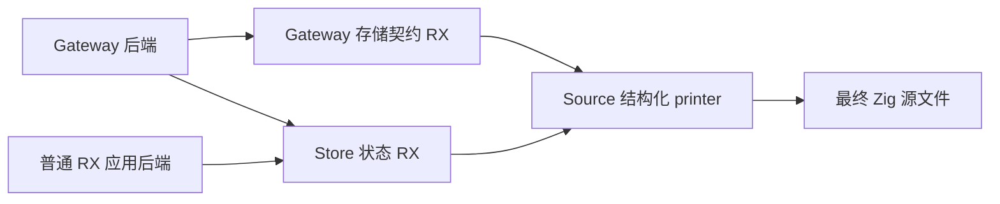
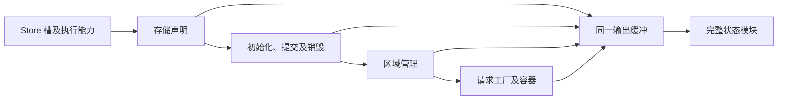

# Gateway 存储契约与 Store 状态直接打印自举

## Intent

将 Gateway 的存储契约和普通 RX 与 Gateway 共用的 Store 状态模块接到 Source printer。沿正式入口消除 Source AST 列返回 Zig 宿主后再装配的过程，保留目标模块的声明结构和 Store 行为。

## Data

Gateway 后端分别调用 `genz.gateway.storage.render` 和 `genz.zx.state.renderStorage`。普通 RX 应用随状态能力调用 `state.renderWithCapabilities`。前者原来在宿主还原常量行，后者原来合并四份声明表、逐项登记根声明，再交给同一个 printer。

Store 四个阶段分别生成局部 AST。阶段间引用通过生成的名称解析。同一个输出缓冲按原顺序接收声明，失败时宿主释放缓冲并交付原有错误。

## Edges

前三个 Store 阶段直接打印完整根范围。请求工厂与容器传入局部根编号，选择根时只登记标签及载荷偏移，子声明和载荷列继续使用局部表。各阶段之间的符号引用由普通 Zig 名称链接。初始 seed 仍可用。宿主保留输出分配、借用输入 ABI 和失败清理。

四条 Store 分阶段生成入口的 Zig 适配只存在于旧路径的不可达分支。删除这些适配与独立的引导登记，阶段本身由 Store 状态 RX 继续调用。Gateway 的导入常量和末尾声明直接写入已有 AST 声明列。

## Answer

核对前后两代正式 CLI 在无语义缓存时生成的 Gateway 契约与 Store 状态，以及 Store 三组独立编译输入的所有 Zig 文件。集中回归覆盖 Gateway HTTP 与 JSON、Store 短生命周期别名、区域回收、I/O 与事务失败。对同样的输入和工具链记录受影响路径的墙钟、CPU 与 RSS。

### 一致性与回归

- 用上一代 Source 引导器构建候选引导器，组合目标通过 27 步。单独构建初始 seed 通过 14 步。候选引导器复用于正式 CLI 和 Store 验收工具。
- 在普通、零请求体上限和空 Gateway 三个入口上，存储契约及状态模块共 6 份产物逐字节一致。普通 Store 的写入、服务调用和只读三个入口共 26 份生成 Zig 文件逐字节一致。
- `test-gateway`、`test-application-json-gateway`、`test-store-reclamation`、`test-store-alias-lifetime`、`test-rx-store-io`、`test-stores` 共通过 112 个构建步骤及 284 项测试。Gateway 运行检查通过 86 项。
- Source 引导器的 SHA-256 是 `c9050a9ee1d38b7df8b79e9978b221e739cd9129bede07b4cfe190cb08b8e340`。验收用 CLI 的 SHA-256 是 `ab20a8ddcbcce32e8a1777773597a259b70260821ca3c2958c06eda6d7a2dd71`。

### 受影响路径的性能

macOS arm64，Zig 0.17.0，ReleaseSmall。Gateway 对照使用 `73e9a5a55` 对应的 Source CLI，关闭 zxc 缓存并在相同的工具链缓存和工作目录原生构建。Store 对照复用同一 Store 宿主装配实现的现有 Source 验收工具，命令在生成 Zig 后退出。双方工具均经过 Source 引导并运行 Source 编译路径。下表为一次预热后五对交替运行的中位数，RSS 以十进制 MB 计，来自系统 `wait4`。

| 输入         | 墙钟，基线 / 候选 | CPU，基线 / 候选 | 系统峰值 RSS，基线 / 候选 |
| ------------ | ----------------: | ---------------: | ------------------------: |
| Gateway main |   1.326 / 1.350 s |  1.413 / 1.476 s |        211.83 / 211.75 MB |
| Store 写入   |    5.27 / 6.67 ms |   5.86 / 7.28 ms |          11.75 / 11.86 MB |
| Store 服务   |    4.82 / 5.86 ms |   5.48 / 6.73 ms |          11.85 / 11.88 MB |
| Store 只读   |    4.66 / 5.44 ms |   5.14 / 6.05 ms |          11.09 / 11.12 MB |

Gateway 两项时间的变化分别是 +0.024 秒和 +0.062 秒。Store 的最大变化分别是 +1.40 ms 和 +1.43 ms，系统峰值最多增加 0.11 MB。这是受影响入口的测量。完整自举冷构建与各阶段临时 AST 的独立内存高水位未在本批测量。记录位于 `.zig-cache/verification-tmp/store-and-gateway-source-render/` 的 `parity.json`、`performance.json` 和 `regression.log`。
