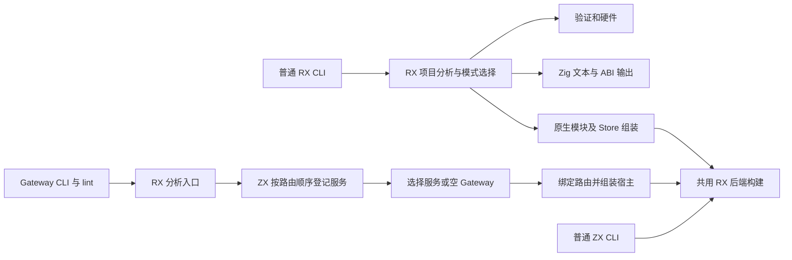
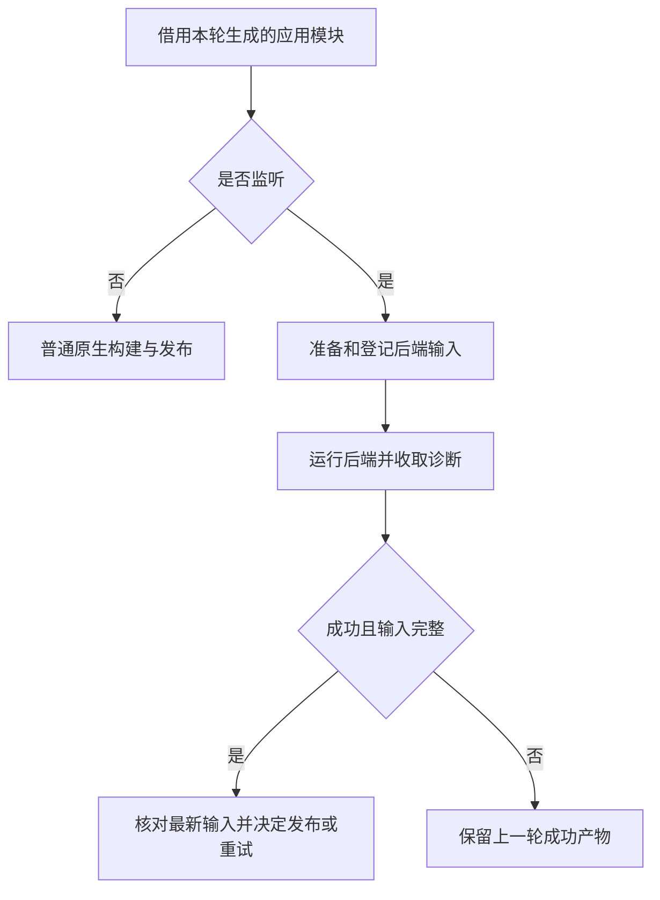

# RX 应用与 Gateway 构建自举

## Intent · 目标

将普通 RX 应用、Gateway 分析与构建，以及 ZX/RX 共用的原生后端交接迁入 RX/ZX。保留原有输入、诊断、缓存、产物和监听重试行为。

## Data · 正式路径

普通 RX 入口之前由 Zig 选择验证、FPGA、文本生成及原生构建，并决定何时补齐 Store 初值和应用状态。Gateway 先分析路由、准备服务导出，随后链接、绑定路由、生成并组装宿主。普通 ZX、RX 和 Gateway 之前各自重复执行后端输入交接、诊断及监听发布。

## Edges · 输入与生命周期

Gateway 编译使用编译库链接给出的服务顺序和已有路由映射。服务列表只在分析服务时持有，文本和路由服务引用沿用原先的借用。同一套原生构建入口先交接观察输入，再运行后端、登记返回输入和输出诊断。仅成功且依赖完整的后端结果可以发布，输入变化继续走重试。普通 RX 生成 Store 初始化器与状态后释放临时描述符。

Zig 提供项目和库装载、编译器分析与生成接口、分配器、诊断写入以及后端进程调用。Gateway 运行时继续使用既有生成器和静态构建路径。

## Answer · 验收

`test-gateway`、`test-application-json-gateway`、`test-rx-project-cli`、`test-rx-watch`、`test-watch-recovery`、`test-rx-store-runtime` 和 `test-semantic-lint` 全部通过，共 133 个构建步骤、144 项 Node 检查及 86 项 Gateway 运行检查。另用同一个 RX 入口分别运行 `verify` 与 `fpga`，直接对照与候选的七份验证工件及两份硬件工件逐字节一致。窄清单中 559 个 Zig 工件逐字节一致，另外 55 个只在 seed 与 Source 的临时变量编号上有差异。

macOS arm64、Zig 0.17.0、ReleaseSmall。固定对照为 `dadb1f21a`，直接对照为 `44f542b1f`。三套 CLI 的编译模块均由 `7c9b225c3` Source 引导器生成，运行时使用 Source 分析和生成。命令均使用 `--no-cache`，原生构建沿用同一 Zig 工具链、后端缓存配置和输出路径。排除初次预热后交错测量，文本输出取九轮中位数，实际原生构建取五轮中位数。RSS 为 `wait4` 返回的峰值，MB 按十进制计。

| 场景                      | 墙钟 ms（固定 / 直接 / 候选） | CPU ms（固定 / 直接 / 候选） | 峰值 RSS MB（固定 / 直接 / 候选） |
| ------------------------- | ----------------------------: | ---------------------------: | --------------------------------: |
| RX 输出 Zig 文本          |         18.31 / 18.17 / 18.18 |        26.36 / 25.93 / 26.17 |             19.07 / 18.89 / 18.73 |
| 原生 RX 应用              |      884.99 / 885.82 / 886.33 |     958.24 / 959.63 / 966.41 |          182.11 / 181.70 / 181.70 |
| 原生 ZX 应用              |      853.27 / 854.22 / 852.76 |     910.22 / 910.76 / 908.87 |          180.22 / 179.85 / 179.60 |
| 空 Gateway                |      793.85 / 795.68 / 795.61 |     850.04 / 850.00 / 848.74 |          176.52 / 176.39 / 176.47 |
| 含路由与 Store 的 Gateway |   1295.13 / 1297.55 / 1299.96 |  1390.19 / 1388.96 / 1392.89 |          212.03 / 211.94 / 211.80 |

五组场景的直接对照和候选产物摘要一致，覆盖 Zig 源码和原生可执行文件。相对直接对照，墙钟最多增加 2.42 ms，CPU 最多增加 6.78 ms，峰值 RSS 最多增加 0.08 MB。相对固定对照，墙钟最多增加 4.83 ms，CPU 最多增加 8.18 ms，五组峰值 RSS 均下降。测量覆盖上述实际命令，其中原生构建包含 Zig 后端执行。原始记录保存在 `.zig-cache/verification-tmp/rx-execution/`。
