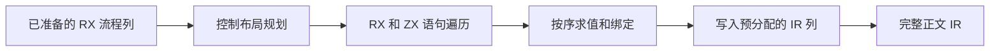
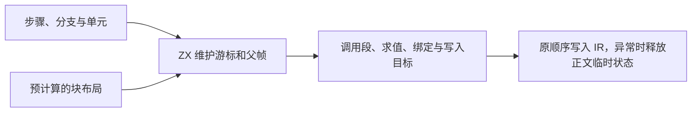

# RX 语句遍历帧栈与分支写入自举

## Intent

从正式 RX 正文降低路径移除 Zig 的遍历帧栈，把控制目标、作用域位置和分支结束范围交由 RX/ZX 决定。保持顺序、并行、Task、分支和返回的语义及 IR 布局。

## Data

正式入口从 `program.lower` 进入 `lowerBody`，先按已有控制规划预分配 IR 列，再降低正文。旧路径为每批连续 Call 或每个控制节点调用一次 Source 转移，并由 Zig 维护当前帧、父帧、位置与作用域。普通分支需要按控制布局校验写入的范围。

## Edges

Source 使用布局中已有的分支计数和 successor 记录。Task 和 Selection 沿用父块，Case 使用独立块。作用域在遍历预案中按深度复用槽位。标签、主体表达式和 Task 输出继续按原执行顺序求值。IR 写入范围仍由原有控制列规则校验。

Zig 继续负责表达式求值、调用导入、绑定与控制列的内存适配。初始 seed 仍使用旧遍历。

## Answer

沿同一入口核对正式帧栈退出。在已有顺序、Task、Parallel、选择、Store 与错误场景中验证 IR 和生成结果。使用固定入口做冷暖生成与内存对照。剩余原生职责在[自举收敛计划](自举收敛计划.md)进度栏记录。

### 正式路径

`traversal/build.rx` 初始化根帧并调度一次 ZX 遍历。输出记录连续 Call、并行、标签和结果求值、作用域打开与写入所需的编号。正式入口顺序执行这份预案，无须维护用于重新遍历的 Zig 父帧或按事件调用旧的 Source 推进入口。源遍历也决定每次分支关闭使用哪个 IR 范围。错误发生时丢弃当前正文保留的绑定尾部。

现在的宿主仍持有已经求值的表达式编号、待还原的绑定长度和各控制块的写入游标。这些值产生于实际求值和调用导入。分支和作用域的写入沿用现有 Source 控制列规则。正式路径复用流程及布局列，只为遍历结果和运行中的绑定、游标保留临时状态。

### 固定清单回测

macOS arm64，Zig 0.17.0，ReleaseSmall，16 分区，关闭常驻。由 `3ae041c28` 的 Source 引导器构建候选。三套工具运行 Source 分析与生成。在同一 735 入口清单上交替三轮，表内为中位数。RSS 以十进制 MB 计。

| 指标                     |  固定基线 |    上一代 |      候选 |
| ------------------------ | --------: | --------: | --------: |
| 冷生成墙钟               |    2.89 s |    2.61 s |    2.63 s |
| 冷生成 CPU               |   12.46 s |   12.65 s |   12.62 s |
| 冷生成进程树采样峰值 RSS | 902.92 MB | 723.57 MB | 708.71 MB |
| 冷生成单进程系统峰值 RSS | 961.64 MB | 742.18 MB | 733.53 MB |
| 热生成墙钟               |    2.22 s |    1.97 s |    1.97 s |
| 热生成 CPU               |    8.47 s |    8.27 s |    8.28 s |
| 无改动墙钟               |    0.03 s |    0.03 s |    0.03 s |

相对上一代，冷生成墙钟增加 0.02 秒，CPU 减少 0.03 秒，进程树采样峰值下降 14.86 MB。相对固定基线，墙钟缩短 0.26 秒，CPU 累计增加 0.16 秒。11,753 份生成文件逐字节一致，工具身份戳除外。两代 v18 所有权缓存正文 SHA-256 同为 `cdf9fa7e0f33002a95dc097b2837de781d67e6e519a452fb97f89f7c0bbf3a23`。本批未重测完整 Zig/LLVM 冷构建。

### 回归与引导

Source 引导构建通过 25 步，初始 seed 通过 14 步。RX 推导、Task 输出、并行推导、顺序运行、并行运行、并行所有权、Store 应用和磁盘项目共八组，通过 1,301 个构建步骤和 1,481 项测试。

正式路径使用 `generated_rx_statement_schedule_body`，原有逐事件推进的独立引导登记已删除。旧帧栈只在 `traversal/seed.zig` 的初始路径中使用。Source 引导器的 SHA-256 是 `1731056b4c9f6230f1910c996fac69aa56869af8eb7d16a1f5f62161a20e1c29`。验证记录在 `.zig-cache/verification-tmp/rx-statement-schedule/` 下的 `stage.log`、`seed.log`、`regression.log`、`measurement.log` 和 `paired-comparison.json`。
