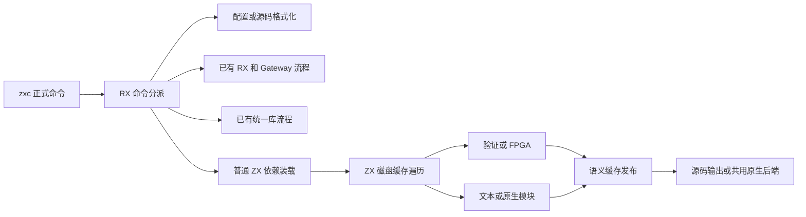
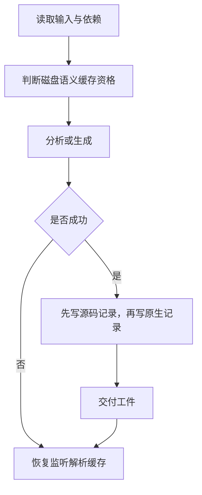

# ZX 命令与缓存流程自举

## Intent · 目标

将正式 CLI 命令分派、普通 ZX 编译及其磁盘语义缓存流程迁入 RX/ZX。验证、FPGA、源码输出和原生应用沿同一入口处理项目与依赖，继续使用原有诊断格式和产物契约。

## Data · 正式路径

此前 `cli/compile.zig` 负责模式选择、项目和引用载入、缓存读写及输出发布，磁盘缓存用 Zig 遍历源文件和原生签名。验证和 FPGA 分别选择有无语义缓存的分析入口。原生 ZX 构建还复制了一份只用于标记成功的入口源码。

## Edges · 生命周期与写回

监听轮次在分析前借入已有解析缓存，结束时恢复到监听状态。发现混合 RX 引用时在换入解析缓存前交给已有 RX 流程。语义缓存仍保留编译库输入的读取旁路、原生签名去重、源记录与原生记录写入顺序以及磁盘失败诊断。编译或查询成功后才执行相应写回。源码格式化直接使用输入字节与格式化结果，原生构建直接交接生成的模块束。

FPGA 继续调用既有的符号分析、硬件 IR 和 Verilog 生成接口。ZX 扫描函数契约，需验证时由 RX 先执行验证。Zig 暂时提供文件 I/O、缓存编码和表存储、底层编译器 API 以及分配与诊断边界。

## Answer · 验收

持久缓存、原生生成缓存、生成运行、ZX 导入顺序、RX 格式化、配置格式化、验证、ZX 与 RX 监听恢复、安装模式共十组回归通过。构建共 102 个步骤，Node 检查通过 314 项。另用实际 CLI 检查 ZX 导入 RX 的路径，以及根函数没有契约但被调用函数有契约的 FPGA 路径，产物逐字节一致。初始 seed 与 Source 的窄清单生成，640 个 Zig 工件逐字节一致，58 个只在临时变量编号上有差异。

macOS arm64、Zig 0.17.0、ReleaseSmall。固定对照为 `dadb1f21a`，直接对照为 `019f4dd2a`。三套 CLI 的编译模块由 `7c9b225c3` Source 引导器生成，运行时使用 Source 分析和生成。三版交错运行，排除预热后，原生构建取五轮中位数，其余取九轮。每次冷缓存试验清除样本的磁盘语义缓存，暖缓存试验复用对应工具的实际记录。RSS 采用 `wait4` 返回的峰值，MB 按十进制计。

| 场景                      | 墙钟 ms（固定 / 直接 / 候选） | CPU ms（固定 / 直接 / 候选） | 峰值 RSS MB（固定 / 直接 / 候选） |
| ------------------------- | ----------------------------: | ---------------------------: | --------------------------------: |
| 单文件 ZX 生成            |            2.12 / 2.12 / 2.08 |           2.33 / 2.37 / 2.38 |                7.47 / 7.34 / 7.34 |
| ZX 依赖闭包生成，禁用缓存 |         19.42 / 19.33 / 19.36 |        21.60 / 21.38 / 21.33 |             16.89 / 16.53 / 16.53 |
| 冷磁盘语义缓存            |         26.99 / 26.70 / 26.52 |        29.11 / 28.63 / 28.41 |             17.48 / 17.73 / 17.71 |
| 暖磁盘语义缓存            |         17.97 / 17.69 / 17.66 |        20.14 / 19.61 / 19.61 |             14.06 / 14.04 / 13.84 |
| ZX 格式检查               |         15.44 / 15.40 / 15.29 |        15.16 / 15.15 / 15.03 |             16.12 / 16.09 / 16.09 |
| ZX 验证                   |            8.64 / 8.57 / 8.63 |           7.76 / 7.74 / 7.79 |             25.02 / 24.99 / 24.99 |
| 时钟式 FPGA 生成          |            1.63 / 1.58 / 1.62 |           1.38 / 1.34 / 1.36 |                5.55 / 5.41 / 5.62 |
| 原生 ZX 构建              |      850.77 / 851.52 / 851.76 |     908.50 / 908.78 / 907.90 |          179.65 / 180.04 / 179.75 |

直接对照与候选的工件、标准输出和诊断摘要一致。两版冷缓存均分析并写回 49 条源码记录，第二次从磁盘载入并复用 49 条。相对直接对照，墙钟最多增加 0.24 ms，CPU 最多增加 0.05 ms。FPGA 相对直接对照增加 0.21 MB RSS，较固定对照增加 0.07 MB。原生构建的墙钟相对固定对照增加 1.00 ms，CPU 下降 0.60 ms。原始记录保存在 `.zig-cache/verification-tmp/zx-compilation/`。
