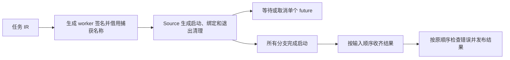

# genz 任务捕获与并行发布自举

## Intent

从普通函数、值 ABI 和递归函数的生成入口迁移 Task 的捕获、启动、等待、取消及并行结果发布。保持启动顺序、失败清理和捕获的参数表示。

## Data

`Lower.expr` 和绑定语句进入 `tasks/root.zig`。Source 已生成 worker 参数、future 调用和少数独立 AST 片段。Zig 仍逐项找捕获名称和地址表示，复制 worker 名称表，并组装启动、等待和结果阶段的输入。

## Edges

宿主提供 IR 列和分配器，递归降低 worker 正文与子表达式，并安装生成的 AST 列。捕获名称借用当前符号表，退出 worker 时恢复。并行结果名称在启动结束后分配，所有 await 在任一结果的错误检查之前发出。已有初始 seed 保留独立实现。

## Answer

正式路径由同一段 RX 构造启动参数、调用、绑定和取消清理。捕获选取直接读取 IR 符号、名称和栈成员，省去中间名称和地址标志数组。等待与取消共用同一段 RX，选择是否启动内联 future、如何调用及是否以语句块汇合。

worker 使用作用域共用的名称保存与恢复规则，仅为被捕获的槽留存旧名称。临时使用标记和缓存读计数随 worker 工作区一起释放。并行等待与结果汇合在同一段 RX 中构造和发布，结果标签和返回字段不再由 Zig 扫描。宿主保留逐分支的递归降低，以及同正文生成共用的行区间安装。[自举收敛计划](自举收敛计划.md)

### 阶段产物

候选由 `0d431beab` 的 Source 引导器构建，25 个构建步骤成功。初始 seed 重新构建并生成 lexer，14 个构建步骤成功。候选执行同配置的主清单、growth 和 collections，再生成的 14,340、459 和 84 份文件分别逐字节一致，工具身份戳除外。

上一代与候选 CLI 对 14 个可执行的 RX Task 现有夹具关闭缓存生成，输出的 Zig 文件逐字节一致。夹具覆盖顺序任务、并行混合结果、嵌套任务和空返回。

九组回归通过 1,545 个构建步骤与 1,625 项 Zig 测试。68 项 Node 集成检查通过。运行覆盖内联等待、取消和清理、部分启动失败、错误优先顺序、进程参数、浮点捕获与别名作用域，并核对源码、编译库和再发布路径。

候选引导器 SHA-256 为 `15c3263e04b17b912f92d89723d830f126e1b02487ff545e47ca7ed29490c158`。原始记录位于 `.zig-cache/verification-tmp/genz-tasks/`。

### 固定输入回测

固定清单包含 735 个入口和 16 个分区。三代工具均由 Source 构建并执行 Source 分析与生成。环境为 macOS arm64、Zig 0.17.0、ReleaseSmall，关闭常驻。表中取三轮交错测量的中位数，RSS 使用十进制 MB。计时覆盖生成阶段。

| 指标                 |  固定基线 |    上一代 |      候选 |
| -------------------- | --------: | --------: | --------: |
| 冷生成墙钟           |    2.84 s |    2.66 s |    2.61 s |
| 冷生成 CPU           |   12.48 s |   12.62 s |   12.60 s |
| 冷生成进程树峰值 RSS | 885.47 MB | 708.33 MB | 712.77 MB |
| 冷生成单进程峰值 RSS | 967.97 MB | 733.38 MB | 736.69 MB |
| 热生成墙钟           |    2.24 s |    1.98 s |    1.96 s |
| 热生成 CPU           |    8.49 s |    8.21 s |    8.23 s |
| 无改动墙钟           |    0.04 s |    0.03 s |    0.03 s |

相对上一代，冷生成墙钟减少 0.05 秒，CPU 减少 0.02 秒。进程树峰值 RSS 增加 4.44 MB，单进程峰值增加 3.31 MB。相对固定基线，冷生成墙钟减少 0.23 秒，累计 CPU 增加 0.12 秒，进程树峰值 RSS 下降 172.70 MB。

候选与上一代的 11,753 份固定清单文件逐字节一致，工具身份戳除外。两代 v18 所有权缓存正文的 SHA-256 均为 `cdf9fa7e0f33002a95dc097b2837de781d67e6e519a452fb97f89f7c0bbf3a23`。固定基线保留早期 v17 缓存和分区配置。
