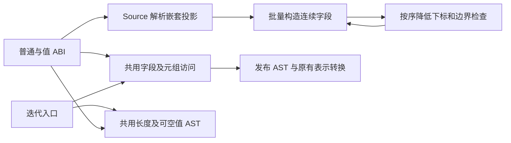

# genz 共享表达式访问自举

## Intent

贯通普通函数、值 ABI 和迭代函数中的字段、元组下标、嵌套下标、长度和可空值访问。由 Source 解析投影路径、决定表示和构造 AST。

## Data

正式入口是 `Lower.regular`、值 ABI 的普通表达式回退和迭代的 `evaluation.lower`。普通链借用状态布局与深层列表表示，迭代链使用迭代缓冲及专用类型。原路径计划返回表达式编号，宿主沿编号重新解码字段、下标与名称；迭代另外实现字段、元组和长度生成。

## Edges

路径规划借用表达式、类型和缓存列。字段段落在下一个键求值前提交。下标继续逐个经过已有边界检查及错误捕获，每个键只求值一次。缓存命中、错误顺序、普通与迭代各自的数组表示维持现有契约。

## Answer

嵌套投影由 Source 直接借用 IR 列，解析字段名、下标键及路径段边界。一次发布连续字段段，宿主执行键的递归求值和既有的检查下标。普通与迭代的字段和元组共用一个 Source 入口，统一生成字段读取及必要的解引用，并返回结果表示。长度和可空值的解包与包装共用 AST 构造。宿主继续执行表示转换、读写物理缓存和安装 AST 列。[自举收敛计划](自举收敛计划.md)

### 阶段产物

候选由 `00e8a68a8` 的 Source 引导器构建，25 个构建步骤成功。初始 seed 重新构建并生成 lexer，14 个构建步骤成功。候选以相同配置重新执行主清单、growth 和 collections，分别有 14,349、459 和 84 份文件逐字节一致，工具身份戳除外。

两代 CLI 关闭缓存分别生成 20 个现有夹具的 Zig 源码，结果逐字节一致。夹具覆盖嵌套缓冲、迭代缓冲、分支中保留的视图和元组绑定。

十二组回归共通过 465 个构建步骤、2,819 项 Zig 测试及 1 项 CLI 集成检查。覆盖嵌套及迭代缓冲、借用字段、边界和错误、普通与值 ABI、源码及编译库。CLI 核对了重新定位和重新发布编译库后的返回视图。

首轮回测的单进程峰值比上一代高 13.52 MB。随后将投影段发射的临时区移出路径计划，发射完成即释放，并缩小有固定节点上限的缓冲。调整后重新构建候选，生成一致性复核通过。嵌套缓冲、循环字段、迭代缓冲及元组绑定补验通过 230 个构建步骤和 253 项测试。

最终候选引导器 SHA-256 为 `42b9f581a249affcdbec8b0ba46557045d1249ce3b3f1e50765023605e7d52cf`。原始记录位于 `.zig-cache/verification-tmp/genz-projection/`。

### 固定输入回测

固定清单含 735 个入口和 16 个分区。三代工具均由 Source 构建，并执行 Source 分析和生成。环境为 macOS arm64、Zig 0.17.0、ReleaseSmall，关闭常驻。交错三轮取中位数，RSS 使用十进制 MB。计时覆盖生成阶段。

| 指标                 |  固定基线 |    上一代 |      候选 |
| -------------------- | --------: | --------: | --------: |
| 冷生成墙钟           |    2.83 s |    2.62 s |    2.62 s |
| 冷生成 CPU           |   12.44 s |   12.62 s |   12.61 s |
| 冷生成进程树峰值 RSS | 885.77 MB | 718.24 MB | 707.59 MB |
| 冷生成单进程峰值 RSS | 922.04 MB | 733.36 MB | 732.76 MB |
| 热生成墙钟           |    2.24 s |    1.98 s |    1.99 s |
| 热生成 CPU           |    8.51 s |    8.25 s |    8.23 s |
| 无改动墙钟           |    0.04 s |    0.03 s |    0.03 s |

相对上一代，冷生成墙钟持平，CPU 减少 0.01 秒。进程树峰值 RSS 下降 10.65 MB，单进程峰值下降 0.61 MB。相对固定基线，冷生成墙钟减少 0.21 秒，累计 CPU 增加 0.17 秒，进程树峰值 RSS 下降 178.18 MB。

候选与上一代的 11,753 份固定清单文件逐字节一致，工具身份戳除外。两代 v18 所有权缓存正文 SHA-256 均为 `cdf9fa7e0f33002a95dc097b2837de781d67e6e519a452fb97f89f7c0bbf3a23`。固定基线保留早期 v17 缓存和分区配置。
