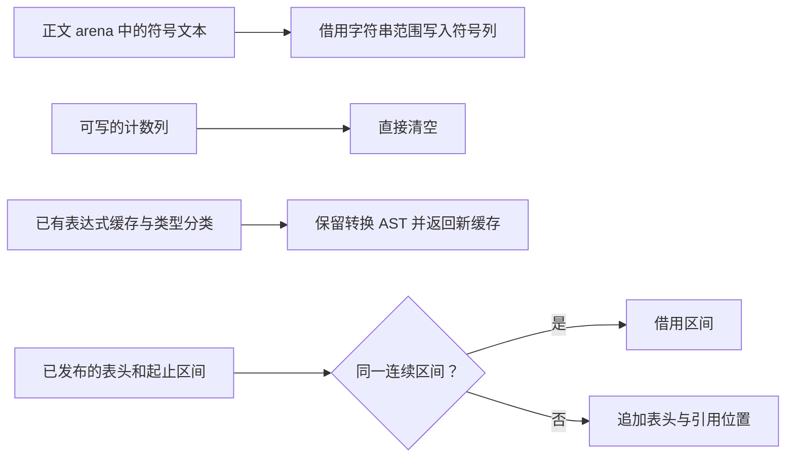

# genz 函数工作区与 AST 区间自举

## Intent

让正式 genz 的普通函数和值 ABI 共用 RX 工作区初始化。由 ZX 选择表示切换时的缓存转换和函数体 AST 区间，减少独立函数文件生成中的重复分配。

## Data

普通与值 ABI 的正文都经过 `Lower.function`。原先它分别调用分配策略与打包符号名，然后在 Zig 解包名称和清空计数。生成独立函数文件时，它先按项目入口分配工作区，选择目标函数后再分配一次。表示转换需要为每个表达式保留原有 AST 包装与编号。语句块由表头行描述，可以在连续时直接借用原区间。

## Edges

符号名借用一次生成的文本，文本由正文的 arena 持有。符号使用状态和缓存读取计数在现有列内初始化。单独生成签名、类型或外部模块正文时无需分配这些列。表示切换继续保留原有转换 AST 和求值顺序，旧缓存及类型、布局视图由作用域借用并恢复。区间追加由 Zig 预留可写容量，ZX 写入表头，长度在写入成功后提交。

## Answer

工作区预留与正文准备调用生成的 Source 入口，初始 seed 保留原生分配及初始化。已移除正式路径中独立的分配能力查询和符号解包。缓存遍历以可选转换请求决定完成，Source 直接按类型选择转换布局。通用节点区间选择由 ZX 判定空块、原区间借用和追加位置。

Zig 仍安装所选函数的共享视图，负责表示作用域恢复、正文语句与表达式递归，以及 AST 列的容量提交。下一步优先迁移这些正式调用路径中共享的作用域生命周期和正文调度。[自举收敛计划](自举收敛计划.md)

### 阶段产物

候选由 `da3effcb2` 的 Source 引导器构建，27 个构建步骤通过。候选用同一工具链和输入重新生成清单。主清单和表示转换所在的 growth 清单各有 14,264 份与 436 份文件逐字节一致，工具身份戳除外。初始 seed 单独构建并生成 lexer，14 个步骤通过。初始 seed 继续复用枚举函数分析所用的原生分配规则。

同一候选运行九组回归，289 个构建步骤和 391 项 Zig 测试通过。覆盖独立模块生成、函数分析与运行、集合迭代、值返回、Store 所有权、契约和语义保持。安装版通过五项检查，包含重定位库的返回引用、原生对象 ABI 与三项分段生成缓存场景。

候选引导器 SHA-256 为 `80732c8b3fa4975b8acbc8216d84b4be4c7b512737688134d7186e04a7a851e2`。原始记录位于 `.zig-cache/verification-tmp/genz-function-context/`。

### 固定输入回测

同一固定清单含 735 个入口和 16 个分区。三代工具均由 Source 生成并执行 Source 分析与生成。macOS arm64、Zig 0.17.0、ReleaseSmall、关闭常驻，交错三轮取中位数。RSS 使用十进制 MB。

| 指标                 |  固定基线 |    上一代 |      候选 |
| -------------------- | --------: | --------: | --------: |
| 冷生成墙钟           |    2.85 s |    2.59 s |    2.64 s |
| 冷生成 CPU           |   12.42 s |   12.58 s |   12.61 s |
| 冷生成进程树峰值 RSS | 885.31 MB | 712.15 MB | 710.56 MB |
| 冷生成单进程峰值 RSS | 935.95 MB | 737.17 MB | 732.56 MB |
| 热生成墙钟           |    2.23 s |    1.96 s |    1.97 s |
| 热生成 CPU           |    8.44 s |    8.22 s |    8.22 s |
| 无改动墙钟           |    0.04 s |    0.03 s |    0.03 s |

相对上一代，冷生成墙钟增加 0.05 秒，CPU 增加 0.03 秒，进程树峰值 RSS 下降 1.59 MB。相对固定基线，冷生成墙钟仍快 0.21 秒，CPU 累计增加 0.19 秒，进程树峰值 RSS 下降 174.75 MB。候选与上一代的 11,753 份固定清单文件逐字节一致，工具身份戳除外。两代都是 v18 所有权缓存，正文哈希均为 `cdf9fa7e0f33002a95dc097b2837de781d67e6e519a452fb97f89f7c0bbf3a23`。
