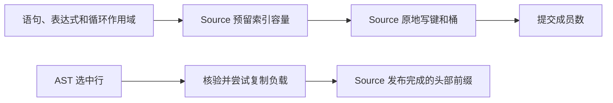

# genz 成员索引与选中行发布自举

## Intent

正式作用域批量登记及回收成员时保留可写容量。AST 选中行只发布已成功写入的前缀，引用区间以提交后的行数为准。

## Data

旧批量删除在不可变数组循环中生成了 `zxRenew`。调用方使用零容量分配器，循环退出可能留下栈符号。成员索引的键和桶来自同一索引的自有缓冲，临时作用域通过指针借用索引状态。选中 AST 的负载复制可能失败，发布头部前需要回滚当前半行。

## Edges

保留哈希探测、失败后可见状态和 AST 行顺序。索引回收期间只写独占的已有缓冲。AST 负载仍由 Zig 通用列复制和释放原语处理。

## Answer

批量加入在修改有效条目前预留键槽和桶。作用域关闭时，单项和批量删除调用同一原地探测及移位实现。批量执行只携带游标及计数，生成的三个写入与回收入口及其本地依赖均无 `zxRenew`。循环参数、语句块、转换及迭代局部作用域共用成员回收。

AST 选中行仍按原顺序尝试写入负载。当前行失败时释放已复制的负载并回滚列长度。成功前缀的标签沿用批量复制，偏移在 Source 计算，最后由同一入口发布可见长度。

候选与上一批工具在当前源码清单的主清单 14,383 份、增长清单 464 份和集合清单 97 份产物逐字节一致。初始 seed 与候选 Source 工具均构建通过。候选工具 SHA-256 为 `6d04e447b737bdbfb19ae30233cb7367da37322873b745dea38d5b10fbd8ba03`。

循环、编译分配失败、借用视图、求值顺序、函数效果和编译库的九组回归全通过，合计 417 项构建步骤和 1,488 项测试。

### 性能

macOS arm64、Zig 0.17.0 ReleaseSmall、固定 735 个入口及 16 个分区。三个工具均由 Source 构建，启用 Source 分析和生成并关闭常驻生成，三轮交错运行取中位数。

| 场景与指标                     | 固定基线 | 上一批 |  本批 |
| ------------------------------ | -------: | -----: | ----: |
| 冷生成墙钟（秒）               |     2.81 |   2.58 |  2.58 |
| 冷生成 CPU（秒）               |    12.35 |  12.52 | 12.46 |
| 冷生成进程树采样峰值 RSS（MB） |    889.8 |  716.0 | 707.3 |
| 冷生成单进程峰值 RSS（MB）     |    957.1 |  732.1 | 734.0 |
| 热生成墙钟（秒）               |     2.20 |   1.92 |  1.92 |
| 热生成 CPU（秒）               |     8.36 |   8.12 |  8.10 |
| 无修改生成墙钟（秒）           |     0.04 |   0.03 |  0.03 |

相比上一批，冷生成 CPU 减少 0.06 秒，进程树峰值下降 8.7 MB，单进程峰值增加 1.9 MB。相比固定基线，冷生成墙钟减少 0.23 秒，CPU 累计增加 0.11 秒。

固定清单中上一批与本批的 11,753 份冷生成产物一致，候选冷暖产物也一致。相邻两批的所有权缓存内容 SHA-256 均为 `cdf9fa7e0f33002a95dc097b2837de781d67e6e519a452fb97f89f7c0bbf3a23`。

### 剩余工作

语句段的反向请求、融合时游标推进、函数体入口的顺序及 AST 负载通用列适配仍在 Zig。下一批沿 `Lower.function` 到语句段的正式路径收口。
