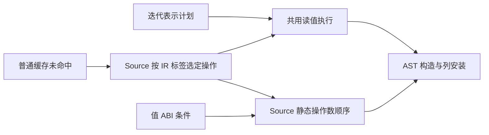

# genz 未缓存表达式调度自举

## Intent

把普通表达式未命中缓存后的分派迁入 Source。条件与运算符的操作数按同一套静态请求推进，迭代和普通入口共用读值路径。

## Data

普通入口先降低结果类型，再执行具体表达式。二元运算按左操作数、右操作数、左操作数类型的顺序推进。迭代可空值的类型取自迭代布局。值 ABI 条件的两个分支通过值入口降低。

## Edges

编译期确定分派与操作数顺序。保留原类型、表示、递归及失败顺序。宿主从原 IR 列读取固定操作数，复杂节点沿用既有借用视图。旧 Zig 分派只由初始 seed 执行。

## Answer

用上一阶段的 Source 工具构建本阶段引导器。候选再生成同一清单，主清单 14,370 份、增长清单 462 份、集合清单 84 份产物逐字节一致。初始 seed 独立构建通过。

集中运行求值顺序、整数安全、原生错误、匹配与 Switch、迭代及值 ABI 的现有目标，408 项构建步骤与 1,297 项 Zig 测试通过。

候选工具 SHA-256 为 `00b49218a5c9cfadf1955ed4409e2de2d124826f72ddeac5ea5942d5f7d3f747`。

### 性能

在 macOS arm64 上用 Zig 0.17.0 ReleaseSmall，固定 735 项入口和 16 分区，三轮交错运行取中位数。三个工具均为 Source 构建，启用 Source 分析和生成，关闭常驻生成。以下为生成器实测。

| 场景与指标                     | 固定基线 | 上一批 |  本批 |
| ------------------------------ | -------: | -----: | ----: |
| 冷生成墙钟（秒）               |     2.86 |   2.60 |  2.62 |
| 冷生成 CPU（秒）               |    12.45 |  12.60 | 12.62 |
| 冷生成进程树采样峰值 RSS（MB） |    886.8 |  710.9 | 708.3 |
| 冷生成单进程峰值 RSS（MB）     |    957.8 |  732.7 | 741.0 |
| 热生成墙钟（秒）               |     2.22 |   1.95 |  1.97 |
| 热生成 CPU（秒）               |     8.39 |   8.21 |  8.20 |
| 无修改生成墙钟（秒）           |     0.04 |   0.03 |  0.03 |

相对上一批，冷生成墙钟与 CPU 各增加 0.02 秒，进程树采样峰值下降 2.6 MB，单进程峰值上升 8.2 MB。相对固定基线，冷生成墙钟下降 0.24 秒，CPU 累计增加 0.17 秒，冷生成两项内存峰值均低于基线。

固定清单的上一批与本批 11,753 份冷生成文件一致，候选冷暖产物一致。两个相邻阶段的所有权缓存内容 SHA-256 均为 `cdf9fa7e0f33002a95dc097b2837de781d67e6e519a452fb97f89f7c0bbf3a23`。

### 剩余工作

正式执行器仍在 Zig 递归调用具体操作并提交 AST。后续集中处理递归工作区的继承和恢复，以及正式闭包中剩余编译器专用实现。
