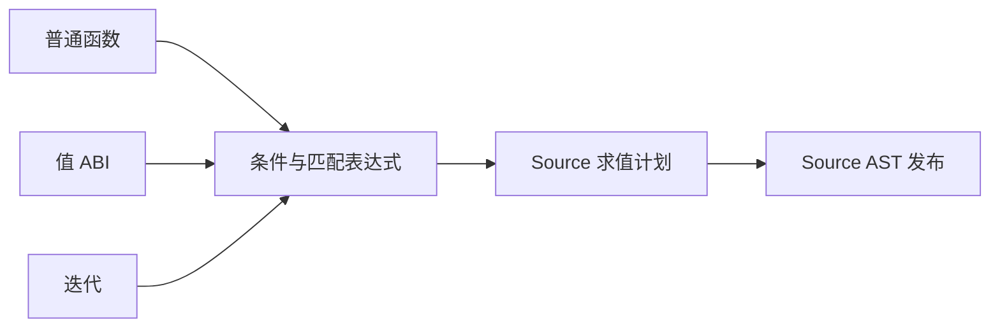

# genz 条件与匹配表达式自举

## Intent

普通函数、值 ABI 和迭代共用条件表达式的求值顺序与 AST 发布。匹配表达式沿同一条正式入口处理临时主体、默认结果、分支和缓存恢复。

## Data

三条路径原先分别降低条件表达式。普通路径通过 Source 构造条件节点，值 ABI 经过通用调用发布链，迭代上下文直接用 Zig 构造节点。匹配表达式的分支计划和结果构造已在 Source，进入时的默认值表示、空分支处理和缓存解绕仍在 Zig。

## Edges

编译器按原顺序先降低判断式，再降低两个分支。运行时由生成的条件节点惰性选择分支。值 ABI 只切换分支结果的表示。匹配主体只绑定一次，先保存外层缓存，再临时安装主体引用。默认分支仍先于其余分支降低。分支标签在生成时临时绕过缓存，退出后恢复原值。

## Answer

两种表示的条件求值计划在 Zig 编译期展开，三条正式路径直接走同一个条件节点发布入口。值 ABI 的通用调用上下文和迭代的 Zig 专用节点构造退出该路径。

Source 决定匹配主体的空分支处理，以及默认结果和各分支共用的表示。匹配缓存和标签缓存接入共用恢复入口。只有默认分支时直接使用该结果，仍保留主体求值。宿主负责递归请求、借用 AST 表、追加节点以及错误退出时恢复作用域。初始 seed 保持独立引导路径。[自举收敛计划](自举收敛计划.md)

### 阶段产物

候选由 `a6d3583e4` 的 Source 引导器构建，27 个构建步骤通过。候选以相同的输入与分区设置再生成主清单、growth 和 collections。分别有 14,288、448 和 84 份生成文件逐字节一致，工具身份戳除外。初始 seed 重新编译并生成 lexer，14 个构建步骤通过。

十组回归共完成 492 个构建步骤和 1,702 项 Zig 测试，覆盖匹配、跨模块类型、求值顺序、短路、分支作用域、值返回、循环列、函数分析和分段生成。CLI 通过三项磁盘生成缓存集成检查。

候选引导器 SHA-256 为 `fbfb44267e9ee6f456357d7eb0322ab9b740f3258dfdf5e25bc4b208fc9dda64`。原始记录位于 `.zig-cache/verification-tmp/genz-selection-expression/`。

### 固定输入回测

固定清单含 735 个入口和 16 个分区。三代工具均由 Source 生成，并执行 Source 分析与生成。环境为 macOS arm64、Zig 0.17.0、ReleaseSmall，关闭常驻。交错三轮取中位数，RSS 采用十进制 MB。计时覆盖生成阶段。

| 指标                 |  固定基线 |    上一代 |      候选 |
| -------------------- | --------: | --------: | --------: |
| 冷生成墙钟           |    2.84 s |    2.62 s |    2.62 s |
| 冷生成 CPU           |   12.43 s |   12.60 s |   12.58 s |
| 冷生成进程树峰值 RSS | 886.60 MB | 713.61 MB | 710.51 MB |
| 冷生成单进程峰值 RSS | 969.77 MB | 733.79 MB | 731.51 MB |
| 热生成墙钟           |    2.23 s |    1.97 s |    1.96 s |
| 热生成 CPU           |    8.49 s |    8.17 s |    8.19 s |
| 无改动墙钟           |    0.04 s |    0.03 s |    0.03 s |

相对上一代，冷生成墙钟持平，CPU 减少 0.02 秒，进程树峰值 RSS 下降 3.10 MB。相对固定基线，冷生成墙钟减少 0.22 秒，累计 CPU 增加 0.15 秒，进程树峰值 RSS 下降 176.10 MB。候选与上一代的 11,753 份固定清单产物逐字节一致，工具身份戳除外。两代 v18 所有权缓存正文哈希均为 `cdf9fa7e0f33002a95dc097b2837de781d67e6e519a452fb97f89f7c0bbf3a23`。
