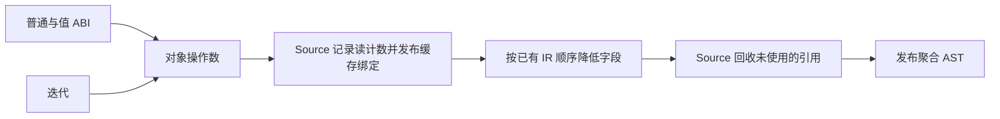

# genz 聚合求值与字段表示自举

## Intent

沿普通、值 ABI 和迭代三条聚合入口迁移临时操作数绑定、未使用引用的回收和字段表示。保留原求值顺序、借用和 AST 发布契约。

## Data

普通和值 ABI 共用对象构造。对象操作数在常规缓存中记账，迭代对象有自己的缓存和稀疏读计数。两条路径原先分别记录读计数和写入缓存，并分别按读计数发布丢弃语句。展开字段及对象更新使用 IR 已解析的操作数和字段顺序。元组、列表与模板原先在 Zig 求值循环内选择元素表示。

## Edges

操作数完成递归求值后才记录它的读计数。对象字段按 IR 原列顺序读取，带借用布局的字段保持原投影，常规字段按当前表示决定是否转换。字段和操作数仍从原 IR 借用，字段表示一致时共用一个标记。缓存快照与最终恢复沿用同一接口，普通、迭代的缓存各自独立。

## Answer

Source 将读计数和临时缓存更新合并为一次操作。普通、值 ABI、迭代及调用参数的聚合临时值使用同一个回收规则。对象布局计划同时提供字段动作，普通元组、列表和模板共用一个序列计划。Zig 宿主仍执行单次递归求值、安排工作区生命周期和提交 AST 行。调用参数的单独转换流程归后续调用阶段。[自举收敛计划](自举收敛计划.md)

### 阶段产物

候选由 `becfb2f9b` 的 Source 引导器构建，27 个构建步骤通过。候选用相同的输入和分区设置重新生成主清单、growth 和 collections，分别有 14,304、448、84 份文件逐字节一致，工具身份戳除外。初始 seed 重新编译并生成 lexer，14 个构建步骤通过。

十二组回归共完成 599 个构建步骤和 992 项 Zig 测试，覆盖对象、数组与模板的求值顺序、展开和短路失败、值返回、聚合循环及借用字段。CLI 通过原生对象 ABI 缓存和已编译循环库迁移两项集成检查。

候选引导器 SHA-256 为 `4358f3605040c5f29abc89248d57031d355c79cb680276396800bb61415d8a93`。原始记录位于 `.zig-cache/verification-tmp/genz-aggregate/`。

### 固定输入回测

固定清单含 735 个入口和 16 个分区。三代工具均由 Source 生成，并执行 Source 分析与生成。环境为 macOS arm64、Zig 0.17.0、ReleaseSmall，关闭常驻。交错三轮取中位数，RSS 采用十进制 MB。计时覆盖生成阶段。

| 指标                 |  固定基线 |    上一代 |      候选 |
| -------------------- | --------: | --------: | --------: |
| 冷生成墙钟           |    2.87 s |    2.60 s |    2.62 s |
| 冷生成 CPU           |   12.47 s |   12.58 s |   12.54 s |
| 冷生成进程树峰值 RSS | 885.74 MB | 707.18 MB | 715.64 MB |
| 冷生成单进程峰值 RSS | 924.99 MB | 743.11 MB | 730.04 MB |
| 热生成墙钟           |    2.23 s |    1.96 s |    1.97 s |
| 热生成 CPU           |    8.45 s |    8.18 s |    8.19 s |
| 无改动墙钟           |    0.04 s |    0.03 s |    0.03 s |

相对上一代，冷生成墙钟增加 0.02 秒，CPU 减少 0.04 秒。三轮均无子进程，采样的进程树峰值增加 8.45 MB，计时器记录的单进程峰值下降 13.07 MB，采样物理内存增加 0.79 MB。相对固定基线，冷生成墙钟减少 0.25 秒，累计 CPU 增加 0.07 秒，进程树峰值 RSS 下降 170.10 MB。候选与上一代的 11,753 份固定清单产物逐字节一致，工具身份戳除外。两代 v18 所有权缓存正文哈希均为 `cdf9fa7e0f33002a95dc097b2837de781d67e6e519a452fb97f89f7c0bbf3a23`。
