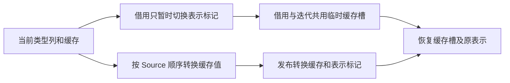

# genz 表示作用域发布与恢复自举

## Intent

值函数、借用参数、循环和 ABI 适配器使用同一套临时状态发布与恢复规则。保留缓存转换顺序、成功和失败行为，以及动态类型列的延迟生成。

## Data

普通类型列和 ABI 列在构造期共享底层存储。转换态单独保存类型和布局列。切换到转换态时原缓存保留到离开作用域，借用入口应只切换读取的类型列。循环的迭代视图、字段视图和延迟增长分别有自己的有效范围。

## Edges

临时类型、缓存和名称只借用原有底层数据。涉及 AST 的表示转换延续原有顺序，所有可失败的准备步骤结束后才切换表示。初始 seed 保留兼容路径。

## Answer

Source 在编译期确定各入口实际要保存的字段。普通 ABI 和转换表示沿用已有类型列，由当前标记选择。借用和已进入转换态的重复调用省去了旧的缓存准备分派。ABI 适配器只暂存缓存和所有权计划，并复用 Source 的工作区初始化。

普通、借用和迭代调用仍以原求值顺序执行。循环的初始视图、参数视图、字段视图和延迟增长分别在自身的有效范围恢复。借用与迭代调用共用表达式缓存槽的还原。

同一源码清单中，主清单 14,383 份、增长清单 464 份、集合清单 88 份生成文件逐字节一致。初始 seed 独立构建通过。候选引导器 SHA-256 为 `4ef50fd9930f6dbbd376f9f70300182a31b0b4f1590918afed8024101ce5148d`。

迭代、借用视图、聚合循环、原生代码生成和 typed try 的九组既有回归通过。合计 357 项构建步骤和 495 项测试。

### 性能

在 macOS arm64 上用 Zig 0.17.0 ReleaseSmall，固定 735 个入口及 16 个分区，三轮交错运行取中位数。三个工具均由 Source 构建，启用 Source 分析和生成，关闭常驻生成。

| 场景与指标                     | 固定基线 | 上一批 |  本批 |
| ------------------------------ | -------: | -----: | ----: |
| 冷生成墙钟（秒）               |     2.86 |   2.57 |  2.60 |
| 冷生成 CPU（秒）               |    12.47 |  12.53 | 12.57 |
| 冷生成进程树采样峰值 RSS（MB） |    885.5 |  724.3 | 706.6 |
| 冷生成单进程峰值 RSS（MB）     |    930.2 |  737.5 | 736.1 |
| 热生成墙钟（秒）               |     2.22 |   1.95 |  1.95 |
| 热生成 CPU（秒）               |     8.40 |   8.18 |  8.19 |
| 无修改生成墙钟（秒）           |     0.04 |   0.03 |  0.03 |

相对上一批，冷生成墙钟增加 0.03 秒、CPU 增加 0.04 秒，进程树峰值下降 17.7 MB，单进程峰值下降 1.4 MB。相对固定基线，冷生成墙钟减少 0.26 秒，CPU 累计增加 0.10 秒。

固定清单中上一批与本批的 11,753 份冷生成文件逐字节一致，候选冷暖产物也一致。两批的所有权缓存内容 SHA-256 均为 `cdf9fa7e0f33002a95dc097b2837de781d67e6e519a452fb97f89f7c0bbf3a23`。

### 剩余工作

尝试在循环参数退出时共用批量成员删除产生了多余的地址表达式。逐个使用现有的 Source 删除操作后，上一代与候选工具的干净生成一致。批量路径生成了可能申请内存的 `zxRenew`，调用边界提供零容量分配器。下一批从成员索引的写入与失败恢复入手，连同作用域的引用区间与 AST 发布验证。
