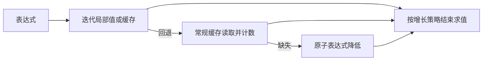

# genz 表达式缓存与值表示作用域自举

## Intent

让普通和值 ABI 共用 Source 的表达式缓存读取、计数和增长规则。表示切换时由 Source 确定借用的类型列、恢复位置和缓存写入顺序。

## Data

普通求值先尝试迭代上下文，再使用常规缓存。常规缓存命中时更新密集读计数，迭代缓存使用单独的稀疏计数。增长处理在表达式得到结果后执行。值表示入口原先逐条从 Source 请求缓存转换，完成后在 Zig 切换类型和布局列。

## Edges

保留迭代值、缓存和常规降低的先后顺序。进入值表示时，按原缓存槽顺序转换已有值，全部成功后才切换。嵌套进入复用活动视图。失败和正常退出都恢复到同一个外部缓存和类型列。临时分配与持久 AST 分开，底层 IR 与类型列只借用。

## Answer

常规表达式的缓存命中与计数在同一个生成入口执行。普通查询、迭代局部查询和快照复用相同读值逻辑。增长规则在求值结束时读取静态表，Source 决定先归一化还是更新增长缓冲。表达式块、迭代块和集合回调也复用上一批的批量符号回收。

RX 为活动值表示直接返回复用计划，为首次切换返回借用的旧视图和目标视图。ZX 读取转换顺序并在转换完成后按同一槽序重建缓存。旧的 Zig 缓存游标已退出正式路径。宿主仍执行单项转换、安装视图和在退出时恢复令牌中的列。普通与值 ABI 的单条 AST 派发仍需迁移。[自举收敛计划](自举收敛计划.md)

### 阶段产物

候选由 `ed4dc1596` 的 Source 引导器构建，27 个构建步骤通过。候选重跑同一工具链和输入，主清单、growth 和 collections 分别有 14,278、449 和 84 份生成文件逐字节一致，工具身份戳除外。

初始 seed 重新编译并生成 lexer，14 个构建步骤通过。八组回归共完成 511 个构建步骤、740 项 Zig 测试，覆盖集合上下文借用、迭代列布局、聚合循环、值返回、函数更新、独立函数和分支作用域。安装版通过三项分段生成缓存检查。

候选引导器 SHA-256 为 `6c1d89dd9fdd9dfa5dd62a3904d7d0b0fe64d2a02bd8c1ad64453199e0c66284`。原始记录位于 `.zig-cache/verification-tmp/genz-expression-scope/`。

### 固定输入回测

固定清单含 735 个入口和 16 个分区。三代工具均由 Source 生成并执行 Source 分析与生成。环境为 macOS arm64、Zig 0.17.0、ReleaseSmall，关闭常驻。交错三轮取中位数，RSS 使用十进制 MB。

| 指标                 |  固定基线 |    上一代 |      候选 |
| -------------------- | --------: | --------: | --------: |
| 冷生成墙钟           |    2.85 s |    2.65 s |    2.61 s |
| 冷生成 CPU           |   12.41 s |   12.57 s |   12.63 s |
| 冷生成进程树峰值 RSS | 893.08 MB | 709.17 MB | 711.13 MB |
| 冷生成单进程峰值 RSS | 921.99 MB | 740.70 MB | 738.21 MB |
| 热生成墙钟           |    2.21 s |    1.97 s |    1.97 s |
| 热生成 CPU           |    8.40 s |    8.24 s |    8.28 s |
| 无改动墙钟           |    0.04 s |    0.03 s |    0.03 s |

相对上一代，冷生成墙钟减少 0.04 秒，CPU 增加 0.06 秒，进程树峰值 RSS 增加 1.97 MB，单进程峰值下降 2.49 MB。相对固定基线，冷生成墙钟减少 0.24 秒，累计 CPU 增加 0.22 秒，进程树峰值 RSS 下降 181.94 MB。候选与上一代的 11,753 份固定清单产物逐字节一致，工具身份戳除外。两代 v18 所有权缓存正文哈希均为 `cdf9fa7e0f33002a95dc097b2837de781d67e6e519a452fb97f89f7c0bbf3a23`。
