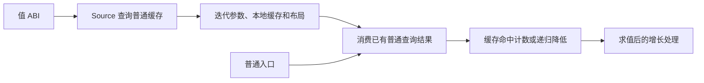

# genz 表达式读取与回退自举

## Intent

沿普通、值 ABI 和迭代三个正式入口贯通缓存命中、读计数、表示回退和求值后的增长处理。撤出重复查表及命中前的 IR 解码。

## Data

普通入口已由 Source 查询并计数。值 ABI 判断分派时先查普通缓存，转回普通入口后再查一次。迭代判断本地缓存和参数后，还要查看普通缓存以选择解包或回退。随后普通入口重复查同一个键。常量分支标签还会暂时修改普通缓存。

## Edges

查询结果只在同一表达式入口间传递。借用参数替换缓存后重新读取。直接普通入口的调用仍可跳过迭代表达式表示和最终增长。迭代参数优先于本地缓存，本地读取记入迭代计数，消费普通缓存时记入普通计数。

## Answer

值 ABI 的 Source 分派依据表达式种类和类型列，在实际查过普通缓存时传递查询结果。迭代编排先处理参数与本地命中，再复用或查询普通缓存，选择原值、解包或常规降低。普通入口消费已有结果时只更新读计数。值 ABI 的回退和普通缓存命中都推迟 IR 解码。迭代调用也由 Source 选择所需 ABI；临时替换参数作用域后，递归调用按当前缓存状态执行。常量分支标签直接走未缓存的普通降低入口。

增长处理保持在表达式求值之后。宿主仍调用原子降低函数、写入 AST、安装并恢复临时借用描述符。[自举收敛计划](自举收敛计划.md)

### 阶段产物

候选由 `7923ea283` 的 Source 引导器构建，25 个构建步骤通过。初始 seed 重新构建并生成 lexer，14 个构建步骤通过。最终候选对主清单、growth 和 collections 重新生成，14,354、462 和 84 份文件分别逐字节一致，工具身份戳除外。

两代 CLI 对 19 个现有的迭代调用、常量 switch、分支作用域和跨模块 match 夹具关闭缓存生成，所得 Zig 文件逐字节一致。

十二组回归通过 439 个构建步骤和 586 项 Zig 测试，另有 8 项 Node 集成检查通过。覆盖迭代调用及缓冲、所有权缓存、借用 ABI、常量分支、副作用顺序和循环库迁移。

首轮的冷生成进程树峰值比上一代高 7.68 MB。随后保留普通读取的原输入形状，让已查明的命中只调用共用读计数，让已知未命中直接进入未缓存降低。普通递归路径直接进入普通读取。最终候选重新核对所有生成清单，五组补验通过 202 个构建步骤、229 项 Zig 测试及 3 项集成检查。

最终候选引导器 SHA-256 为 `9ffb250129ecb232758d443b51bb2722b09b5b4592af8fc98c4e2665e45d9331`。原始记录位于 `.zig-cache/verification-tmp/genz-evaluation/`。

### 固定输入回测

固定清单含 735 个入口和 16 个分区。三代工具均由 Source 构建并执行 Source 分析和生成。环境为 macOS arm64、Zig 0.17.0、ReleaseSmall，关闭常驻。三轮交错测量取中位数，RSS 使用十进制 MB。计时覆盖生成阶段。

| 指标                           |  固定基线 |    上一代 |      候选 |
| ------------------------------ | --------: | --------: | --------: |
| 冷生成墙钟                     |    2.85 s |    2.60 s |    2.61 s |
| 冷生成 CPU                     |   12.48 s |   12.54 s |   12.63 s |
| 冷生成进程树采样峰值 RSS       | 884.65 MB | 711.38 MB | 720.37 MB |
| 冷生成内核记录的单进程峰值 RSS | 936.79 MB | 738.21 MB | 731.35 MB |
| 热生成墙钟                     |    2.24 s |    1.98 s |    1.98 s |
| 热生成 CPU                     |    8.50 s |    8.24 s |    8.24 s |
| 无改动墙钟                     |    0.04 s |    0.03 s |    0.03 s |

相对上一代，冷生成墙钟增加 0.01 秒，CPU 增加 0.09 秒。每轮均只有生成器进程。进程树采样中位数增加 8.99 MB，内核记录的峰值中位数下降 6.86 MB，候选的三个内核峰值都低于上一代的三个峰值。相对固定基线，冷生成墙钟减少 0.24 秒，累计 CPU 增加 0.15 秒，进程树采样峰值下降 164.28 MB。

候选与上一代的 11,753 份固定清单文件逐字节一致，工具身份戳除外。两代 v18 所有权缓存正文 SHA-256 均为 `cdf9fa7e0f33002a95dc097b2837de781d67e6e519a452fb97f89f7c0bbf3a23`。固定基线沿用早期 v17 缓存和分区配置。
