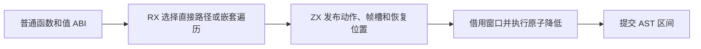
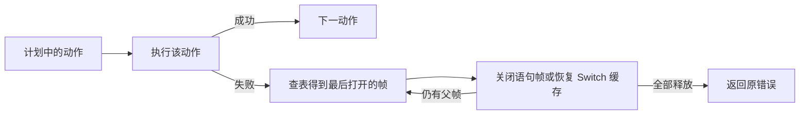

# genz 语句帧与失败恢复自举

## Intent

普通函数和值 ABI 共用 Source 的嵌套语句帧、Switch 槽位与失败恢复顺序。正式 lowering 宿主直接消费编排，为作用域、分支和 AST 写入提供原子操作。

## Data

`Lower.statements` 的 Source 遍历已确定语句顺序和容量。宿主还逐事件增减语句深度、已占用的写入窗口与 Switch 深度，每个语句作用域维护可空的 Switch 指针。此实现需要在失败时复原宿主深度并按逆序释放。`Scope.open` 和 `Selection.enter` 已各自清理未完成的操作。

## Edges

保留条件、Switch 默认分支和命名分支的求值顺序。打开失败由当前操作清理，已成功打开的帧按计划恢复。正常关闭时释放当前帧，关闭失败仍由恢复路径释放。无分支正文使用一次作用域和现有直通路径。

## Answer

Source 为每个动作给出当前语句帧槽位。打开语句帧时使用计划中的列窗口起点，Switch 操作使用计划中的 Switch 槽位。失败时从动作标明的最近一次成功打开处向上释放，正常关闭后的帧从后续动作的恢复链中移除。宿主的三个可变游标及 `Scope.selection` 已移除。[Source 遍历](../../packages/genz/src/analysis/statements/traversal/walk.zx) · [语句宿主](../../packages/genz/src/zx/statements/traversal/host.zig)

遍历把当前帧保存在循环值中，进入子块时才把父帧追加到连续缓冲。检查生成的遍历发现，父帧数组使用值元素，循环内没有逐帧 `allocator.create` 或 `zxRenew`。动作、槽位和恢复链接仍按标量列批量增长。无分支正文仍通过单作用域直接执行。

候选由上一批 Source 引导器生成，以 Zig 0.17.0、ReleaseSmall 和 16 个生成分区构建，25 个构建步骤成功。主清单、增长清单和集合清单分别核对 14,390、464 和 97 份生成文件，共 14,951 份，与上一批工具在同一输入上逐字节一致。候选引导器 SHA-256 为 `bab77a2da13758ee8285df5f9a4a8496658f361bc39ed252cfb108ec6392311f`。

七组既有回归覆盖 If 和 Switch 求值顺序、循环规则与编译分配失败、Store I/O、函数效果、类型化 Try 库及契约。164 个构建步骤、236 项 Zig 测试和 9 项 Node 集成检查全部通过。嵌套恢复链逐动作核对了打开失败、关闭失败与已关闭三种情况。

### 性能

三个工具均由 Source 引导构建，并使用 Source 分析和生成。macOS arm64、Zig 0.17.0 ReleaseSmall、固定 735 个入口、16 个分区，关闭常驻生成。三轮交错运行取中位数。

| 场景与指标                     | 固定基线 | 上一批 |  本批 |
| ------------------------------ | -------: | -----: | ----: |
| 冷生成墙钟（秒）               |     2.86 |   2.63 |  2.61 |
| 冷生成 CPU（秒）               |    12.45 |  12.60 | 12.61 |
| 冷生成进程树采样峰值 RSS（MB） |    885.5 |  706.7 | 707.6 |
| 冷生成单进程峰值 RSS（MB）     |    925.2 |  732.1 | 736.6 |
| 热生成墙钟（秒）               |     2.26 |   1.99 |  1.98 |
| 热生成 CPU（秒）               |     8.48 |   8.26 |  8.25 |
| 无修改生成墙钟（秒）           |     0.04 |   0.03 |  0.03 |

冷生成较上一批墙钟减少 0.02 秒，CPU 增加 0.01 秒，进程树采样峰值增加 0.9 MB，单进程峰值增加 4.6 MB。较固定基线，冷生成墙钟减少 0.25 秒，CPU 累计增加 0.16 秒，进程树采样峰值下降 177.9 MB。指标覆盖源码分析与 Zig 生成，完整 `zxc` 冷构建未做配对测量。

固定清单中上一批和本批的 11,753 份冷生成文件一致。候选自身的冷暖生成文件一致。相邻两批的所有权缓存内容 SHA-256 均为 `cdf9fa7e0f33002a95dc097b2837de781d67e6e519a452fb97f89f7c0bbf3a23`。

### 剩余工作

宿主继续创建物理作用域及 Switch 状态，执行原子求值、释放资源和写入 AST 负载。下一批以引用区间和 Switch 的正式导入路径为入口，收拢 AST 负载发布及失败前缀提交。[自举收敛计划](自举收敛计划.md)
