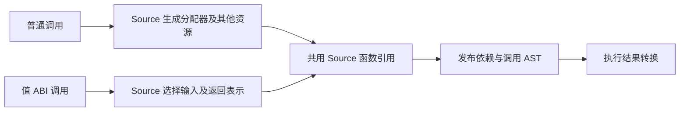

# genz 调用边界与依赖发布自举

## Intent

迁移普通调用与值 ABI 的参数表示、函数引用和结果转换编排，贯通循环消费者调用候选的回退。保持原有参数求值、返回形式、依赖顺序和错误边界。

## Data

普通调用已在 RX 生成函数引用和调用节点，分配器表达式由宿主单独建立。值 ABI 先从宿主请求和写入函数引用，再调用 Source 生成调用节点。借用参数另在宿主保存和安装 ABI 视图。循环消费由 Source 判断候选，宿主指定一次尝试失败后的下一阶段。

## Edges

两类调用沿用参数求值、借用和 Store 适配顺序。值 ABI 的旧接口仍使用普通入口，递归或外部模块沿用已有请求规则。参数转换和结果转换分别发生在调用前后。借用调用只暂换一项参数缓存并在退出时恢复该项，保留其余缓存更新。表示切换的完整缓存迁移仍按原规则。生成器只保有临时名称，宿主在节点提交时保存必须跨阶段存活的名称。

## Answer

普通调用、值 ABI 和循环消费共用已有的 Source 引用、表示转换及依赖登记组件。普通调用的资源节点与函数引用、调用节点一次发布。值 ABI 的来源引用也在 RX 中与调用 AST 一起构造，Source 给出输入、输出和 ABI 变体。借用调用进入通用视图作用域，由 Source 决定视图和缓存的恢复策略。循环消费从同一份决定取得候选及其失败后的阶段。宿主负责递归求值、执行原子转换和安装借用描述符及 AST 列。[自举收敛计划](自举收敛计划.md)

### 阶段产物

候选由 `45302cc6c` 的 Source 引导器构建，27 个构建步骤通过。初始 seed 重新编译并生成 lexer，14 个构建步骤通过。候选以相同配置再生成主清单、growth 和 collections，分别有 14,335、459、84 份文件逐字节一致，工具身份戳除外。

十三组回归共通过 472 个构建步骤及 564 项 Zig 测试，另有 46 项 Node 集成检查通过。原生借用、集合上下文和调用约定覆盖源码与已编译库，CLI 验证了循环库迁移和原生对象 ABI 在生成复用与声明重排后的行为。

候选引导器 SHA-256 为 `91330f4df9e5ad0181617bf3087e4b28c5f81cf8faf05b1fda72a216c985f943`。原始记录位于 `.zig-cache/verification-tmp/genz-invocation/`。

### 固定输入回测

固定清单包含 735 个入口和 16 个分区。三代工具均由 Source 构建，并执行 Source 分析和生成。环境为 macOS arm64、Zig 0.17.0、ReleaseSmall，关闭常驻。数值为三轮交错测量的中位数，RSS 使用十进制 MB。计时覆盖生成阶段。

| 指标                 |  固定基线 |    上一代 |      候选 |
| -------------------- | --------: | --------: | --------: |
| 冷生成墙钟           |    2.81 s |    2.60 s |    2.61 s |
| 冷生成 CPU           |   12.35 s |   12.53 s |   12.44 s |
| 冷生成进程树峰值 RSS | 885.24 MB | 709.00 MB | 712.41 MB |
| 冷生成单进程峰值 RSS | 921.49 MB | 737.05 MB | 734.87 MB |
| 热生成墙钟           |    2.19 s |    1.94 s |    1.93 s |
| 热生成 CPU           |    8.31 s |    8.21 s |    8.09 s |
| 无改动墙钟           |    0.04 s |    0.03 s |    0.03 s |

相对上一代，冷生成墙钟增加 0.01 秒，CPU 减少 0.09 秒。进程树峰值 RSS 增加 3.41 MB，单进程峰值下降 2.18 MB。相对固定基线，冷生成墙钟减少 0.20 秒，累计 CPU 增加 0.09 秒，进程树峰值 RSS 下降 172.83 MB。

候选与上一代的 11,753 份固定清单产物逐字节一致，工具身份戳除外。两代 v18 所有权缓存正文的 SHA-256 均为 `cdf9fa7e0f33002a95dc097b2837de781d67e6e519a452fb97f89f7c0bbf3a23`。固定基线沿用更早的 v17 缓存和分区产物，作性能比较。
