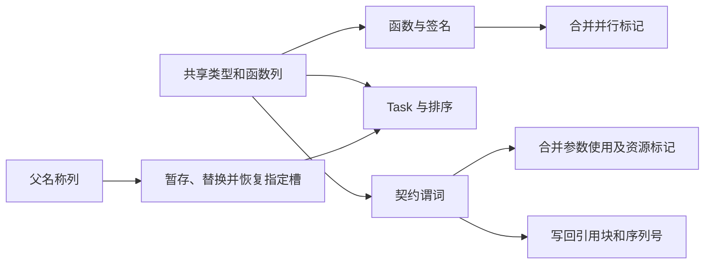

# genz 递归工作区自举

## Intent

让 Source 决定递归降低时哪些状态可以借用、哪些要重新分配，以及哪些结果写回父作用域。覆盖被请求函数、独立函数签名、Task worker、排序 worker 和契约谓词。

## Data

被请求函数需要独立符号名、缓存和序列号。Task 和谓词借用表示符号表，排序使用独立的表示符号表。谓词继承并写回已生成的引用块。独立函数和签名使用同一套函数正文视图选择。

## Edges

保留每个入口的错误顺序和分配器生命周期。名字视图、引用块和缓存独立核对。初始 seed 继续走自己的构造路径。

## Answer

被请求函数、独立签名、Task、排序和谓词通过 Source 的计划构造工作区。函数和谓词的 IR 列选择在编译期展开。Task 和排序共用使用状态缓冲的分配与初始化，排序和 Task 共用名称槽恢复。排序只保存三个参数的名称槽，并在任何退出路径恢复。

先由上一批 Source 工具构建本批引导器，再由本批引导器重新生成同一清单。主清单 14,383 份、增长清单 462 份、集合清单 88 份产物逐字节一致。主清单包含实际生成排序 worker 的入口。初始 seed 独立构建通过。

契约、Task、拥有所有权的集合、嵌套集合、迭代 ABI、库链接及编译库契约的八组现有目标通过。合计 529 项构建步骤和 11,595 项测试。

候选 Source 工具 SHA-256 为 `a1e41480f748bce78501a59381a623f5875fb8b30c7ef45ebdd68b7a2888566a`。

### 性能

在 macOS arm64 上用 Zig 0.17.0 ReleaseSmall，固定 735 个入口及 16 个分区，三轮交错运行取中位数。三个工具均由 Source 构建，启用 Source 分析和生成，关闭常驻生成。

| 场景与指标                     | 固定基线 | 上一批 |  本批 |
| ------------------------------ | -------: | -----: | ----: |
| 冷生成墙钟（秒）               |     2.81 |   2.58 |  2.56 |
| 冷生成 CPU（秒）               |    12.42 |  12.54 | 12.55 |
| 冷生成进程树采样峰值 RSS（MB） |    884.7 |  707.4 | 707.6 |
| 冷生成单进程峰值 RSS（MB）     |    926.8 |  737.8 | 737.9 |
| 热生成墙钟（秒）               |     2.18 |   1.93 |  1.93 |
| 热生成 CPU（秒）               |     8.35 |   8.15 |  8.13 |
| 无修改生成墙钟（秒）           |     0.04 |   0.03 |  0.03 |

相对上一批，冷生成墙钟减少 0.02 秒，CPU 增加 0.01 秒，两项内存峰值各增加约 0.2 MB。相对固定基线，冷生成墙钟减少 0.25 秒，CPU 累计增加 0.13 秒，进程树采样峰值降低 177.1 MB，单进程峰值降低 188.9 MB。

固定清单中上一批与本批的 11,753 份冷生成文件逐字节一致，候选冷暖产物也一致。两批的所有权缓存内容 SHA-256 均为 `cdf9fa7e0f33002a95dc097b2837de781d67e6e519a452fb97f89f7c0bbf3a23`。

### 剩余工作

宿主按 Source 规则借用和安装列，仍执行递归求值、原子 AST 安装及表示视图的恢复。下一组从函数值、借用参数、循环和 ABI 适配器切入，核对共用表示状态的进入、发布及退出恢复。
