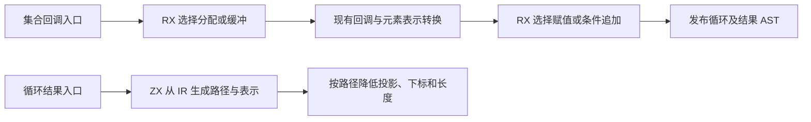

# genz 集合回调与循环结果消费自举

## Intent

迁移普通 map、filter 的缓冲准备、写入和循环 AST 发布，迁移循环结果的字段、元组、下标和长度读取规则。从正常编译、值 ABI 和已编译库消费者检查结果。

## Data

原先 map 和 filter 在 Zig 内拼装分配、更新和循环节点。回调本身通过共享表达式降低。predicate 和 reduce 已各有 Source 生成入口。循环结果由 Zig 递归沿 IR 到达循环状态，再逐层挑选借用或转换。

## Edges

保持接收者、回调准备和参数初始化的顺序。map 保留定长分配，filter 保留惰性追加和同一错误捕获边界。输出循环体先执行元素捕获的转换，再按原规则处理回调结果。循环结果的计划只借用输入 IR 及类型列，路径存在临时区。独立下标表达式仍在目标就绪后求值。

## Answer

正式 map 与 filter 调用由 RX 选择准备方式，再由 Source 发出写入、条件分支、结果调用及循环节点。Zig 执行回调表达式和已有转换，借用名称与 AST 输入并提交列。循环消费的递归路径和表示判断已进入 Source。宿主沿路径执行原子投影及可能失败的下标求值。[自举收敛计划](自举收敛计划.md)

### 阶段产物

候选由 `9d374a9df` 的 Source 引导器构建，27 个构建步骤通过。初始 seed 重新编译并生成 lexer，14 个构建步骤通过。候选用同一配置重新生成主清单、growth 和 collections，分别有 14,335、452、84 份文件逐字节一致，工具身份戳除外。

十二组回归共完成 529 个构建步骤、979 项 Zig 测试。map 和 filter 的回调轨迹在源码与已编译库两条路径通过。五项循环 CLI 检查和一项已编译循环库迁移检查通过。

候选引导器 SHA-256 为 `33df20d392cc4fa7f94e83a6b17bc777013f9189fab94558e8c0247cced8886b`。原始记录位于 `.zig-cache/verification-tmp/genz-transform/`。

### 固定输入回测

固定清单含 735 个入口与 16 个分区。三代工具均由 Source 生成，并执行 Source 分析与生成。环境为 macOS arm64、Zig 0.17.0、ReleaseSmall，关闭常驻。交错三轮取中位数，RSS 采用十进制 MB。计时覆盖生成阶段。

| 指标                 |  固定基线 |    上一代 |      候选 |
| -------------------- | --------: | --------: | --------: |
| 冷生成墙钟           |    2.81 s |    2.58 s |    2.58 s |
| 冷生成 CPU           |   12.38 s |   12.52 s |   12.53 s |
| 冷生成进程树峰值 RSS | 894.06 MB | 708.31 MB | 711.20 MB |
| 冷生成单进程峰值 RSS | 921.44 MB | 731.73 MB | 734.59 MB |
| 热生成墙钟           |    2.19 s |    1.93 s |    1.91 s |
| 热生成 CPU           |    8.34 s |    8.11 s |    8.14 s |
| 无改动墙钟           |    0.04 s |    0.03 s |    0.03 s |

相对上一代，冷生成墙钟持平，CPU 增加 0.01 秒，进程树峰值 RSS 增加 2.88 MB，单进程峰值增加 2.87 MB。相对固定基线，冷生成墙钟减少 0.23 秒，累计 CPU 增加 0.15 秒，进程树峰值 RSS 下降 182.86 MB。候选与上一代的 11,753 份固定清单产物逐字节一致，工具身份戳除外。两代 v18 所有权缓存正文哈希均为 `cdf9fa7e0f33002a95dc097b2837de781d67e6e519a452fb97f89f7c0bbf3a23`。
