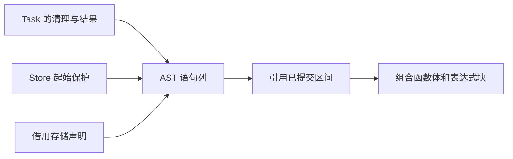
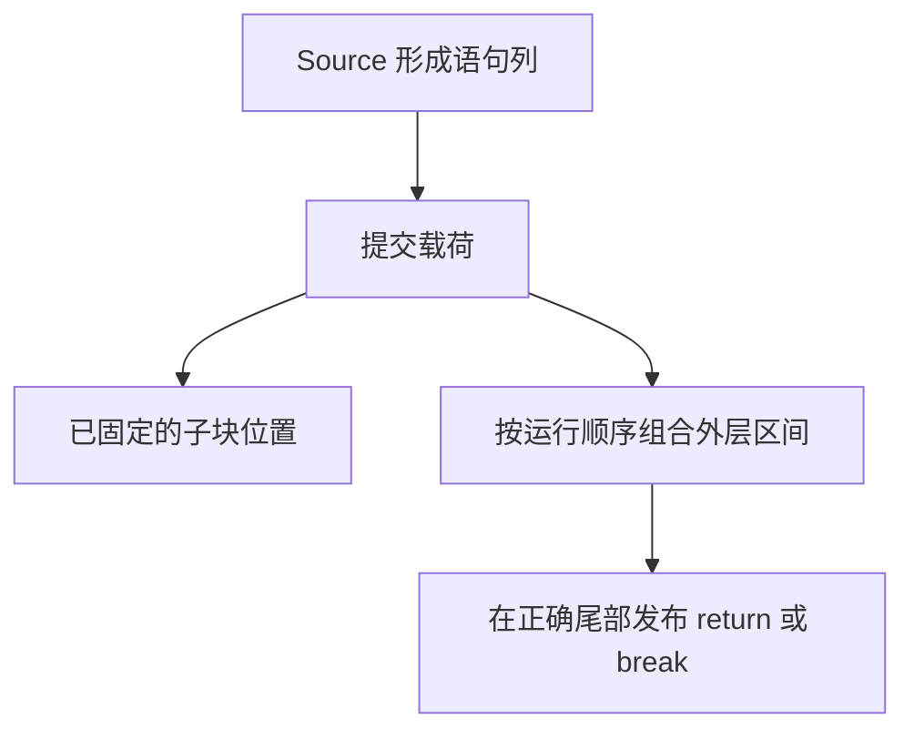

# 任务与借用语句区间自举

## Intent

让任务取消与等待、Store 起始保护和借用存储声明使用同一张 AST 语句表。各入口保留运行顺序，只记录需要组合的语句区间。

## Data

`tasks.root` 降低任务启动、等待和取消，再用临时 Zig 语句列表拼接清理及结果。Store 起始保护的 RX 已生成完整语句列，宿主拆出外层分支并将它还原为一个 Zig 值。借用与所有权转换为函数入口准备的局部声明先存为 Zig 语句列表，最后才重新写回 AST。

## Edges

Task 启动与延迟清理保持相邻。并行任务先启动、再全部等待、最后按源码次序处理结果和错误。Store 起始保护必须先于相应的读或调用。借用存储声明在函数入口发布，先于任何使用该存储的语句。生成子块的起点使用真实表尾。借用文本和需要转移到 AST 的文本仍采用各自现有的所有权契约。

## Answer

检查正式 Source 路径退出原生语句重建，验证旧 seed 的独立路径。集中运行 Task、并行、Store、普通借用返回、字段所有权、循环和排序的既有回归。使用冻结清单核对生成结果、所有权缓存与冷暖成本。

### 实现

Task 的 ZX 入口发布清理子块和外层绑定的连续语句列，明确返回外层区间。等待使用这个区间，取消追加自己的调用，并行按启动、等待和归并的顺序组合各段。Store 起始保护交付其外层分支位置，语句降低器在源语句之前引用该分支。

引用槽、所有权清除和普通类型转换将需要提前声明的局部变量直接写入 AST。函数、公开入口、适配器、Task 和排序 worker 在各自的函数入口引用这些已提交区间。生成子块先按原有偏移入表，借用存储随后入表。组装时只复制必要的语句头部。初始 seed 保留自己的原生实现。

### 固定清单回测

macOS arm64，Zig 0.17.0，ReleaseSmall，16 分区，关闭常驻。候选由 `1ecc6059f` 的 Source 引导器生成。固定基线、上一代和候选均执行各自的 Source 分析与生成。用同一 735 入口冻结清单交错运行三轮，取中位数。

| 指标                   |  固定基线 |    上一代 |      候选 |
| ---------------------- | --------: | --------: | --------: |
| 冷生成墙钟             |    2.85 s |    2.60 s |    2.57 s |
| 冷生成 CPU             |   12.42 s |   12.17 s |   12.13 s |
| 进程树采样峰值 RSS     | 897.89 MB | 710.13 MB | 708.79 MB |
| 单进程系统记录峰值 RSS | 970.24 MB | 740.66 MB | 732.46 MB |
| 热重建墙钟             |    2.22 s |    1.96 s |    1.95 s |
| 热重建 CPU             |    8.49 s |    8.22 s |    8.23 s |
| 无改动墙钟             |    0.04 s |    0.03 s |    0.03 s |

较上一代，冷生成墙钟减少 0.03 秒，CPU 减少 0.04 秒。进程树采样峰值下降 1.34 MB，单进程系统峰值下降 8.19 MB。较固定基线，冷生成墙钟与 CPU 分别减少 0.28 秒和 0.29 秒，两种 RSS 峰值分别下降 189.10 MB 和 237.78 MB。候选三轮冷生成墙钟为 3.44、2.57 和 2.55 秒，对应 CPU 为 12.16、12.13 和 12.13 秒。

排除工具身份戳，上一代与候选的 11,753 个生成文件逐字节一致。两者所有权缓存 v18 正文的 SHA-256 均为 `cdf9fa7e0f33002a95dc097b2837de781d67e6e519a452fb97f89f7c0bbf3a23`。三套工具各自的热重建与冷生成一致。

### 引导与增量

Source 引导器完成 25 步构建，初始 seed 完成 14 步。旧 seed、新 seed 和候选 Source 在六个已有借用样例上生成的 22 个文件逐字节一致。候选与上一代在首次生成、编辑读取位置、改动调用依赖和恢复源码四次常驻请求中逐次一致。每次结果均与独立冷生成一致。

候选引导器构建的 12 个回归入口完成 539 步，834 项检查全部通过。覆盖 Task 等待、取消和并行启动失败，RX 并行，Store 事务与刷新，普通借用视图，函数契约，字段所有权，嵌套缓冲及统一库消费。

### 自我审查

任务的递归求值、发起编译阶段的位置以及 AST 容量维护仍由 Zig 执行。普通借用实参及部分转换的就地求值还使用本地临时语句列表。冻结清单覆盖 Source 分析、生成、缓存和写出。完整冷构建的 Zig 后端耗时和峰值内存需单独核对。
