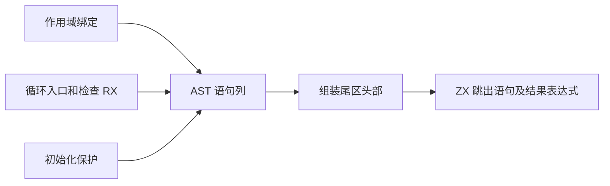
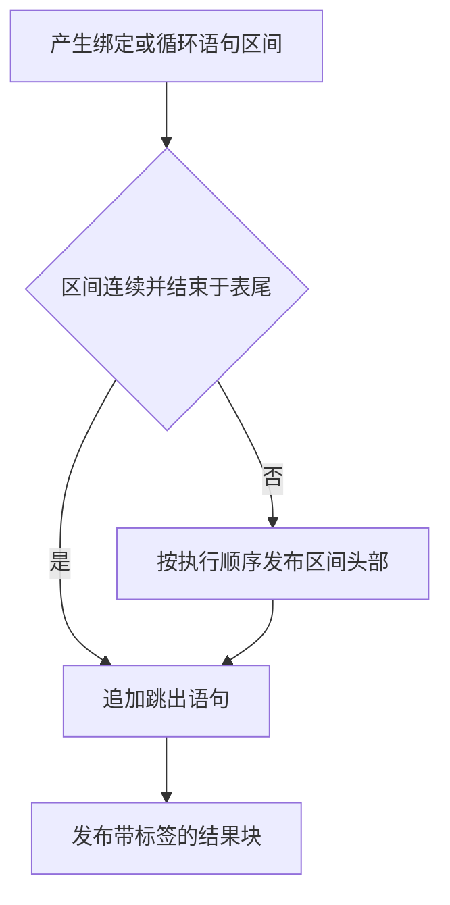

# 作用域与循环结果块发布自举

## Intent

把表达式内的普通和按值作用域、循环入口及循环结果接到已提交的 AST 语句区间。结果块复用已有语句载荷，收尾时写入跳出语句和表达式根。

## Data

作用域原先从后向前降低绑定，为每个绑定保存一份语句数组，再累积到最终数组。循环的生成器先构造 while 和入口分支的 AST 列，宿主将它们还原为临时语句，最终生成块时再次写回 AST。普通和带条件的结果块共用临时数组作为宿主边界。

现在作用域只记录每个绑定的起点与长度，复用函数语句块阶段的头部发布。循环 RX 将条件检查、循环体形态和入口分支组织成 AST 列，ZX 计算本次发布的外层语句区间。宿主接着把区间交给结果块收尾。准备初始化保护时暂存已提交的前置区间，语句缓冲可以继续用于循环内层。

## Edges

降低继续从作用域结果向前推导依赖。已融合到迭代的绑定不占独立区间。循环保持初始值、回调、条件检查、续存和结果表达式的原来顺序。发布运行顺序时先引用状态声明和前置处理，再引用循环及结果转换。初始条件失败时，带保护的表达式沿用原回退结果。

如果块末尾已与表尾相接，直接追加跳出语句。如果块已被其他节点隔开，则先把需要的标签与索引发布到尾区，载荷仍由原表拥有。生成的标签文本在临时区释放前转移到 AST 所用的内存。种子继续从同一已提交区间生成普通 Zig 语句。

## Answer

验收范围包括条件首次检查与循环结束检查、初始化保护、提前返回、作用域局部值、循环状态和触发分配失败时的现有行为。使用 Source 和 seed 对照生成文件，按冻结清单核对上一代和固定基线的墙钟、CPU、RSS 与所有权缓存。

### 固定清单对照

macOS arm64，Zig 0.17.0，ReleaseSmall，16 分区，关闭常驻。候选由 `3e2bcd676` 生成，三套工具运行 Source 分析和生成。用同一 735 入口冻结清单交错运行三轮，取中位数。热重建移除输出并保留缓存。

| 指标                   |  固定基线 |    上一代 |      候选 |
| ---------------------- | --------: | --------: | --------: |
| 冷生成墙钟             |    2.85 s |    2.54 s |    2.58 s |
| 冷生成 CPU             |   12.39 s |   12.13 s |   12.18 s |
| 进程树采样峰值 RSS     | 885.24 MB | 710.21 MB | 706.64 MB |
| 单进程系统记录峰值 RSS | 977.90 MB | 737.59 MB | 736.71 MB |
| 热重建墙钟             |    2.22 s |    1.96 s |    1.96 s |
| 热重建 CPU             |    8.42 s |    8.25 s |    8.23 s |
| 无改动墙钟             |    0.04 s |    0.03 s |    0.03 s |

相对上一代，冷墙钟和 CPU 分别增加 0.04 秒和 0.05 秒，两种峰值 RSS 下降 3.57 MB 和 0.88 MB。候选三轮冷生成墙钟分别为 3.97、2.58 和 2.52 秒，CPU 分别为 12.19、12.18 和 12.10 秒。相对固定基线，冷墙钟和 CPU 分别减少 0.27 秒和 0.21 秒，两种 RSS 峰值分别下降 178.60 MB 和 241.19 MB。

上一代和候选的 11,753 个生成文件逐字节一致，排除工具身份戳。所有权缓存 v18 正文 SHA-256 均为 `cdf9fa7e0f33002a95dc097b2837de781d67e6e519a452fb97f89f7c0bbf3a23`。三套工具各自的热重建与冷生成一致。

### 函数工作区探针

同一清单各记录 4,604 次函数开始打印时的工作区容量。各次容量之和由 360.43 MB 降为 338.39 MB，中位数从 50,788 B 降为 48,821 B。单次最大值从 1,458,794 B 降至 1,396,854 B。这里累加的是逐函数工作区容量，进程峰值见固定清单对照。

语句头部条目由 490,191 增至 517,791，新增头部使用已提交的载荷。这组数据覆盖了尾区重排的额外成本和临时语句数组减少后的收益。

### 引导与增量

候选完成 25 步 Source 引导。重新构建的 seed 完成 14 步。seed 与候选在六个现有样例上生成的 22 个文件逐字节一致。在八个已有的循环样例上，旧 seed 和新 seed 生成的 27 个文件也逐字节一致。常驻的初次生成、编辑读取位置、改变调用依赖和恢复源码四次请求均与独立冷生成一致。上一代与候选的结果同时匹配。

九个现有回归入口完成 347 步构建，791 项检查全部通过。覆盖作用域与求值顺序、循环缓冲和条件、源码与归档库调用、聚合状态、Store 事务和函数效果。

### 自我审查

表达式作用域及循环收尾已经使用已提交区间。绑定和循环单步的宿主求值调度，以及调用间的临时节点构造仍由 Zig 执行。冻结清单覆盖 Source 分析、生成、缓存和写出。完整冷构建的后端耗时和峰值仍需独立核验。
