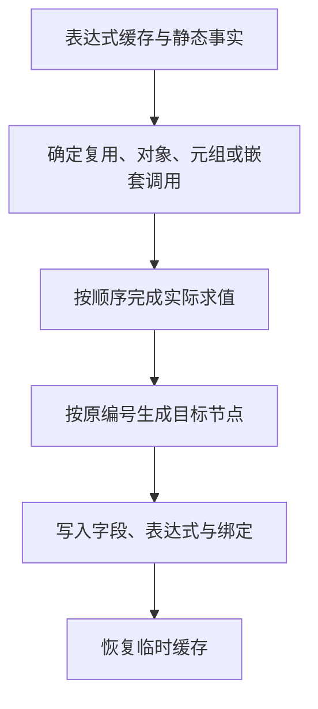

# 借用实参规划与目标节点合并

## Intent

完成借用实参从正式调用入口到目标节点发布的静态规划。合并借用对象的字段选择、ABI 绑定和取地址，减少在生成器内反复发布临时节点。

## Data

普通调用与值调用都可能进入 `value_call/argument.zig`。宿主仍判断缓存命中、聚合类型和可借用的嵌套值调用。对象表达式和取地址分别调用既有 RX 入口，分两次发布 AST。元组绑定和普通值取地址共用已有借用打包路径。

## Edges

保留表达式缓存中的临时引用、转换顺序、借用范围和标识符编号。Source 借用既有 IR 列和字段值列。宿主仍负责递归降低、保存和恢复缓存，以及分配和发布目标列。引导 seed 使用原实现。

## Answer

沿普通和值调用的真实入口验证借用布局、原生边界及运行结果。对照 Source/seed 产物与固定清单，核对增量和冷暖生成成本。

### 正式路径

- [借用路径](../../packages/genz/src/analysis/value/call/argument/route.zx) 直接借用表达式缓存的索引和
  被调函数的值 ABI、构造结果列。已缓存的表达式优先沿原引用读取，其余按对象、元组或嵌套值调用处理。
- [借用打包](../../packages/genz/src/analysis/value/call/argument/build.rx) 复用普通对象的字段选择和
  既有绑定构造。它先为对象或元组留出原有的表达式行号，再产生绑定标识符和地址。对象的字段、表达式、
  绑定和取地址由同一次 Source 调用返回，宿主一次发布这些表达式行。
- 宿主按原顺序求值对象操作数并建立临时缓存引用，保留嵌套调用的 ABI 布局切换与恢复。字段值列直接
  借给 Source，文本沿用类型表的稳定存储。借用对象较大时，生成过程沿用该对象已有的临时分配器。

候选 Source 引导器通过 25 个构建步骤，初始 seed 通过 14 个步骤。两者对四个已有入口生成的 17 个文件
逐字节一致，排除工具身份戳。用候选引导器重新生成后七组回归通过 260 个构建步骤、462 项 Zig 测试及
8 项原生借用运行检查，覆盖源与编译库边界、字段独占、缓存失败恢复和对象返回。

### 性能与产物

同一冻结清单包含 735 个入口。使用 macOS arm64、Zig 0.17.0、ReleaseSmall、16 分区并关闭常驻。
候选由上一代 `31889d502` 的 Source 引导器构建，固定基线沿用引导声明准备阶段。三套工具均执行
Source 分析和生成，以下为三轮交错运行的中位数。热重建复用同次冷生成的缓存。

| 指标                 |  固定基线 |    上一代 |      候选 |
| -------------------- | --------: | --------: | --------: |
| 冷生成墙钟           |    2.85 s |    2.61 s |    2.60 s |
| 冷生成 CPU           |   12.46 s |   12.24 s |   12.23 s |
| 冷生成进程树采样峰值 | 887.31 MB | 698.99 MB | 700.63 MB |
| 冷生成单进程系统峰值 | 940.77 MB | 732.22 MB | 784.74 MB |
| 热重建墙钟           |    2.26 s |    2.01 s |    2.00 s |
| 热重建 CPU           |    8.51 s |    8.30 s |    8.28 s |

候选和上一代的 11,753 个生成文件以及所有权 memo 逐字节一致，排除工具身份戳。
三套工具的暖缓存生成各自和冷生成相同。候选与上一代的输出清单 SHA-256 均为
`7248304214a4e61487c037e6ebc0017ce4f9adb96d7071e985dc963a8c43dc4b`。

三轮对照中进程树采样峰值增加 1.64 MB，单进程系统峰值中位数增加 52.53 MB。回归结束后单独追加
六轮交错冷生成，取 `wait4` 的系统峰值并约每 5 ms 读取进程驻留内存。系统峰值中位数从
**730.78 MB 降到 728.09 MB**，密集采样峰值中位数从 **715.66 MB 降到 715.07 MB**，
首次观察到的单进程峰值增幅未重现。相对固定基线，冷生成墙钟和 CPU 分别减少 0.25 秒和 0.23 秒。

### 自我审查

本阶段覆盖普通和值调用的借用打包、递归借用路线和借用对象的表头发布。实际求值、缓存写入、
暂停和恢复 ABI 布局仍通过 Zig 宿主完成。生成结果保持一致，性能测量止于分析与 Zig 生成。
