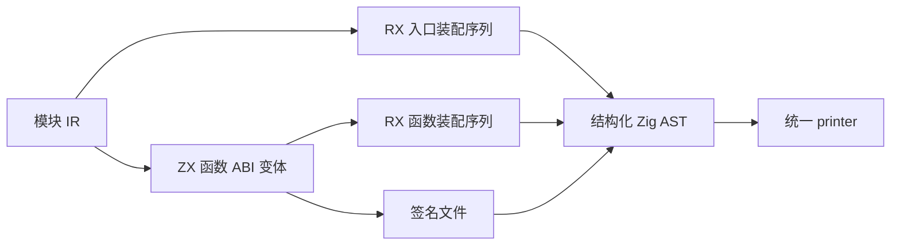
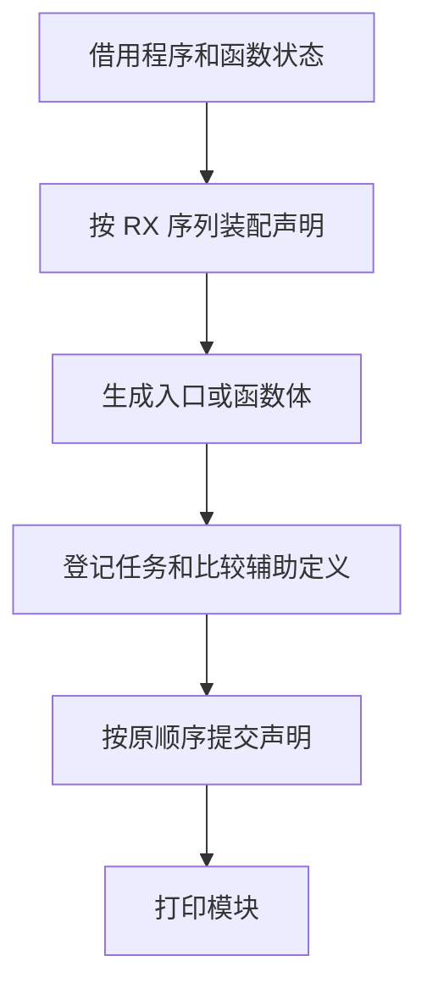

# 入口与函数目标模块装配自举

## Intent

让正式生成路径的单文件入口、分离入口、纯类型模块和独立函数文件使用 RX 装配顺序。统一独立函数定义和签名的 ABI 变体选择。

## Data

`genz.zx.emit` 和分区生成的 `modules.entryPrepared` 都经过 `Lower.declarations`。分离函数文件通过 `modules.functionPrepared` 构建，同时由 `signatureFiles` 生成对应的声明。既有 Zig 顺序安排了标准库和原生导入、类型、常量、Store、函数及辅助定义。

## Edges

纯类型入口在发布导出和常量后结束。分离入口从公共类型文件取得原生别名。单文件生成继续在根声明后处理新发现的函数引用。辅助定义保留原插入位置，并行分配器只在实际使用时发出。原生函数先绑定导入再发布 ABI 包装，值与指针入口共存时先降低指针入口。签名与实现共用变体选择。

## Answer

两份 RX 入口序列由引导构建时展开为直接调用。函数 ABI 变体由已生成的 ZX 签名规则在构建时计算，运行中按三个布尔事实选取。用冻结清单核对语句内容和文件顺序，覆盖分离签名、原生调用、Store、类型入口和应用发布。

### 迁移边界

入口与函数文件的声明顺序由 RX 决定。函数收集、声明存储、AST 容量和具体子表达式降低继续使用现有 Zig 接口。并行分配器和比较函数由实际降低结果触发。

同时核对上批集合路径。正式 ZX 前端已经进入 `analyzer/collections/lower.rx`。上批误接的 `iteration_plan.zx` 只出现在手写前端的生成分支，实际不参与正式编译。移除重复的规则与引导登记，保留已完成的 GenZ 语句区间发布。

### 固定清单回测

macOS arm64，Zig 0.17.0，ReleaseSmall，16 分区，关闭常驻。候选由 `984119579` 的 Source 引导器生成，三套工具各自执行 Source 分析与生成。735 入口冻结清单交错跑三轮，表内为中位数。

| 指标               |  固定基线 |    上一代 |      候选 |
| ------------------ | --------: | --------: | --------: |
| 冷生成墙钟         |    2.89 s |    2.56 s |    2.57 s |
| 冷生成 CPU         |   12.42 s |   12.16 s |   12.16 s |
| 进程树采样峰值 RSS | 898.55 MB | 711.02 MB | 707.00 MB |
| 单进程系统峰值 RSS | 921.16 MB | 741.54 MB | 741.85 MB |
| 热重建墙钟         |    2.21 s |    1.96 s |    1.97 s |
| 热重建 CPU         |    8.47 s |    8.23 s |    8.28 s |
| 无改动墙钟         |    0.04 s |    0.03 s |    0.03 s |

冷生成较上一代墙钟增加 0.01 秒，CPU 持平，进程树采样峰值降低 4.01 MB，单进程系统峰值上升 0.31 MB。热重建墙钟增加 0.01 秒，CPU 增加 0.05 秒。相对固定基线，冷生成墙钟减少 0.32 秒、CPU 减少 0.26 秒，进程树采样峰值下降 191.55 MB。候选冷生成三轮墙钟为 2.97、2.57 和 2.56 秒。完整后端冷构建未在本批重新计时。

排除工具身份戳，上一代与候选生成的 11,753 个文件逐字节一致。所有权缓存 v18 正文 SHA-256 同为 `cdf9fa7e0f33002a95dc097b2837de781d67e6e519a452fb97f89f7c0bbf3a23`。各工具冷暖输出一致。

### 引导与回归

候选 Source 引导器通过 25 步构建，初始 seed 通过 14 步。沿用六个集合与排序输入，新旧 seed 和当前 Source 的 21 个输出逐字节一致。

用候选引导器重新构建下一代 Source 工具，同样完成 25 步。两代引导器逐字节一致，SHA-256 均为 `d68ce27a7f628ca41d99bfb8d959a1a5198bb3eb39b863dfa34051f4d305221f`。

八个回归目标共完成 222 个构建步骤和 85 项 Zig 测试。应用入口另完成 46 项运行检查，原生引用、分离签名、Store、并行和已发布库的消费均通过。

### 自我审查

本阶段移动了声明阶段的顺序、两类入口的停止条件及函数文件和签名的共同选择。函数请求队列仍由 Zig 逐项取出并降低，AST 的容量和宿主声明存储也留在现有边界。初始 seed 使用同序兼容实现。两代 Source 产物一致验收了本阶段，正式路径仍有专用 Zig 依赖。
