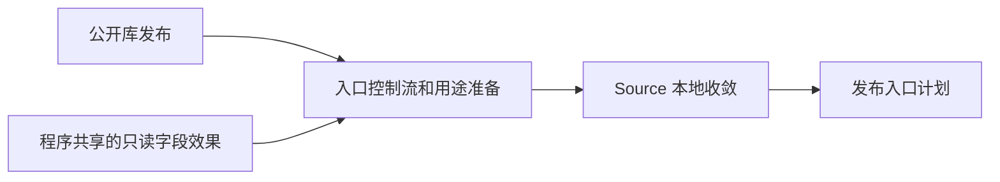
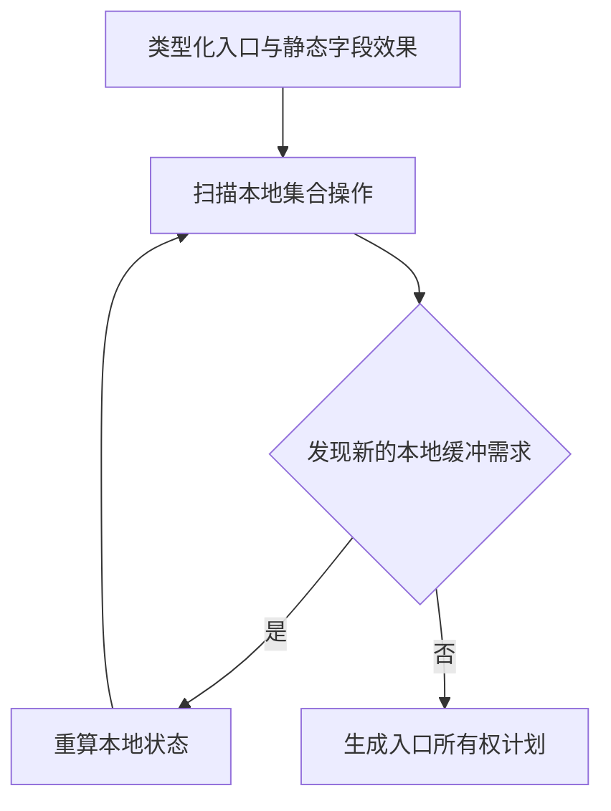

# 公开库入口所有权求解

## Intent

让公开库入口在已生成的被调函数上只求解本地所有权。发布器直接把入口交给 Source 收敛逻辑，去掉仅全程序求解使用的汇总缓冲区和重置工作。

## Data

正式入口沿库发布、重新分析、函数入口进入 Source。公开入口分析的调用方和返回需求始终为空。上一阶段已禁止这些入口向既成的被调函数传播返回需求。库发布器仍为全部函数分配输入和输出的保证表、需求表，并在每个入口检查重置标记。

## Edges

公开入口仍按未知返回保证处理被调函数，保留静态借用、写入和外逃事实。全程序求解保留需求传播、集合更新位置、轮次和可重放的读取记录。初始引导器同步公开入口规则。

## Answer

库发布器移除了用于入口需求表的 arena 和跨入口重置。每个入口的 Source 求解复用程序的只读字段效果，按本地新发现的归一化或缓冲区更新收敛。函数级的持有、写入、返回效果由程序准备阶段计算一次，全程序和公开入口都从同一份事实读取。
[库发布](../../packages/compiler/src/backends/zig/library.zig) · [公开入口 Source](../../packages/genz/src/analysis/uniqueness/function/entry/analyze.rx)

Source 用可选的需求交换描述整个程序才有的读写能力。公开入口没有这项交换，也不遍历被调函数的输入需求。初始引导器同样直接使用未知返回保证，并跳过跨函数需求。宿主仍负责借入 IR、提供工作 arena 和发布 Source 算出的计划。

### 生成与性能

冻结清单由正式的并发库发布路径处理，包含 735 个入口。macOS arm64，Zig 0.17.0，ReleaseSmall，16 分区，关闭常驻。三套工具均由 Source 引导，执行 Source 分析及生成。上一代为 `04a8ec876`，固定基线沿用引导声明准备阶段。三轮交错运行取中位数。

| 指标                 |  固定基线 |    上一代 |      候选 |
| -------------------- | --------: | --------: | --------: |
| 冷生成墙钟           |    2.85 s |    2.58 s |    2.59 s |
| 冷生成 CPU           |   12.42 s |   12.18 s |   12.19 s |
| 冷生成进程树采样峰值 | 885.77 MB | 699.30 MB | 697.86 MB |
| 冷生成单进程系统峰值 | 969.10 MB | 753.78 MB | 737.85 MB |
| 热重建墙钟           |    2.22 s |    1.97 s |    1.98 s |
| 热重建 CPU           |    8.46 s |    8.22 s |    8.25 s |
| 无改动墙钟           |    0.03 s |    0.03 s |    0.03 s |

相对上一代，冷生成墙钟与 CPU 各增加 0.01 秒，进程树采样峰值下降 1.44 MB，单进程峰值下降 15.93 MB。相对固定基线，墙钟减少 0.26 秒，CPU 减少 0.23 秒，进程树峰值减少 187.91 MB。

上一代与候选生成的 11,753 个文件逐字节一致，排除工具身份戳。每套工具的暖缓存重建输出与各自的冷生成一致。全程序所有权 memo 的内容哈希相同，均为 `10f1bcee42ae96ef6908f2019afb5cf0fed27b93425c0aefdeedaa330867a089`。

Source 引导构建通过 25 步，初始引导器构建通过 14 步。两者对五个借用入口生成的 21 个文件逐字节一致，排除工具身份戳。

库链接、混合库、库文件包、所有权缓存、跨调用借用、不可变输入、函数效果和模块生成共通过 177 个构建步骤和 384 项 Zig 检查。库消费的 10 项独立执行也通过。上一阶段修复的共享视图样本继续生成等同的 8 个文件。

相邻两代的生成文件清单 SHA-256 均为 `7248304214a4e61487c037e6ebc0017ce4f9adb96d7071e985dc963a8c43dc4b`。

### 自我审查

只读字段效果现在与程序类型和流转事实共用生命周期。各入口继续用自己的短生命周期工作区。全程序摘要的可变存储、线程及计划发布仍有宿主边界。测量覆盖库发布所用的分析和 Zig 生成阶段。
