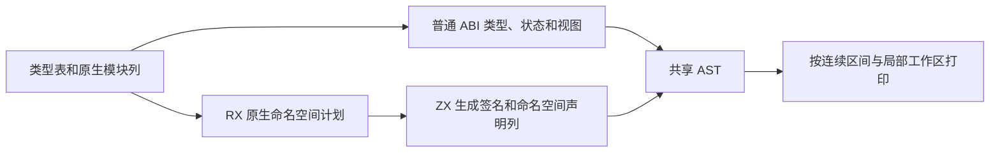

# 共享类型命名空间声明与输出区间自举

## Intent

把共享类型文件的原生命名空间计划、声明列生成和顶层区间选择接到同一条 RX/ZX 流程。保持 ABI 及打印次序，缩短准备区间的内存生命周期。

## Data

独立类型文件生成由 `typesPrepared` 进入，打包入口也调用同一类型构造链。普通 ABI 类型、状态和视图声明先写入 AST。原生命名空间包含类型、各函数的签名、模块归集和布局。旧流程逐条构造常量，再把常量转成 AST 列，并为普通类型和两个顶层命名空间创建逐声明索引。

## Edges

打印顺序保持普通类型前缀、原生命名空间和布局。内部子声明保留原有 AST 行号，由容器表达式访问。命名空间的表和临时计划在计入最终 AST 后立即释放，符号文本继续借用程序所持有的原生类型表。打印保持逐条归还工作区。初始 seed 使用单一区间和原有声明生成。

源声明发布在引导时可能产生值视图。宿主导入按声明表的标准列描述类型读取切片，再将这些切片交给现有 AST 存储，避免把描述符的 ABI 表示当作另一个 AST 列。

## Answer

验证普通类型、引用类型、原生模块布局、分区生成和库产物。沿用 735 个入口的固定工作负载，测生成器冷启动、保留缓存重建及无改动重建，对比 Zig 文件、所有权缓存正文及峰值内存。

各核心模块的优先顺序与退出信号见 [自举收敛计划](自举收敛计划.md)。

### 一致性与回归

候选 Source 引导器通过 25 步构建，初始 seed 通过 14 步。函数分析、分模块生成、生成缓存、原生生成、原生运行、原生引用和原生库发布七个回归目标通过 217 个构建步骤、150 项测试。回归覆盖了声明区间和命名空间发布。随后只缩小打印循环状态，并用相同固定清单复验最终候选。

最终候选与上一代的 11,753 份生成文件逐字节一致，工具身份戳除外。冷暖产物一致，v18 所有权缓存正文的 SHA-256 同为 `cdf9fa7e0f33002a95dc097b2837de781d67e6e519a452fb97f89f7c0bbf3a23`。最终 Source 引导器 SHA-256 为 `ebf52d06f258e8f45c4b3dcf1e46cdcb10a385f3c7c7dfc70569621d5f37b364`。

### 性能与累计变化

macOS arm64，Zig 0.17.0，ReleaseSmall，16 分区，关闭常驻生成器。候选由 `3be9dcdb2` 的 Source 引导器生成。固定基线、上一代、中间候选和最终候选都运行 Source 分析与生成。沿用固定的 735 入口清单，表中为三轮中位数。RSS 用十进制 MB 表示。

| 指标                     |  固定基线 |    上一代 |  中间候选 |  最终候选 |
| ------------------------ | --------: | --------: | --------: | --------: |
| 冷生成墙钟               |    2.80 s |    2.83 s |    2.82 s |    2.59 s |
| 冷生成 CPU               |   12.32 s |   15.28 s |   15.28 s |   12.56 s |
| 冷生成进程树采样峰值 RSS | 893.12 MB | 729.50 MB | 711.46 MB | 708.44 MB |
| 冷生成单进程系统峰值 RSS | 923.12 MB | 745.65 MB | 741.80 MB | 726.61 MB |
| 热生成墙钟               |    2.20 s |    1.93 s |    1.95 s |    1.95 s |
| 热生成 CPU               |    8.35 s |    8.09 s |    8.18 s |    8.12 s |
| 无改动墙钟               |    0.04 s |    0.03 s |    0.03 s |    0.03 s |

同机逐代回查把累计 CPU 增长定位到 `89b703dd2`，表现为发射阶段变慢。对应的生成 Zig 在打印循环每步复制了包含只读 AST 的状态，并逐列重设借用标记。将 AST 和输出缓冲放回只读词法作用域后，循环状态只携带打印栈、深度和游标。冷生成 CPU 比上一代减少 2.72 秒，比固定基线增加 0.24 秒，冷生成墙钟比固定基线缩短 0.21 秒。

原始对照在 `.zig-cache/verification-tmp/shared-type-declaration-ranges/` 的 `measurement.log`、`cpu-lineage-*.log`、`final-measurement.log` 和 `final-comparison.json`。完整 Zig/LLVM 冷构建未在本批重新计时。普通类型 AST 与原生命名空间 AST 的借用写入，以及打印工作区的重用，仍经过现有 Zig 存储和分配接口。
