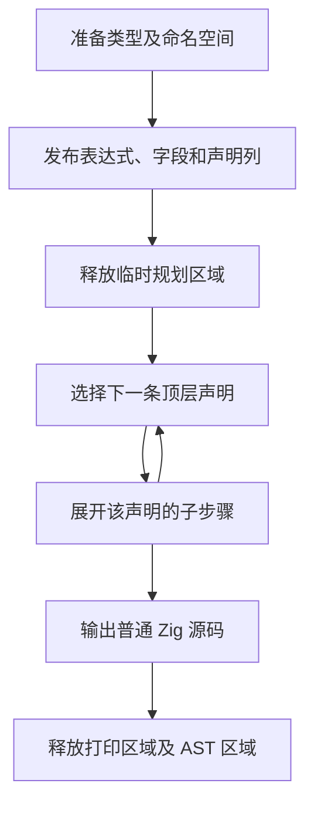

# 共享类型声明发布与打印工作区

## Intent

由 Source 构造普通 ABI 类型、状态值及视图类型的声明列，并决定共享类型文件的顶层声明顺序。缩短类型规划和打印工作区的生命周期，保持 Zig 产物及缓存兼容。

## Data

冷生成从 `Work.generate` 进入 `typesPrepared`，先生成普通类型、状态值和视图声明，再生成列表辅助声明和原生模块命名空间。旧路径从 Source 取回分散的声明记录，在 Zig 中组装实体声明数组，最后再次写入打印器的列存储。命名空间的子声明也写入这张表，但打印入口只接收顶层声明。

在冻结的 735 入口清单上，诊断构建处理了 8,227 个类型。打印前的类型 AST 区域容量为 59.20 MB，打印结束时为 117.43 MB。其中 ABI 规划的临时区域容量为 10.63 MB。此前观测到的 249.6 MB 是负责生成类型文件的工作线程区域容量，涵盖这些嵌套工作区。

## Edges

共享类型文件保持普通 ABI、状态值与视图、列表辅助声明及原生命名空间的顺序。原生命名空间的内部声明继续使用 AST 中的合法索引。输出顶层顺序时只选取行引用，表达式、参数和字符串使用已经发布的列。

分离类型工作的编排、AST 和打印区域后，声明文本、字段及表达式载荷仍需存活到最后一个引用它们的打印步骤。ABI 阶段的临时列保持已有的复制与借用约定。打印器的顶层游标在当前声明的子步骤全部完成后继续，保持声明间及最后一项后的换行。

## Answer

ABI 与状态类型构造直接维护带标签、偏移和常量字段的声明列。共享类型产物把这些列直接写入 AST。原生命名空间的输出同时提供顶层声明选择，列表辅助声明可以直接使用已发布的行。打印时只为当前顶层声明展开子步骤，随后重用打印区域。类型规划、AST、打印和输出字节使用各自的分配边界。

诊断构建中，声明列直写后的类型 AST 区域容量从 59.20 MB 降至 46.01 MB，ABI 临时区域从 10.63 MB 降至 9.39 MB。在同一布局下，单独打印并复用每条声明的工作区后，类型打印区域容量从 91.57 MB 降至 0.70 MB。该诊断生成的 11,753 个文件与正式上一代一致。

[ABI 声明构造](../../packages/genz/src/analysis/types/definitions/construct.zx) · [状态及视图构造](../../packages/genz/src/analysis/types/state/construct/selected.zx) · [顶层次序](../../packages/genz/src/analysis/native_namespaces/emit/finish.zx) · [打印器](../../packages/genz/src/printer/walk.zx)

### 一致性与性能

最终 Source 引导构建通过 25 步。冻结 735 个入口的 11,753 个生成文件与上一代逐字节一致，排除工具身份戳。v18 所有权缓存正文一致，SHA-256 为 `cdf9fa7e0f33002a95dc097b2837de781d67e6e519a452fb97f89f7c0bbf3a23`。初始种子构建通过 14 步，六入口清单的 22 个输出与最终候选一致。该清单的初次生成、修改读位置、修改调用关系和恢复均与独立冷生成一致。

声明列迁移通过七组现有回归，共 201 个构建步骤和 157 项检查。工作区按声明复用后，复跑函数分析运行、共享库文件及原生引用运行三组，通过 139 个构建步骤和 38 项检查。

macOS arm64，Zig 0.17.0，ReleaseSmall，16 分区。候选使用 `1e19fad36` 的 Source 引导器生成。三套工具均经过 Source 引导，执行 Source 分析与生成。固定基线沿用引导声明准备阶段。同一冻结清单交错三轮，关闭常驻，取中位数。RSS 使用十进制 MB。

| 指标                     |  固定基线 |    上一代 |      候选 |
| ------------------------ | --------: | --------: | --------: |
| 冷生成墙钟               |    2.87 s |    2.56 s |    2.57 s |
| 冷生成 CPU               |   12.47 s |   12.12 s |   12.21 s |
| 冷生成进程树采样峰值 RSS | 885.41 MB | 702.27 MB | 711.95 MB |
| 冷生成单进程系统峰值 RSS | 949.26 MB | 740.66 MB | 735.54 MB |
| 热重建墙钟               |    2.24 s |    1.98 s |    1.98 s |
| 热重建 CPU               |    8.49 s |    8.23 s |    8.21 s |
| 无改动墙钟               |    0.04 s |    0.03 s |    0.03 s |

相对上一代，冷生成墙钟和 CPU 增加 0.01 秒和 0.09 秒，进程树采样峰值增加 9.68 MB，单进程系统峰值下降 5.11 MB。相对固定基线，冷生成墙钟和 CPU 下降 0.30 秒和 0.26 秒。中间候选的进程树峰值约为 768 MB，加入逐声明复用后，中位数回到 711.95 MB。

### 自我审查

共享类型的 AST 导入仍由原生列存储接口执行。单文件路径需要和后续宿主声明合并，继续在边界还原常量描述符。打印区域独立可以避免交错分配阻塞回收，其容量数据不能直接等同于进程的峰值 RSS。

按声明重用区域所需的最大工作空间取决于最大的单条声明，其内部命名空间和函数体当前共用同一个打印区域。整进程采样包含同时运行的其他生成任务。完整 Zig/LLVM 冷构建未列入此次对照。
