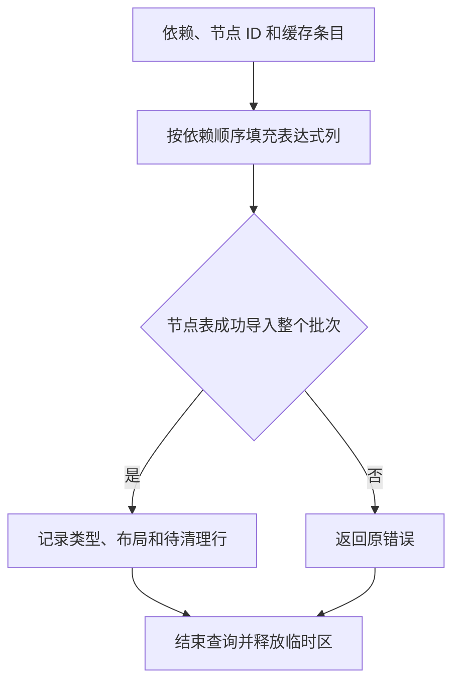

# 共享类型引用与缓存发布自举

## Intent

当生成的函数文件首次引用共享 ABI、状态或视图类型时，在 RX/ZX 中按依赖顺序构造一批 AST 表达式。只有表达式已写入目标节点表，才发布其类型与布局索引。

## Data

正式入口是 genz 的 `types.get`。共享类型查询未命中时，生成器按类型的依赖补齐节点。此前 ABI 查询已有整批表达式列，状态和视图查询会为每步生成一张小表，再由 Zig 逐张校验、调整偏移和导入。两条路径均在导入之前登记缓存中的节点 ID。

本次共用 ABI 表达式构造，直接追加命名类型、包装类型和 Task 表达式。每个查询的未命中依赖只构造一张表达式表。最后一次使用结束后释放查询临时区，符合 [Perceus §2.2](../perceus.pdf) 关于按使用终点释放中间数据的思路。借用跨调用来源、投影和写入的规则见[所有权论文索引](../所有权推导论文.md)。

## Edges

缓存依赖和节点顺序沿用原实现。表达式引用使用目标 AST 的绝对 ID，载荷偏移以本批的对应列为起点，导入时统一调整。重定向到已有表达式的类型只登记缓存。ABI 名称来自稳定的类型名表时可借用字节。生成的状态名与其他临时载荷在查询返回前转为目标 AST 所拥有的数据。

节点容量和载荷分配由通用 Zig AST 导入器负责。它在提交前完成校验和分配，失败时缓存不会指向尚未写入的节点。缓存发布步骤只写入已经存在的列。

## Answer

使用同一冻结清单，比较生成文件和所有权缓存正文。使用已有样例覆盖 ABI 聚合、迭代、原生类型、库链接和常驻编译。墙钟、CPU 和峰值内存对照上一代与固定基线，保留节点存储和暂存区成本的区分。

### 生成与编译开销

macOS arm64，Zig 0.17.0，ReleaseSmall，16 分区，关闭常驻。候选由 `3fc55119d` 构建。三套工具均执行 Source 分析和生成。冻结清单含 735 个入口，三轮交错取中位数。热重建移除输出并保留缓存。

| 指标                   |  固定基线 |    上一代 |      候选 |
| ---------------------- | --------: | --------: | --------: |
| 冷生成墙钟             |    2.87 s |    2.57 s |    2.57 s |
| 冷生成 CPU             |   12.45 s |   12.19 s |   12.17 s |
| 进程树采样峰值 RSS     | 892.99 MB | 707.74 MB | 732.00 MB |
| 单进程系统记录峰值 RSS | 921.42 MB | 738.31 MB | 741.70 MB |
| 热重建墙钟             |    2.22 s |    1.97 s |    1.97 s |
| 热重建 CPU             |    8.43 s |    8.23 s |    8.23 s |
| 无改动墙钟             |    0.04 s |    0.03 s |    0.03 s |

相对上一代，冷生成 CPU 下降 0.02 秒，进程树采样峰值增加 24.26 MB，单进程系统记录峰值增加 3.39 MB。三轮均只有一个生成进程，两种峰值的差距来自采样与系统记录的口径。相对固定基线，冷生成墙钟下降 0.30 秒，CPU 下降 0.28 秒，两种内存峰值分别下降 160.99 MB 和 179.72 MB。

上一代与候选的 11,753 个生成文件逐字节一致，排除工具身份戳。v18 所有权缓存正文 SHA-256 均为 `cdf9fa7e0f33002a95dc097b2837de781d67e6e519a452fb97f89f7c0bbf3a23`。三套工具的热重建各自与冷生成一致。候选完成 25 步 Source 引导构建。同一阶段已验证的初始 seed 与候选在六个输入上生成相同的 22 个文件。常驻生成分别验证初次运行、编辑读取位置、改变依赖和恢复源文件，每次结果均与各自独立冷生成一致，且两个工具结果相同。

本批使用同一个候选引导器运行九个现有回归入口。359 步构建和 378 项检查全部通过，覆盖独立函数与共享 ABI、聚合循环、迭代、原生引用与错误 ABI，以及源码和归档库的链接。

### 类型查询分配探针

在同一冻结清单上分别给上一代和候选的宿主入口加计数。探针只用于定位分配和导入，未纳入正式计时。两版各执行 7,716 次 ABI 查询与 60,942 次状态或视图查询，生成 16,636 与 121,440 个表达式。ABI 查询都在栈缓冲内完成。

| 状态与视图查询指标          |    上一代 |      候选 |
| --------------------------- | --------: | --------: |
| 非空 AST 导入批次           |    63,584 |    59,797 |
| 单次查询最多非空导入批次    |        16 |         1 |
| 使用备用 arena 的查询       |        19 |         5 |
| 备用 arena 保留容量之和     | 249,520 B | 125,872 B |
| 单次查询备用 arena 最大容量 |  56,616 B |  42,376 B |

备用 arena 容量在构造结束时读取，表中的和是所有查询的容量之和。每个查询结束时即释放其暂存区。该路径的分配减少，量级不足以解释整轮 RSS 的变化。

### 自我审查

正式入口已去掉分段表达式表和逐段 Zig 导入。Zig 仍管理宿主 AST 容量、查询分配器、缓存列的借用及函数结束时的缓存清理。生成结果的一致性确认了表达式和依赖顺序，宿主导入器的分配失败由现有的提交顺序约束。

本次整轮指标覆盖引导器的分析与 Zig 生成。完整构建的后端峰值、运行程序与 Rust 的吞吐量，以及采样 RSS 增加的具体来源仍待独立定位。
