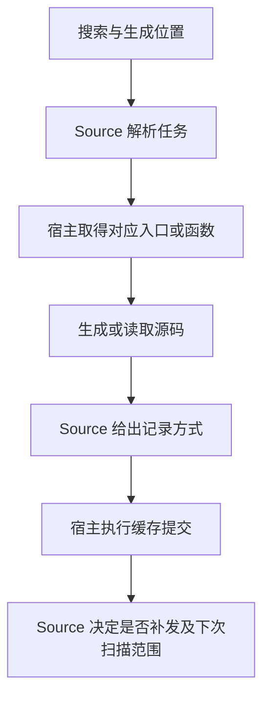

# 函数源码批次调度与发布自举

## Intent

让正式生成器的任务路由、缓存命中发布策略以及普通调用补发轮次使用 Source。复用批次已有的函数列、查找结果和位置缓冲，保持缓存记录顺序和生成文本的生命周期。

## Data

应用、统一库与引导生成最终都调用 `function_sources.createJobs`。公开入口、共享类型、函数和补发位置由同一任务序号空间索引。目前宿主在搜索与生成分别定位任务，缓存记录提交由宿主判定按批累计还是按原顺序逐条记录。普通调用补发时，Zig 根据扫描和筛选结果决定是否发布及下一轮要扫描的来源。

## Edges

Source 在借用列上计算任务类别、函数 ID、变体、缓存批量提交顺序和普通调用补发结果。Zig 继续提供线程、分配器、磁盘读写、错误值与下游生成接口。保留 seed 的旧实现供初始引导。命中结果的复制仍早于任何可能释放旧文本的缓存写入。磁盘载入导致写线程汇合时，保持最后 I/O 错误的发布顺序。

## Answer

沿应用、库与补发入口检查调用链，集中执行模块生成、磁盘缓存与原生 ABI 回归。用当前 Source 和固定基线检查冷生成、热重建、内存、产物一致性及语义编辑后的缓存命中。

### 正式路径

- 搜索和发射均通过 [Source 任务定位](../../packages/compiler/src/backends/zig/function_sources/job.zx) 得到公开入口、共享类型、值函数或普通调用函数。函数 ID 和变体从同一现有表借用，未增加每项任务的副本。
- [缓存分类](../../packages/compiler/src/backends/zig/function_sources/classify.zx) 同时产出命中数和提交顺序。命中仍先发布到结果缓冲，随后才接管磁盘文本。当写线程活跃且同批既有磁盘载入又有读错时，按原任务顺序提交，保留诊断顺序。Zig 执行磁盘记录和分配失败时的前缀恢复。
- [普通调用筛选](../../packages/compiler/src/backends/zig/regular_calls/select.zx) 给出收敛、仅发布或发布后重扫三种结果。首轮扫描入口、初始化器和现有函数，后续只扫描刚补发的函数。Source 统一产生扫描区间，工作线程借用输入按区间取得文本。

上一代 Source 构建候选引导器通过 25 个步骤，初始 seed 构建也通过 14 个步骤。两者在现有四个入口上生成的 17 个文件逐字节一致，排除引导器身份戳。

用候选引导器重新生成后，模块生成、统一库联结、磁盘生成缓存和原生 ABI 的四组回归通过 110 个构建步骤，
包括 69 项 Zig 测试和 4 项 CLI 执行测试。执行覆盖正文编辑仅重编受影响文件、关闭缓存时输出一致、
损坏记录恢复、错误键记录拒绝以及原生接口重排。

### 性能与产物

同一冻结清单包含 735 个入口。使用 macOS arm64、Zig 0.17.0、ReleaseSmall、16 分区并关闭常驻，
取三轮交错运行的中位数。候选由上一代 `730946b41` 的 Source 引导器生成。固定基线沿用引导声明准备阶段。
三套工具均执行 Source 分析和生成。热重建删除生成目录并复用冷生成缓存。

| 指标                 |  固定基线 |    上一代 |      候选 |
| -------------------- | --------: | --------: | --------: |
| 冷生成墙钟           |    2.84 s |    2.59 s |    2.59 s |
| 冷生成 CPU           |   12.47 s |   12.19 s |   12.18 s |
| 冷生成进程树采样峰值 | 884.23 MB | 701.81 MB | 698.61 MB |
| 冷生成单进程系统峰值 | 922.19 MB | 741.54 MB | 730.66 MB |
| 热重建墙钟           |    2.23 s |    2.00 s |    1.97 s |
| 热重建 CPU           |    8.50 s |    8.31 s |    8.24 s |
| 无改动墙钟           |    0.04 s |    0.03 s |    0.03 s |

相对上一代，冷生成墙钟持平，CPU 减少 0.01 秒，进程树采样峰值减少 3.19 MB，单进程系统峰值减少
10.88 MB。相对固定基线，冷生成墙钟和 CPU 分别减少 0.25 秒和 0.29 秒。候选与上一代的 11,753 个输出文件
及所有权 memo 逐字节一致，排除引导器身份戳。三套工具各自冷、暖生成结果一致。
候选和上一代的输出清单 SHA-256 均为 `7248304214a4e61487c037e6ebc0017ce4f9adb96d7071e985dc963a8c43dc4b`。

### 自我审查

普通调用的收敛判定和扫描范围由 Source 计算。Zig 仍负责发起并行扫描和再生成，直到 Source 返回终止状态。
缓存的实际索引修改、文件 I/O、失败回滚、线程调度和内存释放保留现有宿主实现。性能对比覆盖分析和 Zig 生成，
本阶段未重测完整 LLVM 冷构建。
