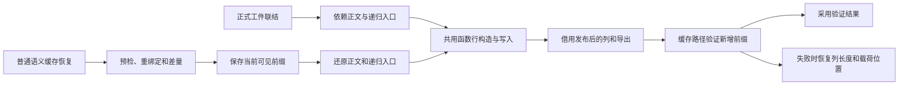

# 函数行发布与语义缓存提交自举

## Intent

沿正式联结和普通语义缓存入口，统一普通正文和递归入口的函数行写入。让缓存恢复的 RX 路径核对写入后的可见 IR，并只在验证通过时交付新的前缀。

## Data

上一批在联结窗口中先追加空正文，再把改写后的描述符交还 Zig 逐列补写。普通与缓存的递归入口另经 Zig 组装登记行。普通语义缓存将准备和发布结果带回 Zig，Zig 再决定何时检查 IR 及采用验证结果。

## Edges

函数表保留现有的列表示、容量预留和发布顺序。正文由持久区持有，完整行写入后再更新依赖编号。编译器内部的 `.d.zx` 布局定义由原有 Source 模型导出路径复用，使各入口使用同一枚举身份。宿主继续绑定列、保存物理分配位置、异常解绕和错误转换。

原生恢复在追加前完成准入与类型检查。它共用函数表布局，写到预留尾部，最终入口发布成员的可见长度。原生分配失败保持原有的临时文本清理路径。

## Answer

依赖窗口不再返回待补写的正文队列。联结与缓存递归入口共用声明、正文和 Store 字段的组装规则，原先将 Zig 函数对象拆成一行的适配退出正式路径。

普通缓存恢复通过 Source 保存函数、类型和名义来源的有效长度。同一条 RX 链完成写入、刷新验证视图并验证前缀。宿主借用新写入的列和导出，接收已验证的结果。发布或验证失败走同一个解绕路径，按 Source 回滚规则还原列长度后回卷载荷区。

### 引导与回归

使用 `7e430f29d` 的 Source 引导器生成本批候选。初始 seed 与候选构建共 27 步通过。联结边界、库联结、原生联结、名义来源、普通语义缓存、缓存编解码和原生声明等 199 项 Zig 测试通过。独立进程复用、依赖正文修改后复用调用者、损坏恢复、禁用缓存和跨模块缓存键等 5 项安装版集成检查通过，共 151 个构建步骤。[自举收敛计划](自举收敛计划.md)

候选重新生成当前 923 个入口的正式清单，14,247 份生成文件与上一代引导器生成的同清单产物逐字节一致，工具身份戳除外。

### 性能与产物

三套 Source 引导器运行 Source 分析与生成。macOS arm64、Zig 0.17.0、ReleaseSmall，关闭常驻，固定清单包含 735 个入口和 16 个分区。交错三轮取中位数。RSS 以十进制 MB 计。

| 生成指标             |  固定基线 |    上一代 |      候选 |
| -------------------- | --------: | --------: | --------: |
| 冷生成墙钟           |    2.87 s |    2.61 s |    2.66 s |
| 冷生成 CPU           |   12.55 s |   12.59 s |   12.55 s |
| 冷生成进程树峰值 RSS | 890.99 MB | 708.61 MB | 715.00 MB |
| 冷生成单进程峰值 RSS | 952.37 MB | 731.43 MB | 734.28 MB |
| 热生成墙钟           |    2.26 s |    1.96 s |    1.94 s |
| 热生成 CPU           |    8.50 s |    8.20 s |    8.22 s |
| 无改动墙钟           |    0.04 s |    0.03 s |    0.03 s |

冷生成较上一代墙钟增加 0.05 秒、CPU 减少 0.04 秒、进程树峰值 RSS 增加 6.39 MB。相对固定基线，冷生成墙钟减少 0.21 秒、CPU 持平、进程树峰值 RSS 下降 175.99 MB。上一代和候选的 11,753 份产物逐字节一致，工具身份戳除外。冷暖产物一致，v18 所有权缓存正文 SHA-256 均为 `cdf9fa7e0f33002a95dc097b2837de781d67e6e519a452fb97f89f7c0bbf3a23`。

用 128 模块依赖链交错七轮，每轮执行正式联结 120 遍。墙钟由 109.24 ms 变为 105.82 ms，CPU 由 189.41 ms 变为 185.45 ms，单进程峰值 RSS 由 17.60 MB 变为 17.61 MB。两版生成的 Zig SHA-256 均为 `3b835e64650bb1d3da3dfe5ed58e46f8a2e7c03bdd1df901c9f3a620d39c146c`。

以安装版 `zxc` 交错 12 轮复测 99 个源码缓存项和 2 个原生接口缓存项，上一代和候选均全部命中。热运行墙钟由 37.56 ms 变为 37.73 ms，CPU 由 38.98 ms 变为 39.30 ms，单进程峰值 RSS 由 12.90 MB 变为 12.92 MB。冷暖应用和 ABI 产物逐字节一致。候选引导器 SHA-256 为 `6d54a6a319c8f08522c2540056fbba6440f58a8cee39360f1813c720edd73283`，原始证据在 `.zig-cache/verification-tmp/link-cache-commit/`。
