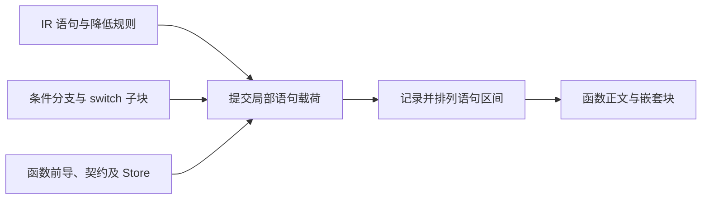
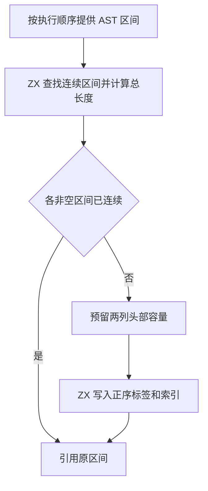

# 函数语句块发布自举

## Intent

让语句块在降低时直接进入 AST。用已提交语句的区间组装函数正文、条件分支和 switch，消除反向遍历产生的各段临时语句数组与正序扁平副本。

## Data

正式路径从 `functionPrepared` 到 `Lower.function`，再到 `statements.lower`。语句降低从后向前推进，以便先处理返回值，并判断能否把迭代或结果与前一个绑定融合。旧路径为每个 IR 语句保留一段临时 `node.Statement`，最后复制到正序数组，调用者再把数组写入 AST。

新路径保留降低顺序，各段语句写入 AST 后只记录其起点与长度。条件和 switch 的子块直接传递现有区间。函数前导、契约、Store 开始和收尾也进入同一节点表。ZX 负责判断现有区间是否可直接复用，以及在需要调整顺序时发布所需的头部列。

## Edges

节点仍按原先顺序降低。先计算正文和契约的资源使用，再生成前导。函数执行顺序为前导、Store 开始、引用绑定、契约、正文、Store 收尾。返回值融合成功时，前一个绑定在最终块中没有独立区间。分支和 switch 的引用仍指向原 AST 中的有效块。

AST 容量由宿主管理。两列头部容量都预留成功后，ZX 从已提交的语句头部读取，在不相交的尾区写入按顺序选择的标签与载荷索引。两列可见长度同时提交。嵌套块、语句载荷和文本仍由现有存储拥有。

## Answer

通过相同输入的字节对照核验生成结果。使用现有回归覆盖普通函数、复合条件、switch、Store、迭代和函数链接。对照固定基线及上一代的冷生成、热重建、CPU 与 RSS。

### 固定清单对照

macOS arm64，Zig 0.17.0，ReleaseSmall，16 分区，关闭常驻。候选由 `2d152d7c4` 生成，三套工具都执行 Source 分析和生成。735 入口冻结清单三轮交错运行，取中位数。热重建移除输出并保留缓存。

| 指标                   |  固定基线 |    上一代 |      候选 |
| ---------------------- | --------: | --------: | --------: |
| 冷生成墙钟             |    3.11 s |    2.58 s |    2.57 s |
| 冷生成 CPU             |   12.39 s |   12.17 s |   12.14 s |
| 进程树采样峰值 RSS     | 885.36 MB | 708.25 MB | 708.82 MB |
| 单进程系统记录峰值 RSS | 978.91 MB | 738.12 MB | 734.77 MB |
| 热重建墙钟             |    2.21 s |    1.96 s |    1.96 s |
| 热重建 CPU             |    8.48 s |    8.19 s |    8.23 s |
| 无改动墙钟             |    0.03 s |    0.03 s |    0.03 s |

相对上一代，冷生成墙钟下降 0.01 秒、CPU 下降 0.03 秒。进程树采样峰值增加 0.57 MB，单进程系统峰值下降 3.34 MB。热重建 CPU 增加 0.04 秒。对比固定基线，冷生成墙钟与 CPU 分别下降 0.54 秒和 0.25 秒，两种峰值 RSS 分别下降 176.54 MB 和 244.14 MB。

上一代与候选的 11,753 个生成文件逐字节一致，排除工具身份戳。所有权缓存 v18 正文 SHA-256 均为 `cdf9fa7e0f33002a95dc097b2837de781d67e6e519a452fb97f89f7c0bbf3a23`。三套工具各自的热重建与冷生成一致。

### 函数工作区探针

在冻结清单中记录独立函数开始打印时的工作区保留容量与语句头部条目。两版都命中 4,604 次函数文件发布。新版容量之和从 367.45 MB 降至 360.42 MB，中位数从 51,351 B 降至 50,788 B，单函数最大值均为 1,458,794 B。容量之和用于比较各函数工作区的合计开销，进程峰值见上表。

因不连续区间需发布正序头部，语句标签和索引的条目从 435,649 增至 490,191。额外头部仍指向已经存在的载荷。省去整条语句结构体的临时数组后，两种统计呈现预期的取舍。

### 自引导与增量

Source 引导完成 25 步。重新构建的初始 seed 完成 14 步，与候选在六个现有输入上生成的 22 个文件逐字节一致。常驻进程执行初次生成、编辑读取位置、改动调用依赖和恢复四次请求，各次生成均与独立冷生成一致，且上一代与候选结果相同。

九个回归入口完成 302 步构建，609 项检查全部通过。覆盖 if 与 switch 的求值顺序、Store 事务、迭代和聚合循环、函数效果、原生错误 ABI 和库链接。

### 自我审查

这批替换了语句块的数组扁平化和多个调用方的 AST 往返转换。按 IR 反向降低的调度、节点容量管理及个别语句的宿主接线仍在 Zig。表达式内的词法作用域和循环结果块仍会经过临时语句数组。当前对照覆盖了编译器分析和生成，完整冷构建的 Zig 后端耗时与峰值另计。
