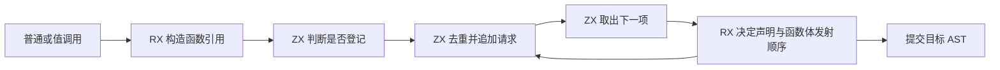
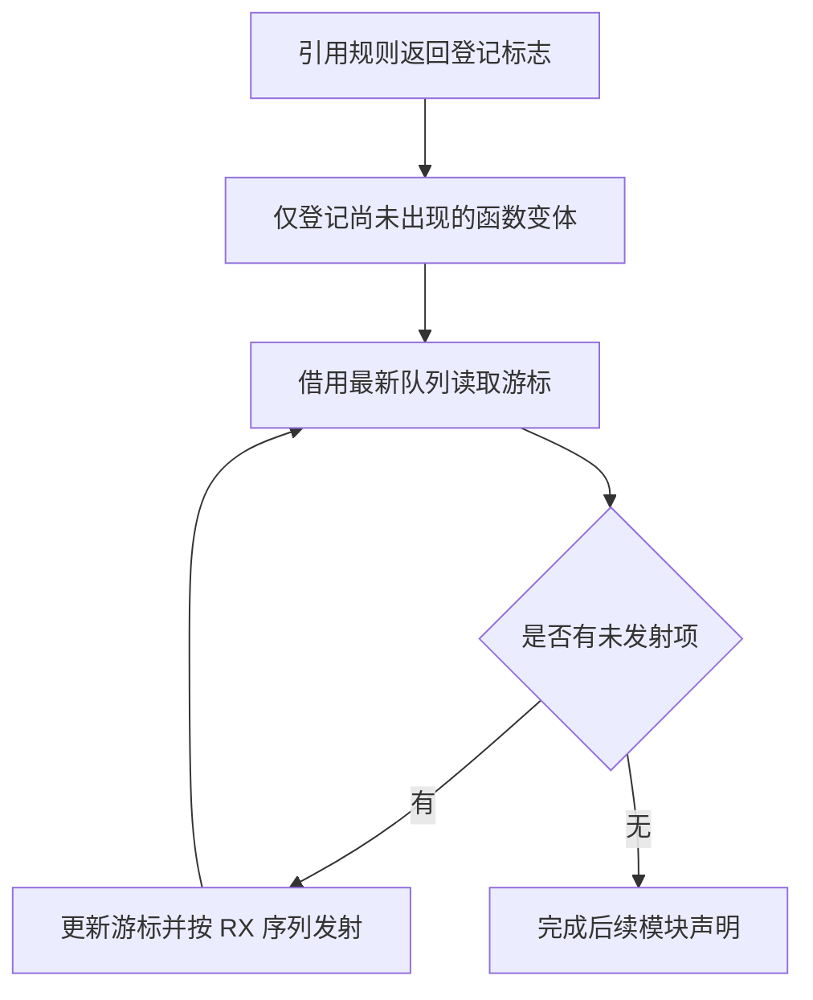

# 函数请求与按需发射自举

## Intent

把单文件生成的函数引用登记、队列取出、ABI 变体发射及首次 Store 声明连成 Source 流程。保持发现顺序和符号身份，分离入口和纯类型入口跳过本地函数请求表。

## Data

`Lower.declarations` 由单文件和分离入口共同使用。函数引用在 `functions/reference.zig` 生成，普通调用经过 `regular_call/emission.zig`。此前 ZX 已负责按函数与变体去重。宿主仍在构造引用前决定登记，持有独立取出位置，然后决定原生、普通、值返回和 Store 前缀的发射顺序。

## Edges

分离模块的递归引用可能直接生成为本地标识符，其所有权和入队决策仍来自分离模块身份。单文件引用在当前调用的 AST 发布前登记。取出时只借用列并返回行号和变体，开始降低函数体前释放列视图，函数体可以安全追加更多请求。首次发射才声明 Store。原生请求和已有名称规则保持同序。

## Answer

使用同一引导器检验单文件普通调用、Store 调用、原生函数、递归依赖和分离文件。对比单文件和分离产物以及相关分配失败回归。记录固定清单的冷暖墙钟、CPU 和两种内存峰值。

### 迁移边界

Source 决定是否登记、下一个函数及其变体、Store 声明与函数体的发射顺序。取出使用借用的列和标量结果，RX 序列按变体在构建时展开。Zig 继续负责递归降低、挂接宿主分配器、选择程序体的借用视图和发布节点存储。初始 seed 有等价的队列兼容实现。

### 固定清单回测

使用同一 735 入口冻结清单，macOS arm64、Zig 0.17.0、ReleaseSmall、16 分区、关闭常驻。候选由 `ca68e3ea7` 的 Source 引导器生成。三个工具均执行各自的 Source 分析与生成。表内为三轮交错的原始中位数。

| 指标               |  固定基线 |    上一代 |      候选 |
| ------------------ | --------: | --------: | --------: |
| 冷生成墙钟         |    2.87 s |    2.58 s |    2.91 s |
| 冷生成 CPU         |   12.49 s |   12.11 s |   12.13 s |
| 进程树采样峰值 RSS | 884.95 MB | 709.28 MB | 715.15 MB |
| 单进程系统峰值 RSS | 965.18 MB | 738.89 MB | 730.82 MB |
| 热重建墙钟         |    2.24 s |    1.98 s |    1.97 s |
| 热重建 CPU         |    8.47 s |    8.22 s |    8.22 s |
| 无改动墙钟         |    0.03 s |    0.03 s |    0.03 s |

候选的第三次冷生成跑到 4.26 秒和 15.32 秒 CPU，同一时段执行了一次生成缓存文件扫描。该结果保留在原始对照。候选前两次冷生成分别为 2.91 和 2.56 秒，推导、发射和写出合计分别为 2.241 和 2.265 秒。

回归结束后只复测受影响的冷生成，上一代与候选各运行三轮，交错取中位数。冷生成墙钟为 2.61 → 2.60 秒，CPU 为 12.19 → 12.16 秒。进程树采样峰值为 709.84 → 706.71 MB，单进程系统峰值为 748.96 → 733.61 MB。

排除工具身份戳后，候选与上一代的 11,753 个生成文件逐字节一致。三套工具各自的热重建与冷生成一致。两代所有权缓存 v18 正文 SHA-256 均为 `cdf9fa7e0f33002a95dc097b2837de781d67e6e519a452fb97f89f7c0bbf3a23`。

### 引导与回归

候选 Source 引导器和初始 seed 分别通过 25 步和 14 步构建。覆盖上次留存的六个集合和排序入口，新旧 seed 与候选 Source 的 21 个生成文件逐字节一致。

七个回归目标通过 187 个构建步骤、365 项 Zig 测试和 46 项应用入口检查。包含单文件函数和库链接、Store 回写、原生引用与错误、分离函数，以及资源不足时的清理。

另外用两代正式 CLI 编译已有的 `control/last.rx` 和 `aggregate.rx`，关闭磁盘缓存。两个输出分别定义两个和三个本地函数。聚合输入覆盖同一函数的普通 ABI 及值 ABI。两代的完整 Zig 输出逐字节一致。 每个输入两代各交错运行十次，排除首次后取中位数。控制流用例墙钟为 4.11 → 4.08 ms，聚合用例为 6.85 → 6.87 ms。计时包含 CLI 启动、解析分析和写出。

### 自我审查

冻结清单针对分离生成。单文件验证另外沿 CLI 的 `emitProgramVerified` 入口执行。宿主仍保持函数体求值循环，因为降低当前体时会产生新请求。静态发射步骤由 RX 决定，队列游标和结束判定由 ZX 处理。完整 Zig 后端冷构建未在本批重新计时。
