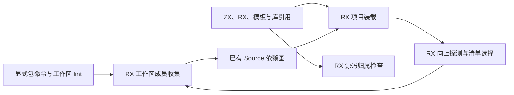
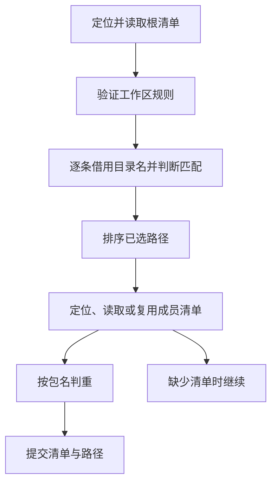

# 包工作区装载与源码归属自举

## Intent · 目标

让显式包配置、从源码向上查找包配置、工作区包成员发现和源码归属检查使用同一套 Source 规则。工作区成员范围、诊断顺序、所观察的文件及清单生命周期沿用现有契约。

## Data · 现有路径

`zxc pkg workspace/graph/install`、工作区 lint 及项目装载都会到达 `package/workspace.zig`。普通 ZX、RX、模板和编译库引用经 `package/project.zig`、`package/discover.zig` 或 `package/source.zig` 检查包边界。glob 匹配、路径通用判定和图计算已有 Source 实现。当前 Zig 仍决定扫描顺序、是否下降到成员目录、何时停止向上探测、保留哪个清单、何时提交成员和归属。

## Edges · 资源与错误顺序

清单、路径和包成员数组由现有 arena 持有。按目录迭代器当前条目借用名称，匹配到的目录仍复制路径并排序，再逐个装载清单。保留最近清单和已选祖先对应的 arena，拒绝或失败的候选及时释放。物理路径和工作区根的约束保持原有诊断顺序。

## Answer · 执行与验收

Source 负责成员遍历和发布、祖先探测、项目选择及源码验证。作用域绑定先按清单选择入口文件、源码导出或编译库导出，将每个包的候选目标填入原有存储，再借用列交给已有的作用域绑定规则。发现重复成员、非法配置或缺失公开模块时沿用原来的短路顺序。

宿主保留文件系统、目录迭代器、标准排序、清单解码、列借用、索引存储和 arena 所有权。迭代器闭合提前到成员清单装载之前。验证窄清单使用上一阶段的 `e9c315888` Source 引导器和本阶段通用的初始 seed。排除两个清单戳后，72 个文件逐字节一致，13 个仅有局部临时名编号差异。

十组正式回归通过，共 113 个构建步骤、6 项 Zig 测试和 2,272 项 Node 检查。覆盖清单、包图、包导入、安装、编译库、语义 lint、配置格式化、RX 项目及观察恢复。另沿正式 CLI 对照六种祖先选择、显式配置和清单符号链接边界，诊断、退出状态与输出工件均与上一版一致。

性能沿用[工作区发现与清单交接](../2026-11-19/工作区发现与清单交接自举.md)的冻结用例与固定基线 `dadb1f21a`，直接对照为 `e9c315888`。固定与直接对照由 `7c9b225c3` Source 引导器构建，候选由 `e9c315888` Source 引导器构建。三版均使用 Source 分析和生成，macOS arm64、Zig 0.17.0、ReleaseSmall，关闭生成缓存。交错执行，排除首轮后取八轮中位数。十种场景的 328 份产物逐字节一致。

| 场景                           | 墙钟 ms（固定 / 直接 / 候选） | CPU ms（固定 / 直接 / 候选） | 峰值 RSS MB（固定 / 直接 / 候选） |
| ------------------------------ | ----------------------------: | ---------------------------: | --------------------------------: |
| 源码库，默认配置               |         18.57 / 18.31 / 18.34 |        19.61 / 19.48 / 19.40 |             12.57 / 11.94 / 11.89 |
| 编译库，显式配置               |         16.80 / 16.57 / 16.77 |        17.93 / 17.75 / 18.20 |             11.29 / 10.30 / 10.34 |
| 源码库，大量别名               |         19.67 / 18.16 / 18.75 |        21.08 / 19.46 / 20.14 |             14.45 / 13.31 / 13.30 |
| 编译库，大量别名               |         18.10 / 18.45 / 18.31 |        19.67 / 19.87 / 19.45 |             13.59 / 12.09 / 12.06 |
| 源码库，52 个模块与 142 条依赖 |         75.68 / 75.22 / 74.98 |        76.83 / 76.27 / 76.23 |             16.22 / 15.37 / 15.31 |
| 编译库，52 个模块与 142 条依赖 |         76.25 / 74.98 / 75.21 |        77.51 / 76.15 / 76.44 |             15.83 / 13.89 / 13.85 |
| 源码装载，32 个原生模块        |            2.97 / 2.77 / 2.73 |           2.84 / 2.60 / 2.55 |                7.47 / 7.31 / 7.29 |
| 源码装载，2,048 个原生模块     |           49.06 / 7.42 / 7.41 |          48.76 / 7.25 / 7.28 |             18.04 / 13.10 / 13.05 |
| 源码装载，98 个包的工作区根    |           10.19 / 6.95 / 6.88 |          10.30 / 6.97 / 7.01 |               11.21 / 9.19 / 9.14 |
| 源码装载，同一工作区的成员     |           11.46 / 6.44 / 6.28 |          11.23 / 6.23 / 5.96 |               11.26 / 8.77 / 8.71 |

相对直接对照，墙钟和 CPU 最大增加分别为 0.59 ms 和 0.68 ms，出现在同一源码库别名用例，仍低于固定基线。其余缓慢变化均低于 0.45 ms。相对固定基线，最大墙钟和 CPU 增量分别为 0.21 ms 和 0.27 ms，所有样本峰值 RSS 均更低。原始结果在 `.zig-cache/verification-tmp/workspace-discovery/` 的 `current-comparison.json`、`current-regressions.log` 和 `current-check.log`。

本阶段移出了目录遍历和选择编排。清单持有、未通过的候选回收、排序目标路径及作用域表由宿主管理，相关平台调用仍需按最终自举标准分别核对。阶段性能覆盖到生成 Zig 或统一库写出，原生后端冷构建和其他平台本轮未计时。
