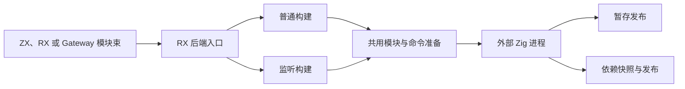
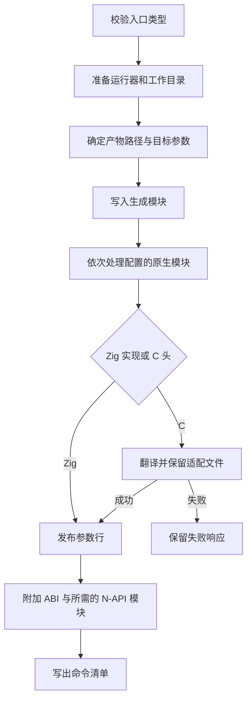

# 原生应用后端命令与执行自举

## Intent · 目标

把普通构建与监听构建共用的原生后端准备流程迁入 RX/ZX。ZX、RX 和 Gateway 继续汇入同一个后端。保留目标平台、链接顺序、C 头翻译、失败诊断、监听依赖和发布契约。

## Data · 正式入口

`cli/build/native.zig` 目前接收已生成的模块束，依次进入 `build.zig` 的 `run` 或 `runObserved`。两条路径都由 Zig `prepare` 决定运行器、工作目录和各组命令参数。参数的具体写入、工件保留和最终发布已有 Source 规则。本批迁移仍在执行的运行器选择、模块顺序、翻译短路、进程结果接线和发布前条件。

## Edges · 资源与诊断

保留普通和监听入口各自的环境变量、缓存打开顺序和失败类别。目录、生成文本、命令参数和响应继续由已有的状态及 arena 持有。ZX 循环直接使用已分配的目标表和模块行，避免为接口复制模块束。C 翻译失败时停止增加后续模块，普通模式渲染已有失败诊断，监听模式继续解析失败响应的依赖。

## Answer · 执行与验收

普通和监听入口复用 RX 的 `prepare`、`command` 和逐模块流程。工作目录写入后释放临时运行器与 Node 源码。监听构建解析完所有依赖批次后，释放翻译响应及子进程环境，保留后端响应供最终诊断和发布。Zig 继续持有参数缓冲、响应和发布状态，并承担目标查询、接口限制检查、平台路径解析、文件和子进程操作。

初始 seed 和 `e9c315888` Source 引导器对同一窄清单生成的 58 个 Zig 文件逐字节一致，4 个仅改了临时变量编号。首轮集中回归通过 105 个构建步骤、66 项 Zig 测试和 50 项 Node 检查。覆盖后端协议进程、发布保护、C 头依赖、Node、Wasm、ZX/RX 及 Gateway。缩短翻译响应与环境的生命周期，并对齐 Node 文件写入顺序后，针对受影响的监听与 Node 路径补验，四组共通过 78 个构建步骤。

记录上一版与最终候选实际执行的 Zig 命令，归一化其中的随机暂存目录名。普通应用、多原生模块、C 头翻译、C 头监听、Node 和 Wasm 六个用例的参数顺序一致。普通应用、汇编、Wasm 及 Node 辅助文件的原始字节一致。Node 动态库按已有方法归一化暂存名称、Mach-O UUID 和签名后，代码与数据一致。

沿用[原生后端命令装配](../2026-11-19/原生后端命令装配自举.md)的固定基线 `dadb1f21a`，直接对照为 `d7fac407e`。固定对照由 `7c9b225c3` Source 引导器生成，直接对照与最终候选由 `e9c315888` Source 引导器生成。三版在 macOS arm64 上以 Zig 0.17.0 和 ReleaseSmall 交错执行，关闭 zxc 生成缓存，复用同一套 Zig 缓存，去掉首轮后取七轮中位数。监听测量从启动到首次发布，CPU 和 RSS 按退出时取得的系统统计。

| 场景             | 墙钟 ms（固定 / 直接 / 候选） | CPU ms（固定 / 直接 / 候选） | 峰值 RSS MB（固定 / 直接 / 候选） |
| ---------------- | ----------------------------: | ---------------------------: | --------------------------------: |
| 普通应用         |      860.18 / 861.94 / 861.24 |     911.62 / 917.76 / 914.38 |          179.57 / 179.52 / 179.44 |
| 52 个原生模块    |      896.40 / 897.33 / 897.40 |     968.52 / 966.86 / 966.22 |          182.32 / 182.22 / 182.30 |
| C 头应用         |      911.05 / 910.32 / 911.37 |     962.71 / 959.71 / 964.44 |          183.22 / 181.99 / 182.17 |
| Node 动态库      |         92.37 / 92.24 / 92.40 |     149.74 / 149.48 / 148.62 |          117.42 / 116.87 / 116.95 |
| Wasm             |      282.91 / 282.80 / 282.53 |     340.33 / 339.77 / 338.77 |          115.38 / 115.54 / 115.57 |
| C 头监听首次发布 |      445.94 / 445.51 / 446.53 |     231.09 / 230.54 / 231.28 |             34.11 / 34.11 / 34.11 |

相对上一版，墙钟最多增加 1.05 ms，CPU 最多增加 4.73 ms，峰值 RSS 最多增加 0.18 MB。相对固定基线，最大增量分别为 1.06 ms、2.76 ms 和 0.20 MB，均低于阶段警戒范围。原始记录位于 `.zig-cache/verification-tmp/native-backend-build/`。本轮测量应用后端的实际构建与发布，编译器完整冷自举及其他平台耗时未重测。
