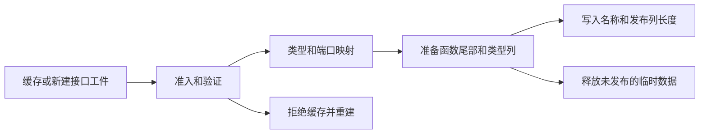

# 原生缓存与成员提交自举

## Intent

沿项目导入和原生缓存恢复入口，把原生接口的准入、类型合并、函数尾部写入和最终发布串到同一条 RX 路径。让普通导入与缓存命中共用最终发布约定。

## Data

当前缓存路径通过两个独立的生成入口计算和发布类型。Zig 在两者之间装配重绑定视图，并在恢复成功后另行登记公开类型与函数长度。类型合并结果来自临时区，项目必须持有发布后的字符串、函数和类型列。

## Edges

复用现有类型、函数列、缓存验证和回退规则。分配失败时，已发布的函数长度、原生模块绑定与类型前缀保持有效。原生解析结果的文本和数组沿用项目持有方式。初始 seed 保留原实现。

## Answer

正式缓存恢复只调用一次生成入口。RX 在临时区完成重绑定，在项目分配器上准备公开绑定、函数尾部和类型差量。`commit.zx` 提交原生表与各列长度，生成代码中的提交步骤只借用视图和写入字段。无缓存的导入复用同一个原生表写入函数。缓存索引、错误转换和分配失败后的内存清理由宿主持有。

首次安装版 ABI 验收在解析缓存恢复后的原生调用时崩溃。符号定位和窄探证实成员、端口及导入均正确，问题来自初始化后仍被借用的空正文描述符。将该描述符放到静态存储后，原始夹具的有缓存和无缓存探针均生成有效 IR。

### 引导与回归

以 `bf700028c` 的 Source 引导器构建候选与初始 seed，共 27 步通过。候选重新运行当前 922 个入口的正式清单，14,253 份生成文件逐字节一致。135 项 Zig 回归通过，覆盖原生声明、原生联结、名义来源、语义缓存和缓存编码。安装版通过 5 项磁盘缓存检查和 3 项增量生成检查。修复后补跑的原生对象 ABI 检查通过，覆盖冷构建、热复用、声明重排和禁用缓存，共 72 步。[自举收敛计划](自举收敛计划.md)

### 性能与产物

固定清单有 735 个入口和 16 个分区。以 macOS arm64、Zig 0.17.0、ReleaseSmall 运行，关闭常驻。三套工具均由 Source 引导并执行 Source 分析和生成。交错三轮取中位数，RSS 以十进制 MB 计。

| 指标                 |  固定基线 |    上一代 |      候选 |
| -------------------- | --------: | --------: | --------: |
| 冷生成墙钟           |    2.86 s |    2.62 s |    2.61 s |
| 冷生成 CPU           |   12.49 s |   12.59 s |   12.51 s |
| 冷生成进程树峰值 RSS | 884.70 MB | 707.58 MB | 708.59 MB |
| 冷生成单进程峰值 RSS | 921.08 MB | 733.59 MB | 732.27 MB |
| 热生成墙钟           |    2.23 s |    1.95 s |    1.96 s |
| 热生成 CPU           |    8.39 s |    8.21 s |    8.21 s |
| 无改动墙钟           |    0.04 s |    0.03 s |    0.03 s |

相对上一代，冷生成墙钟减少 0.01 秒，CPU 减少 0.08 秒，进程树峰值 RSS 增加 1.02 MB。相对固定基线，冷生成墙钟减少 0.25 秒，累计 CPU 增加 0.02 秒，进程树峰值 RSS 下降 176.11 MB。上一代和候选的 11,753 份固定清单产物逐字节一致，工具身份戳除外。冷暖产物一致，两代的 v18 所有权缓存正文哈希均为 `cdf9fa7e0f33002a95dc097b2837de781d67e6e519a452fb97f89f7c0bbf3a23`。

安装版交错 12 轮复测，99 个源码缓存项与 2 个原生接口缓存项均命中。热运行墙钟由 37.04 ms 变为 36.98 ms，CPU 由 38.45 ms 变为 38.41 ms，单进程峰值 RSS 由 13.02 MB 变为 12.97 MB。两版的冷暖应用和 ABI 输出逐字节一致。候选引导器 SHA-256 为 `4a4f7b2c8862b9a4f9c97f53107039d02c97b865355b5e1922d85007baca86ab`，原始证据在 `.zig-cache/verification-tmp/native-cache-publication/`。
