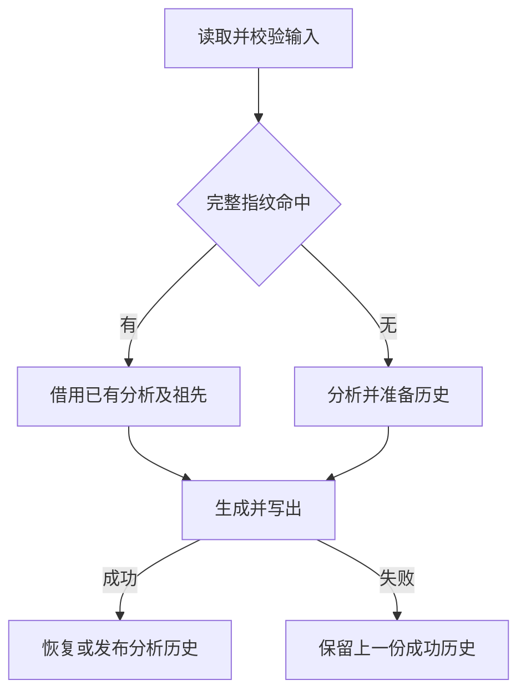

# 常驻分析恢复与历史释放

## Intent

ZX 源码恢复到已经成功分析过的内容时，常驻编译器直接重用对应的分析结果，并释放较新的分析历史。输出继续使用正式生成入口。

## Data

上一阶段用固定的 735 入口清单反复删除和恢复一处 ZX 调用。四轮后两代工具都保留了九份分析历史，分析 arena 容量约 2.10 GB。历史选择在检测到 ZX 内容变化时只选最近一次分析，恢复相同内容也会新增对象。生成器在发布输出前已经计算完整的输入指纹，涵盖工具身份、清单、RX、ZX、模板、原生接口和分区。
[复现和阶段数据](所有权回放访问日志自举.md)

## Edges

准确命中要求完整指纹一致且当前接口装载成功。已有输出的新鲜度路径继续直接返回。历史命中时借用旧版本的不可变库描述符，在生成和写出成功后才释放位于其后的分析 arena。所选版本引用的祖先继续存活。指纹未命中时，沿用原有的增量推导和历史容量规则。

## Answer

Source 从最新记录往前查询输入指纹，只需借用固定宽度的指纹列。常驻宿主用匹配记录已有的库结果生成，随后沿原 arena 释放路径移除较新的版本。历史记录复用原分析分配器，并保存输出所需的已有类型表、函数表和导出描述符。

[Source 指纹选择](../../packages/compiler/src/rx/analysis/project/history/resident/exact.zx) · [正式生成入口](../../packages/compiler/build/generate_parser.zig) · [历史交接](../../packages/compiler/build/resident/state.zig)

### 生成与失败恢复

Source 引导构建通过 25 步，初始种子构建通过 14 步。735 入口的 11,753 个生成文件逐字节一致，排除工具身份戳，暖重建与各自的冷生成一致。相邻两代的 v18 缓存正文 SHA-256 均为 `cdf9fa7e0f33002a95dc097b2837de781d67e6e519a452fb97f89f7c0bbf3a23`。初始种子与候选对六入口生成的 22 个文件逐字节一致。

五组既有回归完成 57 个构建步骤，221 项检查通过，涵盖模块生成、RX 推导、解析缓存、语义缓存和持久缓存编码。

六入口测试创建三份分析历史，并在请求恢复首份历史时让输出路径中的 `types.zig` 成为目录，触发写出失败。历史数依次为 `1 → 2 → 3 → 3 → 2 → 1`。失败当轮保留三份历史，之后两次成功恢复各回到原有 arena 容量及输出。两次恢复均分析零个模块。无写出预热后请求同一输入也直接使用已保存的分析，生成文件与独立冷生成一致。

### 常驻性能

重用上一阶段的 735 入口清单，移除一处 ZX 调用再恢复，连续四轮。保留生成缓存和常驻进程，前后版本的初次生成、首轮编辑和首轮恢复的产物指纹一致。

| 指标                        |      上一代 |        候选 |
| --------------------------- | ----------: | ----------: |
| 编辑墙钟中位数              |   624.58 ms |   623.47 ms |
| 恢复墙钟中位数              |   623.28 ms |   377.96 ms |
| 末次恢复后的历史份数        |           9 |           1 |
| 末次恢复后的分析 arena 容量 | 2,015.76 MB |   280.04 MB |
| 末次恢复请求返回时进程 RSS  | 2,097.59 MB | 1,004.34 MB |

四次恢复均跳过了前端分析。候选历史在一份和两份之间交替，分析 arena 容量在约 280 MB 和 476 MB 之间。末轮分析 arena 容量下降约 1.74 GB，常驻进程 RSS 下降约 1.09 GB。RSS 包含分配器、生成缓存与其他仍保留的内存。

### 冷暖生成

macOS arm64，Zig 0.17.0，ReleaseSmall，16 分区。候选由 `7cf2be898` 的 Source 引导器生成。固定基线沿用引导声明准备阶段，三套工具均由 Source 引导，测量时都执行 Source 分析和生成。关闭常驻，735 入口交错三轮取中位数。

| 指标                     |  固定基线 |    上一代 |      候选 |
| ------------------------ | --------: | --------: | --------: |
| 冷生成墙钟               |    2.86 s |    2.57 s |    2.57 s |
| 冷生成 CPU               |   12.45 s |   12.14 s |   12.16 s |
| 冷生成进程树采样峰值 RSS | 885.16 MB | 714.78 MB | 715.52 MB |
| 冷生成单进程系统峰值 RSS | 927.76 MB | 728.83 MB | 764.33 MB |
| 热重建墙钟               |    2.23 s |    1.97 s |    1.97 s |
| 热重建 CPU               |    8.50 s |    8.25 s |    8.22 s |
| 无改动墙钟               |    0.04 s |    0.03 s |    0.03 s |

相对上一代，冷生成墙钟持平、CPU 增加 0.02 秒，进程树采样峰值增加 0.74 MB。相对固定基线，墙钟和 CPU 各下降 0.29 秒，进程树采样峰值下降 169.64 MB。

首组单进程系统峰值增加 35.50 MB。待回归退出后，同一清单追加四组交错冷生成，约每 5 ms 采样一次。系统峰值中位数为 742.33 → 730.87 MB，采样 RSS 峰值为 716.93 → 716.57 MB，物理内存采样峰值为 712.12 → 711.69 MB。首组上升未在复查中出现。

### 自我审查

保存的是供生成器使用的库描述符，它继续借用分析 arena 中的类型和函数表。恢复时仍执行后端生成和输出缓存检查。连续不同输入的增量历史继续依照原有内存预算管理。常驻测量覆盖可重复恢复的场景，冷暖测量止于 Zig 代码写出。
