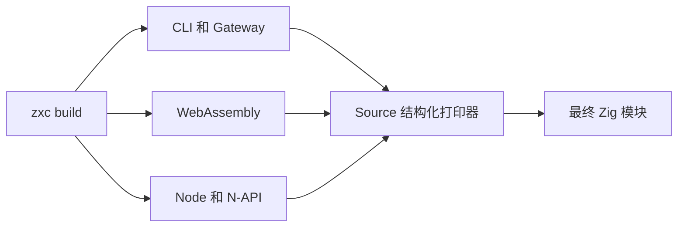
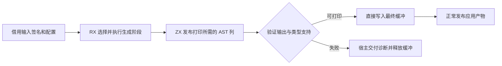

# 应用宿主生成与直接打印自举

## Intent

把 Gateway、CLI、WebAssembly 和 Node 的应用宿主生成串到 Source printer。让负责构造目标声明的 RX/ZX 流程直接交付 Zig 文件，保持各宿主现有的 ABI、声明顺序和诊断。

## Data

`zxc build` 根据应用目标生成进程入口、内存与状态管理、参数解码和结果处理。原路径由 Source 构造声明列，宿主再把列投影到打印器的输入。Gateway 进程入口还把表追加到 Zig 的 AST 存储。

Node 的上下文、任务、入队和进程注册，共用同一个 AST 发布结构。CLI 和 WebAssembly 共用宿主签名输入，N-API 单独处理类型支持状态。

## Edges

WebAssembly 从既有根声明起点打印，容器内部声明保持原编号。N-API 先交付类型不支持的诊断，再处理 AST 构造失败。源表和文本的借用覆盖打印期间，输出缓冲由宿主拥有。初始 seed 继续走现有入口。

这批涉及八个入口，包括 Gateway、CLI、Wasm、Node 上下文、任务、入队、运行入口和 N-API 编解码模块。库构建、元数据、资源和 ABI 视图等发布路径继续由各自的入口处理。

## Answer

复用现有应用夹具比较无语义缓存时的生成 Zig，并集中运行 Gateway、CLI、Wasm、WASI、Node 和 N-API 回归。用相同工作目录、Zig 和选项交替测量受影响的应用构建。保留 Gateway 上一阶段的固定对照。

### 一致性与回归

- 用 `89b703dd2` 的 Source 引导器构建候选，25 个引导构建步骤通过。由候选引导器生成验收 CLI。
- 对照十组真实构建，覆盖有状态和空 Gateway、原生 CLI、Node 同步和有状态入口、Wasm 标量、对象与有状态入口、WASI。97 份生成 Zig 逐字节一致。
- 七个回归目标通过 97 个构建步骤和 48 项 Zig 测试，另有 86 项 Gateway 检查、561 项 N-API 协议用例、489 项 Wasm/WASI 用例和 33 项 TypeScript 声明检查通过。输出覆盖 JSON 边界、Node 异步生命周期和 RX 项目。
- 引导器 SHA-256 为 `81a827d14930dde761984e4e6e887b5be7ae8b1a16b040ff50bfb7ae134e5d25`。验收 CLI SHA-256 为 `090fee296255a0555c9eab54bca6e3cccc1761d1f4d7b683178ce2f592b4dd63`。

### 受影响路径的性能

macOS arm64，Zig 0.17.0，ReleaseSmall，关闭 zxc 缓存。双方均由 Source 引导并使用正式 Source 分析和生成。复用工具链及同一工作目录，一轮预热后三轮交替，取中位数。RSS 是 `wait4` 返回的系统峰值，按十进制 MB 计。

| 输入               | 墙钟，上代 / 候选 | CPU，上代 / 候选 | 峰值 RSS，上代 / 候选 |
| ------------------ | ----------------: | ---------------: | --------------------: |
| Gateway main       |   1.319 / 1.328 s |  1.446 / 1.455 s |    212.09 / 212.17 MB |
| 有状态 CLI         |   0.870 / 0.868 s |  0.923 / 0.924 s |    181.01 / 181.29 MB |
| 有状态 Node        |   0.570 / 0.573 s |  0.629 / 0.629 s |    165.82 / 165.61 MB |
| 有状态 WebAssembly |   0.295 / 0.294 s |  0.353 / 0.348 s |    116.95 / 116.69 MB |

相对上一阶段 Gateway 固定对照 `73e9a5a55`，同轮测得墙钟、CPU 和 RSS 累计变化为 +0.026 秒、+0.062 秒和 +0.56 MB。记录位于 `.zig-cache/verification-tmp/application-host-source-render/` 的 `performance.json`、生成文件哈希和 `regression.log`。

### 自我审查

正式应用宿主继续用 Zig 维护分配器、借用 ABI 并把生成状态映射成既有错误。AST 按列直接交给 Source printer。该批次性能覆盖实际应用入口，未进行完整自举冷构建或跨平台计时。共享类型束发布、应用以外的库构建和元数据装配仍需分别核对正式传递依赖。
