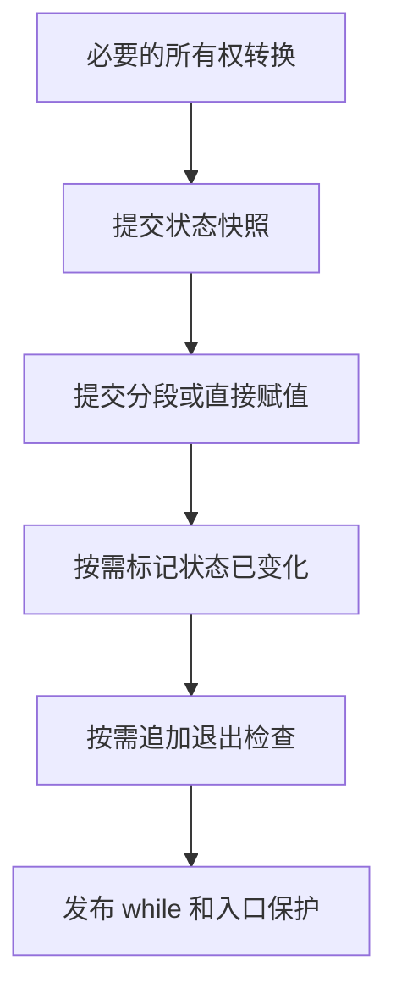

# 循环单步与状态写回自举

## Intent

把普通、状态拆分和字段投影三类循环写回接到同一条 Source AST 发布路径。保留快照在写回之前、状态标记在写回之后、后置条件在最后检查的顺序。

## Data

正式入口是 `iteration.lowerMode`。目前 ZX 按类型选择写回，并为拆分状态生成表达式、快照和赋值列。宿主将几段语句还原为临时对象，再由循环框架写入 AST。跟踪状态是否变化的赋值由宿主单独追加。

## Edges

字段拆分先生成该步全部快照，再提交写回。投影和借用裁剪仍使用原有规则。状态跟踪取自原声明。循环条件的 IR 求值和运行期执行顺序沿用现有路径。

框架接受已提交的循环单步区间。退出检查紧接着该区间提交，检查体引用随后保存的跳出语句。这样外层 while 可以直接引用连续的循环体。种子继续使用其原有语义，用同一 AST 区间契约组装循环。

## Answer

对照同一冻结清单的生成文件、所有权缓存、墙钟、CPU 和峰值 RSS。复用循环缓冲、快照隔离、条件检查顺序、聚合与借用作用域的已有回归。

### 固定清单对照

macOS arm64，Zig 0.17.0，ReleaseSmall，16 分区，关闭常驻。候选从 `bad847fd1` 引导构建，三套工具均执行 Source 分析和生成。用同一份 735 入口冻结清单交错运行三轮，取中位数。热重建移除输出并保留缓存。

| 指标                   |  固定基线 |    上一代 |      候选 |
| ---------------------- | --------: | --------: | --------: |
| 冷生成墙钟             |    2.85 s |    2.59 s |    2.58 s |
| 冷生成 CPU             |   12.45 s |   12.20 s |   12.20 s |
| 进程树采样峰值 RSS     | 889.77 MB | 706.07 MB | 708.74 MB |
| 单进程系统记录峰值 RSS | 924.16 MB | 733.92 MB | 748.54 MB |
| 热重建墙钟             |    2.25 s |    1.98 s |    1.98 s |
| 热重建 CPU             |    8.49 s |    8.29 s |    8.29 s |
| 无改动墙钟             |    0.03 s |    0.03 s |    0.03 s |

相对上一代，冷墙钟减少 0.01 秒。采样峰值增加 2.67 MB，系统记录的峰值增加 14.61 MB。上一代三轮系统峰值为 727.09、744.85、733.92 MB，候选为 748.67、725.88、748.54 MB。两组范围重叠。相对固定基线，冷墙钟和 CPU 分别下降 0.27 秒和 0.25 秒，两种峰值分别下降 181.03 MB 和 175.62 MB。

11,753 个生成文件与上一代逐字节一致，排除工具身份戳。所有权缓存 v18 正文 SHA-256 均为 `cdf9fa7e0f33002a95dc097b2837de781d67e6e519a452fb97f89f7c0bbf3a23`。三套工具各自的热重建与冷生成一致。

### 函数工作区探针

同一冻结清单记录 4,604 次独立函数开始打印时的工作区容量。容量之和由 338.39 MB 降至 324.89 MB，中位数由 48,821 B 降至 48,529 B，单次最大值均为 1,396,854 B。两版语句头部均为 517,791 项。

逐函数工作区减少，整轮系统峰值的增加仍未定位到具体阶段。两组系统峰值范围重叠，采样峰值和系统峰值的中位数均单独保留。

### 引导与增量

候选完成 25 步 Source 引导，重新构建的 seed 完成 14 步。seed 与候选在六个现有输入上生成相同的 22 个文件。旧、新 seed 在八个循环样例上生成的 27 个文件逐字节一致。常驻初次生成、编辑读取位置、改动调用依赖及恢复源码，四次结果均与独立冷生成一致，新旧工具也逐次匹配。

八个回归入口完成 394 步构建，979 项检查全部通过。覆盖循环条件和写回顺序、缓冲和快照、状态更新、各类分配失败、Store 事务及源码与归档调用。

### 自我审查

快照、赋值、跟踪标记及循环框架的 AST 形态已经由 Source 决定。Zig 仍负责调用条件与状态表达式的降低器、借用裁剪的宿主接线和 AST 容量管理。性能对照覆盖分析和生成，完整冷构建的后端耗时与峰值仍需独立核验。
