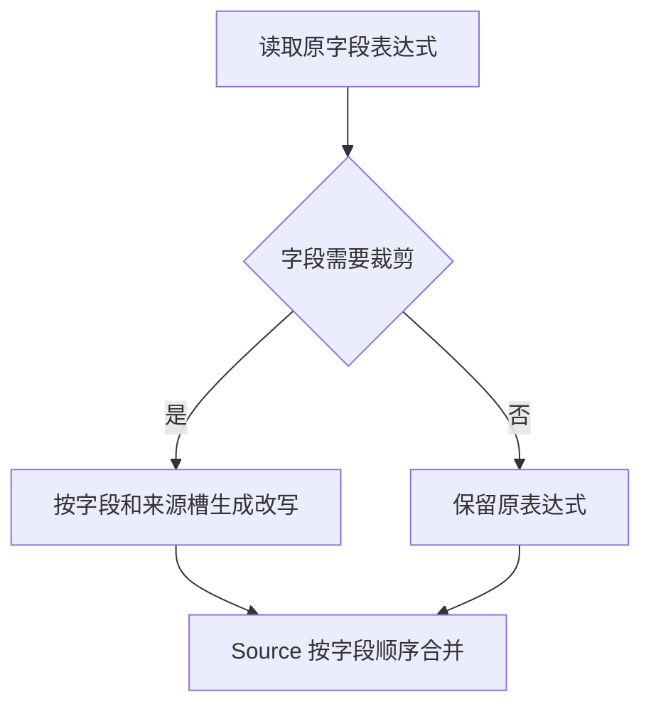

# 循环续存与字段裁剪自举

## Intent

让循环与 reduce 直接消费续存语句的 AST 区间。字段投影由 Source 选择确实需要清除所有权标记的字段，并将修改合并回原对象。

## Data

正式路径从 `iteration.lowerMode` 和 `transform.reduce.lower` 进入续存规划。旧实现先判断续存记录是否延后或由缓冲列表接管，生成续存语句时再次判断缓冲路径。生成的语句被还原成宿主对象，进入循环时重新写入 AST。

字段投影之前向宿主提供与字段等长的可空槽列表，由宿主重新查字段类型并逐项判断。字段是否需要裁剪，依赖被借用的字段、槽位置、状态类型与已有的转移事实。

## Edges

入口续存复用已经筛选过的记录范围。嵌套降低切入新的缓冲上下文时，仅补做此前未覆盖的缓冲筛选。值续存继续按自己的值表达式记录过滤。字段偏移仍按对象的所有字段累计，包括无需裁剪的字段。只有原裁剪条件成立时才提交改写请求。重建从原字段表达式读取默认值，仅覆盖已改写字段。初始遮蔽没有裁剪请求时保持原种子。

节点列与文本仍使用现有 AST 生命周期。非连续的入口语句组装时只复制标签和载荷索引。编译期宿主继续生成实际需要的引用布局和清理辅助函数。

## Answer

以同一冻结清单核对生成文件与所有权缓存。使用原有循环缓冲、聚合循环、共享 ABI、字段转移、迭代条件和错误清理回归，核对固定基线与上一代的冷暖成本。

### 固定清单对照

macOS arm64，Zig 0.17.0，ReleaseSmall，16 分区，关闭常驻。候选由 `15b5ab451` 构建。三套工具均使用 Source 分析和生成。用同一份 735 入口冻结清单交错运行三轮，取中位数。热重建移除输出并保留缓存。

| 指标                   |  固定基线 |    上一代 |      候选 |
| ---------------------- | --------: | --------: | --------: |
| 冷生成墙钟             |    2.84 s |    2.59 s |    2.60 s |
| 冷生成 CPU             |   12.46 s |   12.12 s |   12.15 s |
| 进程树采样峰值 RSS     | 898.63 MB | 712.64 MB | 711.39 MB |
| 单进程系统记录峰值 RSS | 962.27 MB | 738.59 MB | 735.13 MB |
| 热重建墙钟             |    2.22 s |    1.98 s |    1.97 s |
| 热重建 CPU             |    8.46 s |    8.28 s |    8.25 s |
| 无改动墙钟             |    0.04 s |    0.03 s |    0.03 s |

相对上一代，冷生成墙钟和 CPU 分别增加 0.01 和 0.03 秒，进程树采样峰值与单进程系统峰值分别下降 1.25 MB 和 3.46 MB。较固定基线，冷生成墙钟与 CPU 分别下降 0.24 和 0.31 秒，两种峰值分别下降 187.24 MB 和 227.13 MB。

11,753 个生成文件与上一代逐字节一致，排除工具身份戳。所有权缓存 v18 正文 SHA-256 均为 `cdf9fa7e0f33002a95dc097b2837de781d67e6e519a452fb97f89f7c0bbf3a23`。三套工具各自的热重建与冷生成一致。

### 投影与工作区探针

冻结清单两版均进入 1,205 次字段投影，读取 5,769 个字段。进入宿主清除所有权标记的请求从 2,927 次降到 856 次。该计数包含旧宿主入口最终判断无需修改的请求，候选在 Source 规划时已排除它们。

两版各记录 4,604 次独立函数开始打印时的工作区。容量之和从 324.87 MB 变为 324.91 MB，中位数从 48,529 B 变为 48,554 B，单次最大值均为 1,396,854 B。语句头部从 517,791 增至 517,837，增加的头部用于复用不连续的入口语句区间。

### 引导与增量

候选完成 25 步 Source 引导，重新构建的 seed 完成 14 步。seed 与候选在六个已有输入上生成相同的 22 个文件。旧、新 seed 在八个循环输入上生成的 27 个文件逐字节一致。常驻初次生成、编辑读取位置、修改调用依赖及恢复源码，四次请求均与独立冷生成一致，上一代和候选的输出逐次匹配。

九个回归入口完成 510 步构建，1,016 项检查全部通过。覆盖循环缓冲、字段所有权、状态更新、reduce 求值轨迹与分配边界，以及源码和归档库调用。

### 自我审查

入口续存与字段选择本身由 Source 决定。宿主仍负责获得实际需要的布局，发布借用和清理辅助函数，管理节点列的存储。性能对照覆盖编译器分析和生成，完整冷构建的后端开销仍需独立核验。
