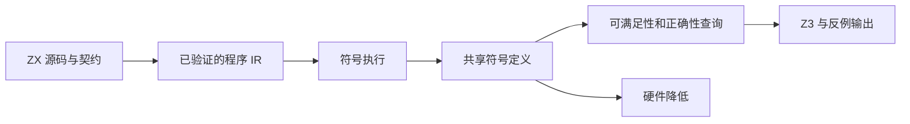
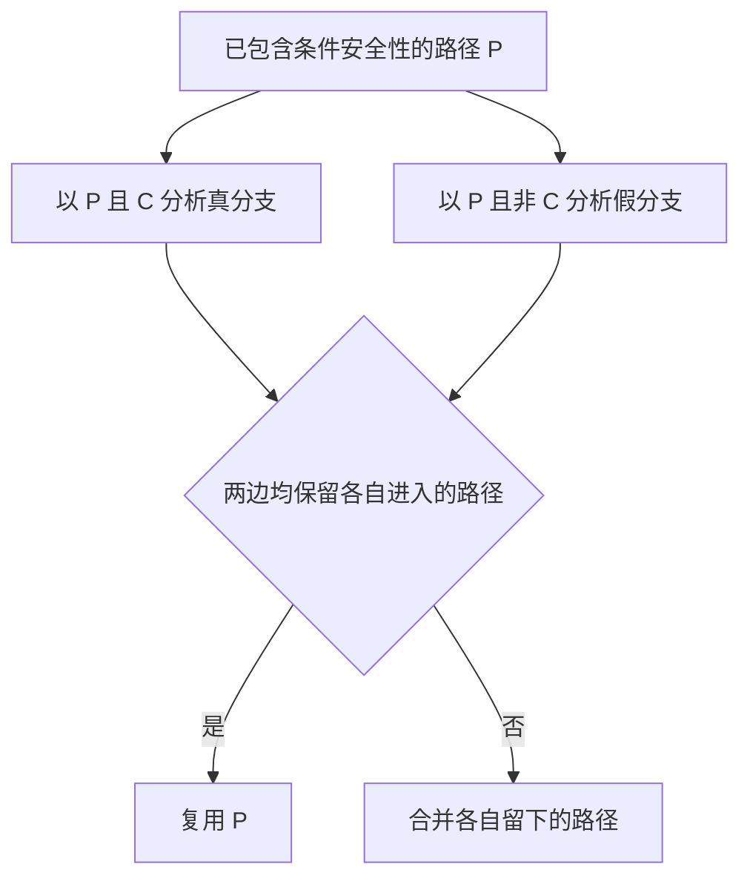

# 性能诊断与验证分支路径复用

## Intent · 目标

按当前正式入口核对外部诊断，把已存在的优化和仍可观测的开销对应到源码。修复 `zxc verify` 连续分支中反复构造等价路径的问题，并用实际 Z3 核对结果和反例。

## Data · 正式路径

| 诊断                      | 当前实现与仍存在的开销                                                                                                                                                                                                                                                                                                                                             |
| ------------------------- | ------------------------------------------------------------------------------------------------------------------------------------------------------------------------------------------------------------------------------------------------------------------------------------------------------------------------------------------------------------------ |
| 全闭包及单 Zig 文件       | 冷构建从入口装载依赖闭包。后端独立生成入口、类型和函数单元，按内容键复用函数源码。公开 watch 使用 Zig 磁盘缓存，每轮仍启动 Zig 子进程。见 `packages/compiler/src/backends/zig/modules.zig` 和 `packages/cli/src/cli/build/observed.zig`。                                                                                                                          |
| 重复推导                  | 同一轮的 RX 根节点共享 ZX 源码装载和解析，公开 watch 跨轮复用解析和已核验的文件版本。RX 混合语义历史当前由常驻自举入口使用，公开 watch 仍逐轮执行 RX 推导。见 `packages/cli/src/cli/rx/preparation/`、`packages/cli/src/cli/watch/driver/build.zig` 和 `packages/compiler/src/rx/analysis/project/history.zig`。                                                   |
| SMT 分支和调用            | 同一函数和相同符号实参命中调用缓存，符号图对表达式去重，求值有步数上限。不同实参仍展开函数体。顺序执行的 `if` 即使两条路径都能完整继续，旧实现也会为后续语句构造新的析取路径。见 `packages/compiler/src/verification/{call_cache,graph,conditions}.zig`。                                                                                                          |
| 不可变对象、集合和 `$ctx` | 生成器对复合输入有只读借用，对可证明独占的更新可复用存储。RX 分析将 `$ctx` 引用解析为局部结果。集合变换链仍可能物化中间数组，释放时机还取决于结果是否被返回、借用或写入 Store。见 `packages/genz/src/zx/value_call/borrowed_argument.zig`、`packages/genz/src/analysis/uniqueness/` 和 `packages/compiler/src/rx/analysis/result_name/`。                          |
| JSON、请求分配和 Store    | Gateway 用请求 arena 批量释放，定长请求体一次分配，连续无转义字符串可借用原始字节。无引用标量服务已能把大的临时请求体从可被 Store 接管的区域分离。会逃逸到 Store 的聚合值仍需保留其借用区域。见 `packages/genz/src/analysis/gateway/invoke/input/` 和 `packages/genz/src/analysis/store/request/`。                                                                |
| 并发和取消                | Gateway 在接受连接的循环内同步读请求头、执行服务并收回退役区域。历史慢连接样本确认了至少 250 ms 的队首阻塞。语句型并行有 `std.Thread.spawn` 路径，ZX Future 使用 `std.Io.async` 或 `std.Io.concurrent`。取消由 Future 和 I/O 边界处理，普通 `loop` 按自身条件迭代。见 `packages/genz/src/analysis/gateway/host/accept.zx` 和 `packages/genz/src/analysis/tasks/`。 |

Zig 的文件缓存与常驻声明级分析分别复用不同阶段的工作。历史实测和实现记录见[编译与运行时性能核查](../2026-11-18/编译与运行时性能核查.md)、[监听构建复用解析结果](../2026-11-19/监听构建复用解析结果.md)、[Gateway 请求体与共享 Store 生命周期](../2026-11-19/Gateway请求体与共享Store生命周期.md)。[Zig 增量编译实现](https://mlugg.co.uk/posts/incremental-compilation-internals/) · [LLVM 前端性能建议](https://llvm.org/docs/Frontend/PerformanceTips.html)

## Edges · 分支路径

先检查条件表达式的安全性，再分别以 `P && C` 和 `P && !C` 分析两个分支。两边继续执行的路径均等于各自进入时的路径时，后续语句直接沿用 `P`。有提前返回或分支内可能失败时，继续合并各自实际留下的路径。每个分支、错误检查和契约仍按原顺序求值。硬件模型共用这段符号执行，正确性查询中的定义数量及编号可以变化。

## Answer · 验收

`test-verification`、`test-verification-resources` 和 `test-hardware-resources` 共通过 84 个构建步骤和 8 项 Zig 测试。正式 CLI 套件覆盖 20 个普通验证场景、公开库和枚举验证。另用实际 Z3 对照六种路径，包含嵌套分支、条件可能失败、分支可能失败、提前返回和失败契约。三组应有反例的场景仍产生反例，三组应通过的场景均通过。直接对照和候选的前置条件查询逐字节一致。

macOS arm64、Zig 0.17.0、ReleaseSmall。固定对照为 `dadb1f21a`，直接对照为 `a587525b2`。三套 CLI 的编译模块均由 `7c9b225c3` Source 引导器生成，执行时使用 Source 分析和生成。执行 `zxc verify --no-cache`，各版交错运行，排除预热后取九轮中位数。固定响应的替身用于观察真正求解前的开销。RSS 为 `wait4` 返回的最大 RSS，MB 按十进制计。

| 场景                 | 墙钟 ms（固定 / 直接 / 候选） | CPU ms（固定 / 直接 / 候选） | 峰值 RSS MB（固定 / 直接 / 候选） |
| -------------------- | ----------------------------: | ---------------------------: | --------------------------------: |
| 1 个分支，实际 Z3    |            9.22 / 9.22 / 9.20 |           8.35 / 8.36 / 8.35 |             25.05 / 25.05 / 25.02 |
| 16 个分支，实际 Z3   |         16.64 / 16.40 / 16.29 |        15.76 / 15.54 / 15.44 |             25.28 / 25.21 / 25.08 |
| 128 个分支，实际 Z3  |         77.86 / 76.05 / 75.44 |        76.89 / 75.11 / 74.51 |             26.82 / 26.36 / 25.69 |
| 512 个分支，实际 Z3  |      375.65 / 368.70 / 365.55 |     374.51 / 367.55 / 364.48 |          200.49 / 200.56 / 200.56 |
| 512 个分支，固定响应 |      362.58 / 363.06 / 361.40 |     361.18 / 361.63 / 359.97 |          200.49 / 200.56 / 200.56 |

512 分支样本的正确性查询从 172,147 字节减为 106,744 字节（下降 38.0%），符号定义从 3,074 个降至 2,050 个。相对直接对照，实际 Z3 端到端墙钟缩短 3.15 ms，峰值 RSS 基本持平。使用固定响应时峰值也保持在 200.56 MB。在同一输入上单次观察，`zxc fmt --check` 达到 137.63 MB，普通 ZX 到 Zig 生成达到 200.59 MB。该输入的内存消耗在常用前端路径上也能重现，具体分配点仍需采样。此前的复杂算术样本则在 Z3 阶段达到峰值。

公开 RX watch 的跨轮语义重放、不同符号实参的契约摘要、集合链融合，以及 Gateway 并发下 Store 的借用、提交和回收，仍有各自的正确性边界。当前串行 Gateway 的排队由连接处理顺序解释，Store 锁争用需要并发实现和测量。完整自举冷构建沿用前一阶段的验收范围。本批原始记录保存在 `.zig-cache/verification-tmp/verification-branch-join/`。
