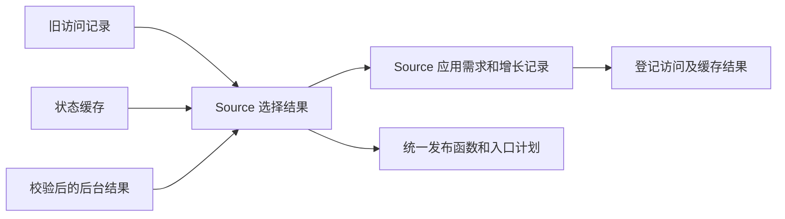
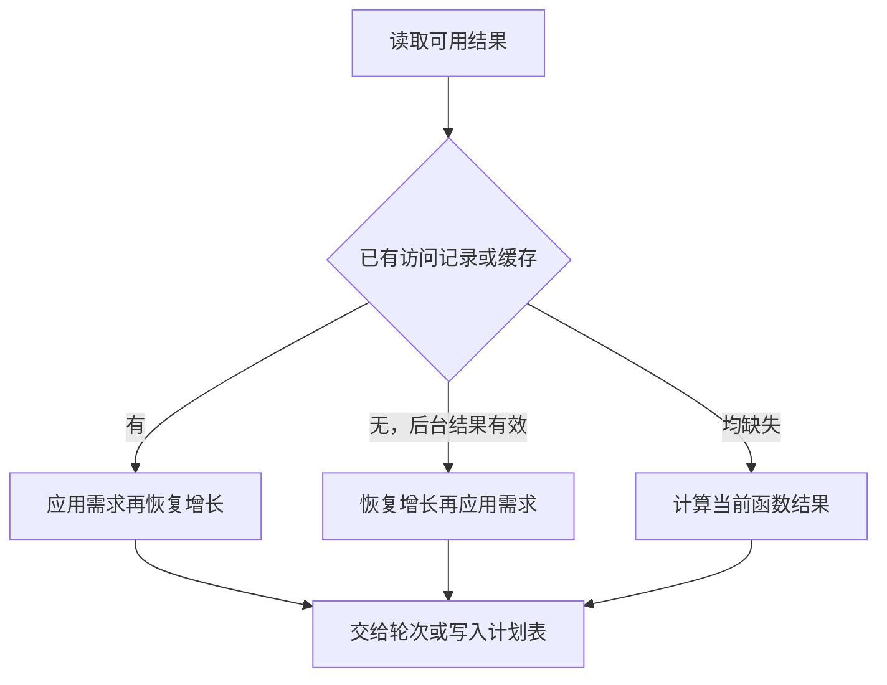

# 所有权函数访问结果采用自举

## Intent

由 Source 选择函数访问采用的结果、应用需求及增长记录，并在普通轮次和快捷回放中统一发布最终计划。

## Data

正式访问已经通过 Source 计算摘要、写出记录和维持工作队列。宿主还决定缓存、后台和当前分析的采用顺序。采用需求记录时，缓存命中和后台结果对摘要与增长记录的写入顺序不同。计划表将函数和程序入口视为两个目的地，普通轮次与快捷回放各自执行一套结果写回。

## Edges

先完成回放及缓存查找，再领取后台任务。即使已命中缓存，也需要领取或取消该函数的后台任务并传播失败。仍按原顺序处理增长保留、摘要应用和缓存登记。普通轮次和回放共用发布入口，按函数编号区分函数表与独立的程序入口。外部或不生成的函数保持空计划。缓存与发射结果持有各自的计划载荷。

## Answer

结算、需求和计划共用 Source 的结果选择规则，依次采用已经读到的旧记录、有效后台结果或重新分析结果。需求采用由 RX 编排摘要重放与增长记录写回。旧记录先应用需求，后台结果先恢复增长记录。标记字段通过跨步只读列借用，增长写回只复制已经保留的两个切片描述符。

普通轮次和快捷回放共用 Plan 发布入口。Source 根据函数编号把计划写到函数表或独立的入口槽，快捷回放跳过已初始化为空的范围。源记录的计划载荷仍按已有保留协议进入结果拥有者。

### 正确性

Source 引导构建通过 25 步。735 入口清单上 11,753 个产物逐字节一致，排除工具身份戳，暖生成和各自的冷生成一致。两代的 v18 所有权缓存正文 SHA-256 均为 `1ade009f07ef878cacf5dba4c875266f536bac4c6e2c8f329aeb02d44d0ffd69`。同一个被多个入口使用的读取函数在常驻进程中修改和恢复，各状态的 21 个文件都与同输入冷生成一致。

生成清单 SHA-256 均为 `7248304214a4e61487c037e6ebc0017ce4f9adb96d7071e985dc963a8c43dc4b`。初始种子构建通过 14 步，种子和候选对五个入口生成的 21 个文件逐字节一致。

函数分析和执行、所有权缓存、字段事实、模块生成和调用借用视图六组回归全部通过，共 167 个构建步骤和 277 项测试。

### 性能

macOS arm64、Zig 0.17.0、ReleaseSmall、16 分区，关闭常驻。三套工具均由 Source 引导，执行 Source 分析与生成。候选由 `b545092e2` 引导，固定基线保留引导声明准备阶段。735 个入口，三轮交错取中位数。

| 指标                 |  固定基线 |    上一代 |      候选 |
| -------------------- | --------: | --------: | --------: |
| 冷生成墙钟           |    2.84 s |    2.58 s |    2.60 s |
| 冷生成 CPU           |   12.44 s |   12.20 s |   12.26 s |
| 冷生成进程树采样峰值 | 893.04 MB | 700.89 MB | 704.12 MB |
| 冷生成单进程系统峰值 | 928.60 MB | 742.38 MB | 740.74 MB |
| 热重建墙钟           |    2.22 s |    1.98 s |    1.99 s |
| 热重建 CPU           |    8.50 s |    8.26 s |    8.29 s |
| 无改动墙钟           |    0.04 s |    0.03 s |    0.03 s |

较上一代，冷生成墙钟和 CPU 增加 0.02 和 0.06 秒，进程树采样峰值增加 3.23 MB，单进程系统峰值下降 1.64 MB。较固定基线，冷生成墙钟和 CPU 分别减少 0.24 和 0.18 秒，进程树采样峰值下降 188.92 MB。

候选三次冷生成墙钟为 3.75、2.60、2.56 秒。首个样本的推导、发射、写出为 1.111、0.848、0.321 秒，额外等待落在这些阶段的计时之外。

### 自我审查

直接跨 RX 传递结构体标记数组会导致公开入口选择元素引用布局，并改变复用该类型的其他入口。本轮复用内存的只读列视图借用原记录，省去布局转换和元素物化。宿主仍执行物理读缓存、后台任务领取、持有分配器及登记记录。测量覆盖 zxc 分析与生成阶段，完整 Zig 后端冷构建和阶段自编译闭包另有验收范围。
