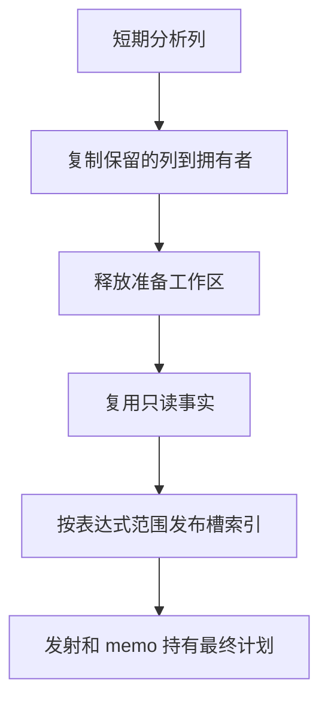

# 所有权分析事实发布自举

## Intent

让 Source 决定哪些控制流、用途事实和所有权计划列进入持久存储。短期工作区在发布后释放，后续轮次和发射可以继续借用必要的数据。

## Data

正式路径由全程序或公开库入口进入所有权准备。Source 已计算控制流和用途事实，宿主用 Zig 类型反射递归复制返回记录；最终计划又从宿主单独截取和复制表达式槽表。

## Edges

沿用现有短期工作区与长期拥有者。跨区列使用分配到目标拥有者的副本，IR 与只读的程序级事实继续借用。表达式槽索引从符号槽末尾开始，保留哨兵和原有偏移。初始 Zig 引导器仍可走自己的初始实现。

## Answer

全程序和公开入口共用 Source 的事实发布规则。宿主先借出 IR 给准备阶段，再把准备结果借给发布阶段。发布用长期拥有者的分配器，返回控制流和用途列。宿主的 Zig 递归字段复制已移除。
[准备后的事实发布](../../packages/genz/src/analysis/uniqueness/function/prepare/publish.zx) · [宿主借用与分配器边界](../../packages/genz/src/zx/uniqueness/function/prepared.zig)

最终计划由现有 RX 发布阶段截取符号之后的表达式槽，按原偏移复制到计划拥有者。调用方只接收计划中的槽索引。
[计划发布](../../packages/genz/src/analysis/uniqueness/function/plan/finish.rx)

首版用等值映射发布数组，生成 Zig 展开逐元素循环。收口版用空数组拼接明确复制连续数组，事实发布函数生成 34 处 `@memcpy`，其中可以为空的列保留空分支，函数内没有逐元素循环。跨 arena 的一次必要复制仍保留。

### 生成物与性能

冻结的并发库发布清单含 735 个入口。macOS arm64，Zig 0.17.0，ReleaseSmall，16 分区，关闭常驻。三套工具均由 Source 引导并执行 Source 分析及发射。上一代为 `a09ccf0c9`，固定基线沿用引导声明准备阶段，三轮交错取中位数。

| 指标                 |  固定基线 |    上一代 |      候选 |
| -------------------- | --------: | --------: | --------: |
| 冷生成墙钟           |    2.87 s |    2.56 s |    2.59 s |
| 冷生成 CPU           |   12.53 s |   12.20 s |   12.27 s |
| 冷生成进程树采样峰值 | 886.33 MB | 698.71 MB | 710.00 MB |
| 冷生成单进程系统峰值 | 926.32 MB | 799.29 MB | 745.16 MB |
| 热重建墙钟           |    2.21 s |    1.97 s |    1.97 s |
| 热重建 CPU           |    8.44 s |    8.21 s |    8.25 s |
| 无改动墙钟           |    0.04 s |    0.03 s |    0.03 s |

相对上一代，冷生成墙钟增加 0.03 秒，CPU 增加 0.07 秒，进程树采样峰值增加 11.29 MB，单进程峰值下降 54.13 MB。相对固定基线，冷生成墙钟下降 0.28 秒，CPU 下降 0.26 秒，进程树采样峰值下降 176.32 MB。

相邻两代的 11,753 个生成文件逐字节一致，排除工具身份戳。每套工具的暖缓存输出与各自的冷生成一致。全程序所有权 memo 的内容哈希保持 `10f1bcee42ae96ef6908f2019afb5cf0fed27b93425c0aefdeedaa330867a089`。候选的 Source 引导构建通过 25 步，初始引导器构建通过 14 步。两者对五个借用入口生成的 21 个文件逐字节一致。

首版迁移通过 172 个构建步骤和 279 项回归，覆盖函数分析、独立发射单元、字段事实、借用视图、所有权缓存和模块生成。换成连续复制后，使用收口版引导器补跑直接受影响的函数分析和执行入口，通过 54 个构建步骤和 49 项检查，其中包含分配失败和共享摘要释放后的使用。

相邻两代生成文件清单的 SHA-256 均为 `7248304214a4e61487c037e6ebc0017ce4f9adb96d7071e985dc963a8c43dc4b`。

### 自我审查

宿主继续管理工作 arena 和长期分配器，将两个生成入口接在现有生命周期上。Source 在目标分配器中构造输出描述符和必要的列副本，拼接沿用普通数组的增长缓冲布局。两种峰值为不同的采集口径。测量覆盖分析与 Zig 生成阶段。
