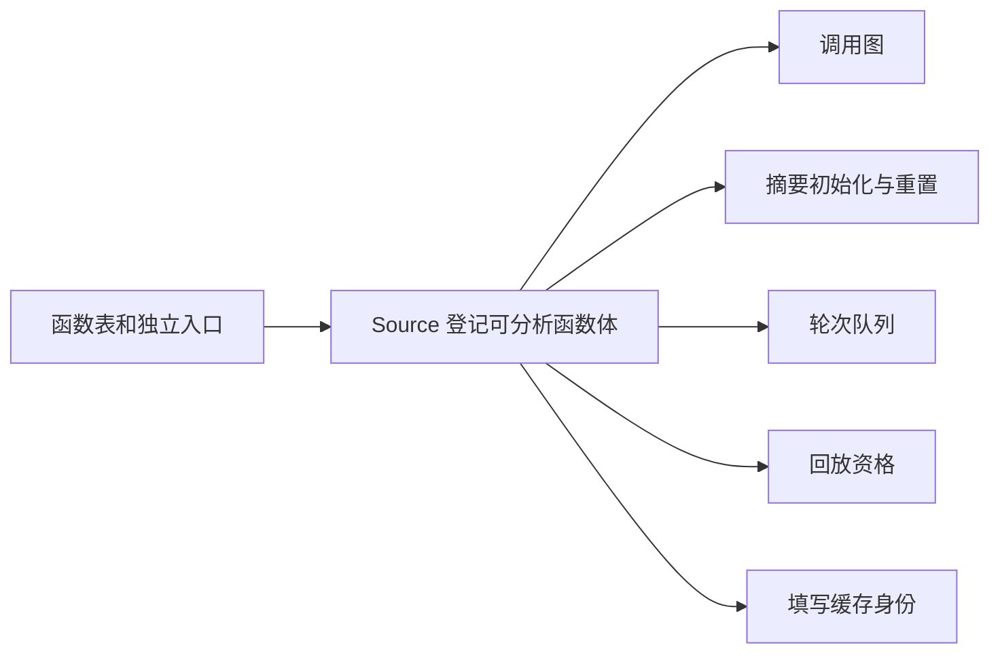
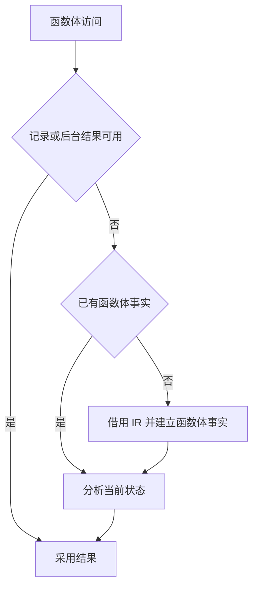

# 所有权分析函数体登记自举

## Intent

由 Source 统一决定哪些编号进入所有权分析，并用于调用图、轮次和快捷回放。对需要分析的函数按需借用 IR 及建立事实，降低缓存命中前的内存开销。

## Data

此前宿主按完整函数行物化分析单元，Source 调用图、队列和回放分别解释原生模块列和入口标记。一项函数的缓存记录只依赖编号、摘要、输入列和增长记录，缓存命中不需要解读函数体。

## Edges

入口保持最后一个编号。原生函数和仅类型入口仍有空计划及零摘要。独立入口复用借用已有 IR 的初始化逻辑。顺序访问和后台访问共用单元事实，并由已有任务领取协议保护。

## Answer

沿正式 Source 入口核对队列、回放和实际分析访问。以固定清单对照生成、缓存及开销，再验收独立入口、函数分析及初始种子。

### 实现

- Source 发布一份包含独立入口的布尔列。摘要初始化、轮次补队、快捷回放与缓存身份的填充沿用这列。调用图直接按表达式表的调用列收集目标，依其原有顺序去重。IR 结构校验保证调用载荷按表达式顺序登记。[Source 调用图入口](../../packages/genz/src/analysis/uniqueness/topology/collect.rx) · [表达式表校验](../../packages/core/src/expression_table/validate.zig)
- 每个编号只持有增长记录和可选的事实指针。缓存查找直接读取共享身份及调用列。首次实际分析再借用符号表、表达式表与控制块，直接保留 Source 发布的事实指针。后台线程先领取对应编号再使用同一状态。[函数体状态](../../packages/genz/src/zx/uniqueness/program/bodies.zig) · [函数体事实发布](../../packages/genz/src/zx/uniqueness/function/prepared.zig)
- 身份填充从原函数列借用描述，复用已有内容摘要。缓存摘要与最终计划共用函数编号和入口编号。[身份填充](../../packages/genz/src/zx/uniqueness/identity.zig)

### 自我审查

本批保留 Zig 的存储分配、线程调用和哈希输出边界。基础内容摘要先于本轮创建，仍在其并行取数循环中查看原生函数列。程序轮次的整体宿主调度继续留待迁移。性能数据覆盖分析与 Zig 生成阶段。

### 正确性

Source 引导构建通过 25 步。735 个入口生成的 11,753 个文件与上一代逐字节一致，排除工具身份戳。两套工具的热重建与各自冷生成一致。v18 所有权缓存正文逐字节相同，SHA-256 为 `cdf9fa7e0f33002a95dc097b2837de781d67e6e519a452fb97f89f7c0bbf3a23`。

函数分析及执行、所有权缓存、字段事实、模块生成、借用调用、原生值边界与库链接八组回归通过 197 个构建步骤和 358 项测试。直接保留已发布事实指针后，六个入口的 22 个生成文件与调整前一致。常驻模式下，编辑共享测试清单中的读索引再恢复，三个版本各 22 个文件都与独立冷生成一致。 初始种子通过 14 步构建，生成的 22 个文件与最终候选一致。六个入口的生成程序均通过执行及分配检查。

### 性能

macOS arm64，Zig 0.17.0，ReleaseSmall，16 分区，关闭常驻。三套工具均由 Source 引导，并执行 Source 分析和生成。候选由上一代 `48b34b228` 生成，固定基线沿用引导声明准备阶段。使用同一 735 入口清单，三轮交错取中位数。

| 指标                     |  固定基线 |    上一代 |      候选 |
| ------------------------ | --------: | --------: | --------: |
| 冷生成墙钟               |    2.85 s |    2.57 s |    2.59 s |
| 冷生成 CPU               |   12.45 s |   12.21 s |   12.25 s |
| 冷生成进程树采样峰值 RSS | 898.48 MB | 718.50 MB | 701.55 MB |
| 冷生成单进程系统峰值 RSS | 921.40 MB | 753.21 MB | 737.66 MB |
| 冷生成单进程物理内存峰值 | 916.41 MB | 747.78 MB | 732.30 MB |
| 热重建墙钟               |    2.23 s |    1.97 s |    1.96 s |
| 热重建 CPU               |    8.44 s |    8.19 s |    8.24 s |
| 无改动墙钟               |    0.04 s |    0.03 s |    0.03 s |

冷生成较上一代墙钟增加 0.02 秒，CPU 增加 0.04 秒，进程树采样峰值下降 16.96 MB，单进程峰值下降 15.55 MB。较固定基线，冷生成墙钟减少 0.26 秒、CPU 减少 0.20 秒，进程树采样峰值下降 196.94 MB。热重建 CPU 较上一代增加 0.05 秒，进程树采样峰值增加 3.47 MB。

首次对照中，系统峰值波动大于采样峰值。实现随后直接保留发布函数返回的事实指针，省去宿主为每个分析过的函数单独分配并复制一份描述符。最终对照额外核查了系统物理内存峰值。各轮峰值波动仍然存在，表格记录固定清单上的观测中位数。
