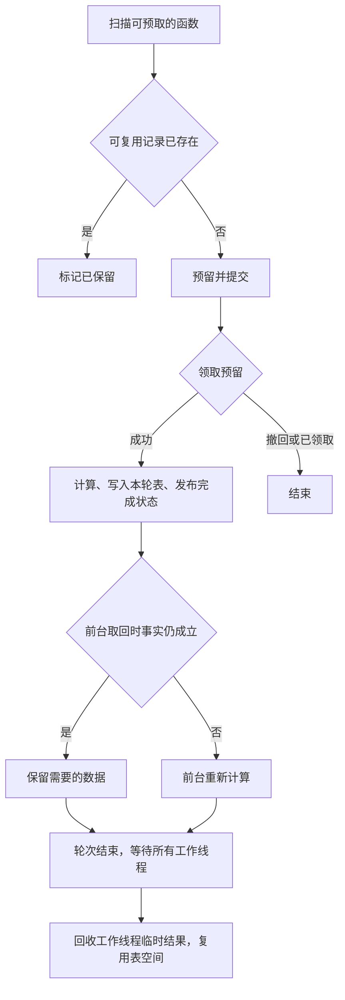

# 所有权后台工作与结果存储自举

## Intent

让 Source 决定后台所有权分析的提交、执行和采用顺序，并按最后使用位置复用结果表。保留前台工作队列、实际借用判断和旧种子的行为。

## Data

结算、需求推导和计划生成各自拥有独立的结果表。实际执行时，一轮只产生其中一类结果。每轮结束前，前台已采用必要的输出，工作池已等完所有被领取的任务，剩余结果也一起释放。三张表的存储空间因此可以共用。这个判断沿用 Perceus 对最后使用和存储复用的联系，在编译器内部由阶段边界确定独占。[Perceus §2.2、§2.4](../perceus.pdf)

## Edges

同一个函数在领到预留状态后才可写入本轮结果表。读线程取得完成状态时才能读取对应条目。队列满时，只撤回尚未领取的预留。需求推导持有自己的增长视图，前台核对它读取的事实后才采用。计划轮次只读取已经稳定的摘要。

## Answer

请求、取回以及三个阶段的后台分析通过 RX 描述。现有 `staticSequence` 在引导时展开步骤。前台计算和后台计算调用同一个入口，后台在结算和需求轮次保留读取事实，并使用自己的增长视图。串行分析省去后台结果表。宿主仍负责 Zig 线程、原生存储及初始种子。

对实际代码类型执行 `@sizeOf`，macOS arm64 的 ReleaseSmall 下三类结果行分别为 48、72 和 80 字节。共用结果行占 80 字节，并发分析每个函数体少预留 120 字节。记录引用的数据按原有路径分配。

[后台编排](../../packages/genz/src/analysis/uniqueness/work/ahead/workflow/sequence.rx) · [结果表与交接](../../packages/genz/src/zx/uniqueness/ahead.zig) · [共享计算入口](../../packages/genz/src/zx/uniqueness/program/visit/compute.zig)

### 一致性与性能

Source 引导构建通过 25 步。冻结的 735 入口生成 11,753 个文件，与上一代逐字节一致，排除工具身份戳。v18 所有权缓存正文也一致，SHA-256 为 `cdf9fa7e0f33002a95dc097b2837de781d67e6e519a452fb97f89f7c0bbf3a23`。六入口常驻样本的初次生成、读取位置修改、调用关系修改和恢复均与各自的独立冷生成一致。

初始种子构建通过 14 步，与候选在六入口清单上生成的 22 个文件一致。七组既有回归共通过 290 个构建步骤和 635 项检查，覆盖静态所有权、函数分析及运行、缓存、字段效果、对象追加和聚合循环。

macOS arm64，Zig 0.17.0，ReleaseSmall，16 分区。候选由 `99268061c` 的 Source 引导器生成。固定基线沿用引导声明准备阶段。三套工具都经过 Source 引导，并执行 Source 分析与生成。关闭常驻，同一冻结清单交错三轮，取中位数。RSS 使用十进制 MB。

| 指标                     |  固定基线 |    上一代 |      候选 |
| ------------------------ | --------: | --------: | --------: |
| 冷生成墙钟               |    2.84 s |    2.56 s |    2.58 s |
| 冷生成 CPU               |   12.46 s |   12.11 s |   12.18 s |
| 冷生成进程树采样峰值 RSS | 886.03 MB | 700.40 MB | 698.55 MB |
| 冷生成单进程系统峰值 RSS | 962.41 MB | 736.69 MB | 738.56 MB |
| 热重建墙钟               |    2.22 s |    1.98 s |    1.97 s |
| 热重建 CPU               |    8.45 s |    8.28 s |    8.28 s |
| 无改动墙钟               |    0.04 s |    0.03 s |    0.03 s |

相对上一代，冷生成墙钟增加 0.02 秒、CPU 增加 0.07 秒，进程树采样峰值减少 1.85 MB，单进程系统峰值增加 1.87 MB。相对固定基线，冷生成墙钟和 CPU 分别减少 0.26 秒和 0.28 秒，进程树采样峰值减少 187.48 MB。

### 自我审查

这次复用的是后台结果行的空间，结果所引用的实际数据仍由各工作线程的区域持有，按原顺序在轮次结束时回收。两种 RSS 采集口径在本批有小幅相反变化，整轮内存收益不能从表数直接推断。冻结清单覆盖编译分析与 Zig 写出，完整冷构建的 Zig/LLVM 峰值与同负载 Rust 对照尚无本批数据。
