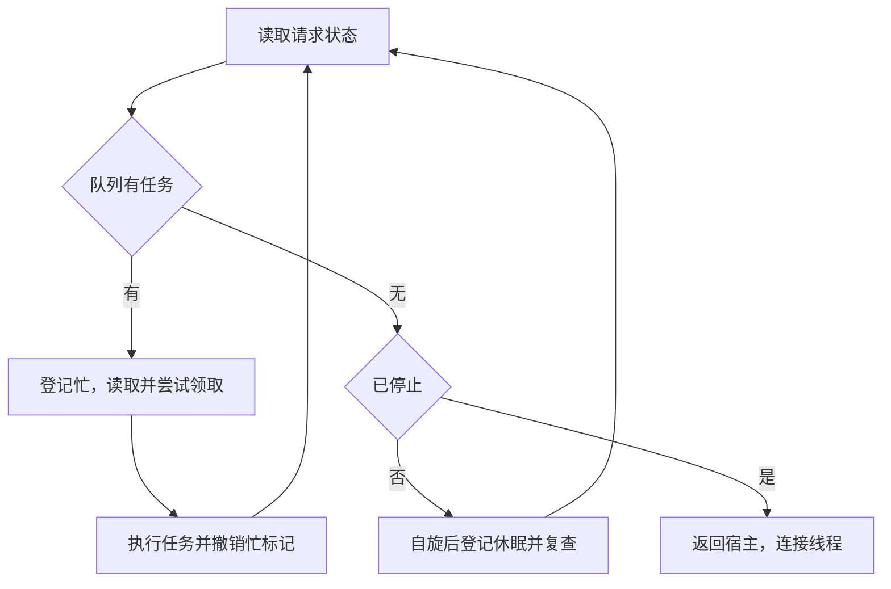

# 所有权后台请求环自举

## Intent

把所有权后台分析的请求入队、领取、休眠、排空和停止迁入 RX/ZX。线程建立、连接和分配器使用 Zig 平台接口。

## Data

正式分析从 `program/host.zig` 请求前瞻任务。Source 已维护单个任务的状态及访问窗口，`pool.zig` 仍维护有界请求环和线程之间的全部同步。后台请求可以丢弃，正式分析按同一工作队列补齐结果。

## Edges

维持单生产者和多消费者原子顺序。读取槽在领取前完成。消费者在重新查看队列前登记为忙，轮次排空后才能丢弃后台保留区。登记休眠者后重新核对请求及停止标记。计数器沿用 32 位回绕。初始种子继续使用独立规则。

## Answer

Source 持有请求环各计数器的布局与容量。RX 编排写槽后唤醒和停止后唤醒，ZX 执行预留、领取、等待、取消未领取请求和等待繁忙任务完成。宿主保持线程创建、连接和 arena 管理。初始种子使用独立的原生队列实现。

Source 保留对共享游标和忙碌计数的顺序一致读写，以及对环槽的宽松读写。领取前先登记忙并读取槽，成功后才准许生产者复用该槽。复用同一强比较交换原语时，领取失败也采用顺序一致读，比原来的失败读取更强。等待前先登记休眠者并重新核对队列和停止状态。环的容量、预留线程上限和自旋阈值来自静态常量。每次调用只借用计数器和环槽，适配器提供容量为零的分配器。

### 生成产物

Source 引导构建通过 25 步。正式并行清单含 735 个入口，两版的 11,753 个生成文件逐字节一致，排除工具身份戳。生成清单的 SHA-256 均为 `7248304214a4e61487c037e6ebc0017ce4f9adb96d7071e985dc963a8c43dc4b`。暖重建和各自的冷生成一致。v18 所有权缓存正文逐字节一致，SHA-256 均为 `1ade009f07ef878cacf5dba4c875266f536bac4c6e2c8f329aeb02d44d0ffd69`。

初始种子构建通过 14 步，与 Source 引导器生成的五入口补充清单共 21 个文件逐字节一致。在同一进程内编辑和恢复被多个入口调用的读取函数，每个状态的常驻生成与同输入的冷生成一致。

函数分析和执行、所有权缓存、字段事实、模块生成和调用借用视图六组回归通过，包含 167 个构建步骤和 277 项测试。

### 性能

macOS arm64、Zig 0.17.0、ReleaseSmall、16 分区，关闭常驻。三套工具均由 Source 引导，执行 Source 分析和 Zig 生成。候选由 `ba6afff92` 引导，固定基线沿用引导声明准备阶段。735 个入口按三轮交错中位数比较。

| 指标                 |  固定基线 |    上一代 |      候选 |
| -------------------- | --------: | --------: | --------: |
| 冷生成墙钟           |    2.82 s |    2.60 s |    2.55 s |
| 冷生成 CPU           |   12.35 s |   12.10 s |   12.11 s |
| 冷生成进程树采样峰值 | 899.17 MB | 708.00 MB | 702.46 MB |
| 冷生成单进程系统峰值 | 930.33 MB | 734.89 MB | 730.92 MB |
| 热重建墙钟           |    2.20 s |    1.91 s |    1.91 s |
| 热重建 CPU           |    8.40 s |    8.06 s |    8.12 s |
| 无改动墙钟           |    0.04 s |    0.03 s |    0.03 s |

较上一代，冷生成墙钟下降 0.05 秒，CPU 增加 0.01 秒，进程树采样峰值下降 5.54 MB。相对固定基线，冷生成墙钟和 CPU 分别下降 0.27 秒和 0.24 秒，进程树采样峰值下降 196.71 MB。

候选第一轮冷生成墙钟为 3.84 秒，其余两轮为 2.55 和 2.52 秒。第一轮内部推导、发射、写出分别为 1.113、0.844、0.306 秒，均在同组上下波动范围内。该次额外墙钟发生在这三个计时区间之外。

### 自我审查

正式路径依赖内部 memory 提供通用平台原子指令、等待、唤醒和自旋提示。线程句柄、工作区生命周期、作业回调和调用方的前瞻访问顺序由宿主处理。测量覆盖编译器分析与生成，完整 Zig 后端构建和全仓阶段自编译有独立验收范围。
