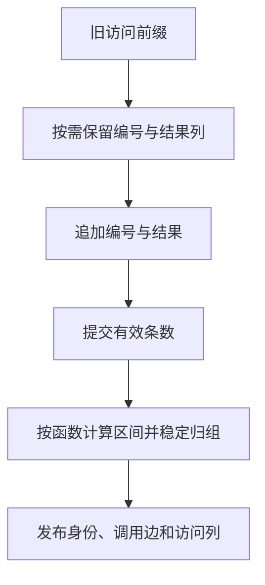

# 所有权回放访问日志自举

## Intent

在正式常驻编译器中，由 Source 管理普通回放的访问追加、容量增长与发布。下次分析复用访问时，仍按函数和原有访问顺序取回结果。

## Data

快捷回放已经由 RX/ZX 选择和发布替换计划。普通轮次则仍用两组 Zig 列表保存每次访问的函数编号和结果，末尾由 Zig 为函数身份、调用边偏移、访问区间和记录申请存储。原 Source 编排负责填充调用边和按函数发布，前置分配与记录长度更新仍由宿主执行。

## Edges

日志跟随本轮分析的工作区。状态字节、身份、调用边和分组后的行归已发布回放持有。结果载荷仍引用 memo 中的向量。两列都准备好后才增加有效条数。任一次分配失败都保留可读的旧前缀；已有容量可以留给重试。只有全部分组完成，宿主才交出记录 arena 并允许替换旧回放。

容量沿用原 `ArrayList` 的增长公式。Zig 提供记录对齐及平台缓存线对应的元素数，Source 决定何时申请。分组按函数累计位置，从尾部移动访问记录，同时保持同一函数内部的相对顺序。三个区间列各用一段连续存储，空日志只发布哨兵区间。

## Answer

Source 承担所有普通访问日志的追加和发布分配。现有 ZX 保留状态字节，记录入口增长并写入编号与结果。RX 组织身份复制、调用图归集和三类访问发布。Zig 负责借出按原布局对齐的记录、管理 arena 所有权交接及初始种子的兼容路径。

- [追加和长度提交](../../packages/genz/src/analysis/uniqueness/replay/record/append.zx) · [增长策略](../../packages/genz/src/analysis/uniqueness/replay/record/reserve.zx)
- [发布编排](../../packages/genz/src/analysis/uniqueness/replay/publication/build.rx) · [稳定分组](../../packages/genz/src/analysis/uniqueness/group/borrowed/arrange.zx)

### 正确性与分配

Source 引导构建通过 25 步，初始种子构建通过 14 步。735 入口冻结清单的 11,753 个生成文件逐字节一致，比较排除工具身份戳。热重建与各自的冷生成一致。相邻两代的 v18 缓存正文 SHA-256 均为 `cdf9fa7e0f33002a95dc097b2837de781d67e6e519a452fb97f89f7c0bbf3a23`。

复用六入口清单，覆盖首次生成、修改读取索引、删除调用及恢复。两代工具的每个状态均生成 22 个与独立冷生成相同的文件。种子和候选对初始状态的生成也一致。735 入口的额外常驻对照用交替删除并恢复一处 ZX 调用触发调用图变化，两代工具的初次生成、首轮编辑及首轮恢复的指纹一致。

七组既有回归通过 290 个构建步骤和 635 项检查，覆盖函数分析和运行、所有权缓存、字段效果、所有权契约、对象追加与聚合循环。

直接调用生成的追加入口，强制缓冲不能原地扩展，追加 2,000 条访问。与原列表的每次扩容边界相同，均申请 22 次、累计 195,276 B，最终保留 67,184 B。21 个增长位置分别注入分配失败，确认旧前缀仍可读且重试能继续追加。随后以交错访问和空日志调用真实发布入口，核对函数身份、调用边区间、各函数内部访问顺序和状态地址。

### 性能

macOS arm64，Zig 0.17.0，ReleaseSmall，16 分区。候选由上一代 `587945352` 引导。固定基线沿用引导声明准备阶段。三套工具均由 Source 引导，并在运行中执行 Source 分析和生成。关闭常驻，735 入口交错三轮取中位数。

| 指标                     |  固定基线 |    上一代 |      候选 |
| ------------------------ | --------: | --------: | --------: |
| 冷生成墙钟               |    2.85 s |    2.59 s |    2.59 s |
| 冷生成 CPU               |   12.44 s |   12.19 s |   12.22 s |
| 冷生成进程树采样峰值 RSS | 889.75 MB | 706.27 MB | 700.42 MB |
| 冷生成单进程系统峰值 RSS | 922.08 MB | 736.08 MB | 732.76 MB |
| 热重建墙钟               |    2.23 s |    1.96 s |    1.96 s |
| 热重建 CPU               |    8.46 s |    8.27 s |    8.23 s |
| 无改动墙钟               |    0.04 s |    0.03 s |    0.03 s |

较上一代，冷生成墙钟持平、CPU 增加 0.03 秒，进程树和单进程峰值分别下降 5.85 MB 和 3.33 MB。相对固定基线，冷生成墙钟减少 0.26 秒、CPU 减少 0.22 秒，进程树峰值下降 189.33 MB。冷生成路径关闭回放录制。

常驻对照包含四轮编辑与恢复。编辑墙钟中位数为 619.98 → 625.80 ms，恢复为 617.96 → 624.05 ms。末轮请求返回时，常驻进程 RSS 为 2.11 → 2.03 GB。单次常驻进程样本用于核对编辑成本与保留趋势。

### 自我审查

普通日志追加和发布的规则均在正式 Source 路径执行。初始种子保留原生列表和分组。状态来源选择、调用过程接线及 arena 生命周期由宿主管理。发布的三份区间列各自申请一次连续内存，原实现一次申请三份区间的总空间。

两代常驻工具在四轮 ZX 编辑与恢复后都累积到九份分析历史，保留 arena 容量约 2.10 GB。首轮分析只保留一份，容量约 280 MB。文件、XML 和 ZX 解析版本的增长远小于分析历史。当前历史祖先查找限于 ZX 源码未变的请求，源码发生变化时选择最近一轮。这个边界解释了为何恢复相同 ZX 内容仍会新增一份分析历史，也是控制常驻内存的具体切入点。
[历史选择](../../packages/compiler/src/rx/analysis/project/history/resident/choose.rx) · [保留容量记录](../../packages/compiler/build/resident/state.zig)
