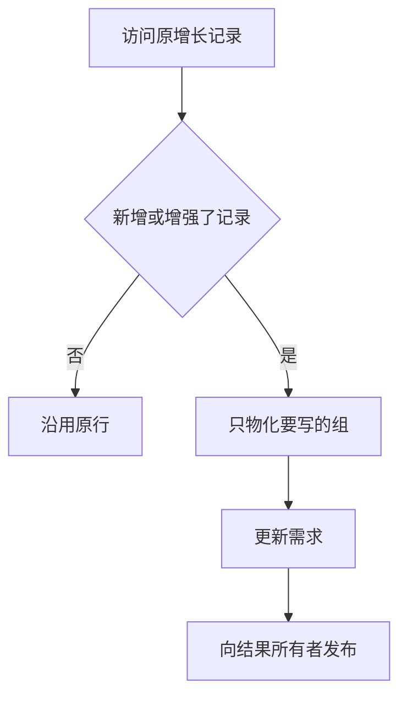

# 所有权增长记录借用自举

## Intent

让函数结算、需求分析、计划和独立入口借用已有增长记录。Source 决定何时复制并更新，记录格式与缓存键沿用现有契约。

## Data

正式路径原先为每次分析分配增长记录对象及指针表。每轮都执行转换，即使只读或需求已经稳定。磁盘加载、快捷恢复和后台结果已经使用相同的宿主行格式。

## Edges

两组记录各自按需物化。可写副本仅在当前分析中使用，原记录可以由已有缓存结果、后台访问或回放状态共享。发布完成后才更换记录，允许快照退出当前分析的生命周期。记录顺序和既有窄键、宽键保持各自的含义。

## Answer

核对缓存、常驻编辑和生成结果，使用固定入口清单比较 CPU、墙钟及常驻内存。

### 实现

- 宿主从已有的窄键、宽键和等级列构造只读视图。结算、需求、计划及独立入口共用同一个栈上上下文，不再为应用同一份增长事实分配行和指针表。[上下文借用](../../packages/genz/src/zx/uniqueness/function/context.zig)
- Source 按键扫描，命中后才从列中解码等级。需求未变化时返回原视图。首次更新某组时按原顺序物化该组，后续更新复用 Source 中的行。两类行使用同一份查询和更新规则。[借用查找](../../packages/genz/src/analysis/uniqueness/function/levels/growth/find.zx) · [需求更新](../../packages/genz/src/analysis/uniqueness/function/demand/growth.zx)
- 结果拥有者需要保留快照时，Source 从已修改的行生成输出。仍借用的组以原有行布局直接批量保留。这样也涵盖快捷回放中从临时状态恢复后保存结果的情况。[快照发布](../../packages/genz/src/analysis/uniqueness/function/demand/snapshot/write.zx)

### 正确性

Source 引导构建通过 25 步。735 个入口的 11,753 个输出文件与上一代逐字节一致，排除工具身份戳。两套工具的热重建和各自冷生成一致。v18 所有权缓存正文也完全一致，SHA-256 为 `cdf9fa7e0f33002a95dc097b2837de781d67e6e519a452fb97f89f7c0bbf3a23`。

直接运行 Source 生成的查找和更新函数，对 u32 键和 u64 键分别验证。零容量分配器可运行读取与无增长更新。增强等级、新键追加以及增长时的分配失败都保留原借用行，成功后的新行保持原顺序。

六入口清单覆盖读索引修改、去除调用和恢复。两个工具在常驻进程中的各状态均有 22 个产物与同输入的冷生成一致。

初始 Zig 引导器构建通过 14 步，对同一六入口清单生成的 22 个文件与 Source 候选逐字节一致。既有函数分析、缓存所有权、字段事实、所有权契约、对象追加和循环回归共通过 635 项测试。

### 性能

macOS arm64，Zig 0.17.0，ReleaseSmall，16 分区，关闭常驻。候选由上一代 `e470c9053` 生成，固定基线沿用引导声明准备阶段。三套工具均执行 Source 分析和生成，对同一 735 入口清单交错测量三轮。

| 指标                     |  固定基线 |    上一代 |      候选 |
| ------------------------ | --------: | --------: | --------: |
| 冷生成墙钟               |    2.85 s |    2.56 s |    2.58 s |
| 冷生成 CPU               |   12.43 s |   12.18 s |   12.13 s |
| 冷生成进程树采样峰值 RSS | 885.16 MB | 704.56 MB | 711.67 MB |
| 冷生成单进程系统峰值 RSS | 925.52 MB | 783.88 MB | 770.47 MB |
| 热重建墙钟               |    2.23 s |    1.98 s |    1.97 s |
| 热重建 CPU               |    8.46 s |    8.24 s |    8.22 s |
| 无改动墙钟               |    0.04 s |    0.03 s |    0.03 s |

较上一代，冷生成墙钟增加 0.02 秒，CPU 下降 0.05 秒，进程树采样峰值增加 7.11 MB，单进程峰值下降 13.40 MB。相对固定基线，墙钟和 CPU 分别下降 0.27 秒及 0.30 秒，进程树峰值下降 173.49 MB。测量覆盖 zxc 分析、生成和写出。

### 自我审查

稳定状态的直接读取经过了零容量分配器验证。发生实际增长时，保存方仍可能需要同时保留已修改与仍借用的两组记录，因为快捷回放可以从临时存储借用。常规需求轮次同样遵循现有的结果拥有者契约，记录存活期间由宿主的分配器负责。
