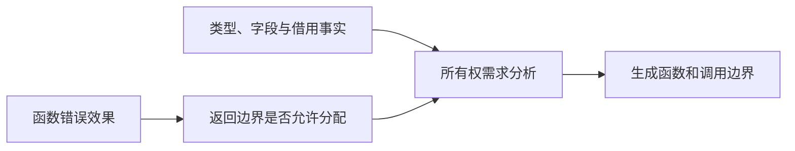
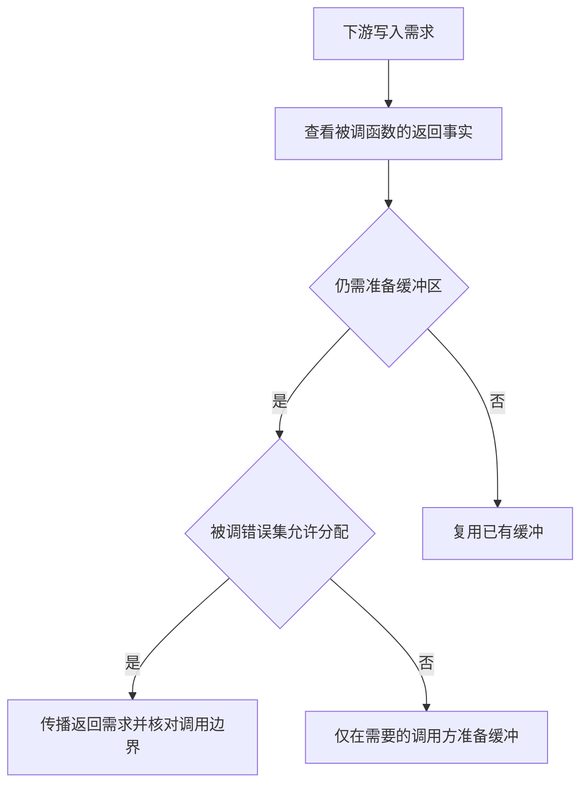

# 所有权复制与函数错误边界

## Intent

修复共享视图在调用链中需要独占缓冲时，生成器把分配放入空错误集函数的问题。保留调用者的错误处理、借用及原地更新语义。

## Data

回归输入把同一个借用视图传入读取字段和反转字段。旧工具先在调用方准备副本，又把独占需求传给返回输入的纯函数，导致该函数生成 `try zxReserve`。其签名只有空错误集，Zig 无法编译该函数。

## Edges

函数效果与签名使用同一来源。只在 Source 被调函数允许 `OutOfMemory` 时传播可能需要复制的返回需求。静态证明返回值已满足需求时，调用点不生成新副本。需保护旧值或别名时，继续在对应调用边界处理。原生函数沿用其 ABI 契约。独立入口沿用已经生成的被调函数，只制定自身的准备与增长计划。

## Answer

复用正式函数错误表，Source 判定返回需求是否可以传播。初始引导器与正式编译器沿用同一个错误效果契约，所有权程序缓存包含分配资格。

正式路径中，函数分析并行准备错误效果和类型槽、流转事实，再用两组结果做所有权求解。返回需求的资格由 Source 计算。初始引导器沿用相同判定。缓存的程序身份升至 v20，同时哈希当前函数的返回分配资格。独立入口对已经生成的被调函数省去无效的返回需求登记。
[分配资格规则](../../packages/genz/src/analysis/facts/return_allocations.zx) · [调用边界处理](../../packages/genz/src/analysis/uniqueness/function/demand/trace/terminal.zx)

原复现入口完成 Zig 编译，运行得到 `[8, 7, 15]`。空错误集的借用函数直接返回输入。三个实际分配点仍由调用方的错误集覆盖，分配器共计 240 B。分别让三个分配点失败，公开分配器入口均返回 `OutOfMemory`。

在同一缓存中将借用函数改为可能分配，再改回原实现。前一种的签名出现 `OutOfMemory` 和 `Overflow`，还原后回到空错误集。修改后及还原后的两组输出均与各自的干净输出逐字节一致，每组 8 个文件，排除工具身份戳。

Source 候选引导器构建通过 25 步，初始引导器构建通过 14 步。两者对原复现生成的 8 个文件逐字节一致，排除工具身份戳。原生值边界、值返回、原地反转、函数效果、不可变列表、所有权缓存、借用视图及类型化错误执行通过 380 个构建步骤和 1,133 项回归。

### 编译器性能

macOS arm64，Zig 0.17.0，ReleaseSmall，16 分区，关闭常驻。冻结清单包含 735 个入口，三轮交错取中位数。三套引导器均由 Source 生成，并执行 Source 分析及发射。上一代为 `5363e1e7a`，固定基线沿用引导声明准备阶段。

| 指标                 |  固定基线 |    上一代 |      候选 |
| -------------------- | --------: | --------: | --------: |
| 冷生成墙钟           |    2.85 s |    2.63 s |    2.60 s |
| 冷生成 CPU           |   12.41 s |   12.18 s |   12.18 s |
| 冷生成进程树采样峰值 | 885.13 MB | 698.24 MB | 698.19 MB |
| 冷生成单进程系统峰值 | 946.11 MB | 744.29 MB | 754.58 MB |
| 热重建墙钟           |    2.22 s |    1.97 s |    1.98 s |
| 热重建 CPU           |    8.50 s |    8.28 s |    8.28 s |
| 无改动墙钟           |    0.04 s |    0.03 s |    0.03 s |

相对上一代，冷生成墙钟下降 0.03 秒，CPU 持平，进程树采样峰值下降约 0.05 MB，单进程系统峰值增加 10.29 MB。相对固定基线，墙钟下降 0.25 秒、CPU 下降 0.23 秒、进程树峰值下降 186.94 MB。相邻两代的 11,753 个输出逐字节一致，排除工具身份戳。暖缓存重建输出与各自的冷生成一致。

相邻两代的生成文件清单 SHA-256 均为 `7248304214a4e61487c037e6ebc0017ce4f9adb96d7071e985dc963a8c43dc4b`。

### 自我审查

本阶段处理的是调用者向被调函数传播的返回缓冲需求。函数内部原有的集合操作和错误处理继续使用已有规则。所有权求解现在需要函数效果和流转事实都已准备好，两组输入可并行准备，工作线程与 arena 仍由宿主管理。性能对照覆盖被冻结清单的分析、所有权求解及 Zig 生成。
