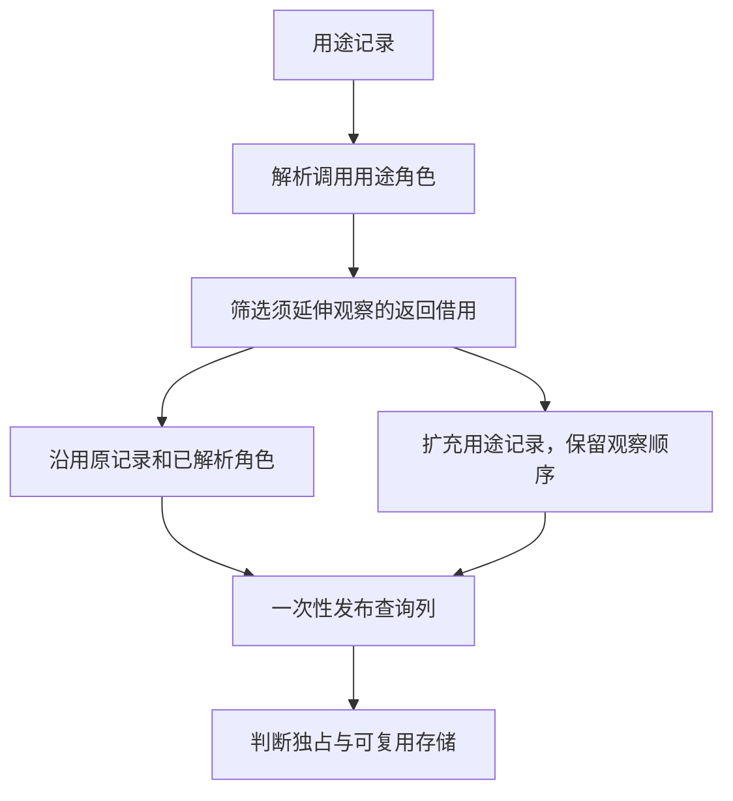

# 所有权工作轮次状态自举

## Intent

让 Source 持有全程序所有权求解的轮次预算和增长状态，并在增量回放中选择连续计划区间。借用用途定型之后再建立查询列，减少编译期的临时分配。宿主继续调度线程、提供缓冲和执行单个函数的缓存读写。

## Data

正式路径进入全程序所有权的工作轮次后，已有 Source 负责队列初始化、摘要更新与出队规则。在每次访问之间，宿主仍保存剩余预算和是否有增长，并构造没有上一访问时的占位反馈。快速回放已在 Source 判断连续区间来源，宿主仍计算原计划与替换计划的消费位置。

借用用途分析先遍历源码，生成用途记录。以前，在检查返回值的借用来源和最后观察位置前，编译器先把记录转成 13 列。用途判断仍读取原记录。无扩展时，初始角色列会被另一列覆盖。有扩展时，第一组列全部被丢弃，并为扩充后的用途重新建立查询列。

Morphic 的函数摘要和程序点分析允许保留真实的借用来源与最后一次观察位置。修改后仍使用 MVS 的路径重叠判断与 Perceus 的最后使用条件。编译器先在同一套记录上完成这些判断，再为后续查询建立列，移除用途定型前的临时查询表。[Morphic §5.1 和 §6.3](../fully_automatic_borrow_inference.pdf) · [MVS §4.4](../mutable_value_semantics.pdf) · [Perceus §2.2 和 §2.4](../perceus.pdf)

## Edges

保留原队列次序，以及预算耗尽时弹出队首但不发起该次访问的行为。四个计数槽直接放在队列对象中，由 Source 写入。反馈借用直到下一次队列推进，之后宿主才可重置临时 arena。增量回放保留计划顺序、按源区间发布和原有失效条件。用途扩展继续使用既有的角色、效果摘要、边编号和顺序判断。初始引导器同步行为。

## Answer

Source 持有轮次预算与增长标记，推进时借用上一轮反馈。增量回放由 Source 选择计划表和起止偏移，宿主按该选择发布计划。用途分析在一套记录上解析角色和观察约束，再建立最终查询列。无需扩展时直接借用解析出的角色列。有扩展时不再为未扩展的用途分配整套查询列。

### 生成器成本

macOS arm64、Zig 0.17.0、ReleaseSmall、16 分区，关闭常驻。固定清单覆盖 735 个入口，三轮交错取中位数。三套工具均由 Source 引导，运行时执行 Source 分析和 Zig 生成。候选由上一代 `e8c9ca46e` 引导，固定基线沿用引导声明准备阶段。

| 指标                 |  固定基线 |    上一代 |      候选 |
| -------------------- | --------: | --------: | --------: |
| 冷生成墙钟           |    2.84 s |    2.57 s |    2.60 s |
| 冷生成 CPU           |   12.46 s |   12.17 s |   12.26 s |
| 冷生成进程树采样峰值 | 885.31 MB | 703.32 MB | 700.40 MB |
| 冷生成单进程系统峰值 | 962.18 MB | 735.02 MB | 730.91 MB |
| 热重建墙钟           |    2.23 s |    1.99 s |    1.96 s |
| 热重建 CPU           |    8.49 s |    8.23 s |    8.27 s |
| 无改动墙钟           |    0.04 s |    0.03 s |    0.03 s |

较上一代，冷生成墙钟增加 0.03 秒，CPU 增加 0.09 秒，进程树采样峰值下降 2.92 MB，单进程系统峰值下降 4.11 MB。相对固定基线，冷生成墙钟减少 0.24 秒，CPU 减少 0.20 秒，进程树采样峰值下降 184.91 MB。

相邻两代的 11,753 个生成文件逐字节一致，排除工具身份戳。暖重建与各自的冷生成一致。相邻两代的生成清单 SHA-256 为 `7248304214a4e61487c037e6ebc0017ce4f9adb96d7071e985dc963a8c43dc4b`，所有权缓存正文 SHA-256 为 `10f1bcee42ae96ef6908f2019afb5cf0fed27b93425c0aefdeedaa330867a089`。

### 正确性与运行分配

Source 引导构建通过 25 步，初始引导构建通过 14 步。五个所有权入口的 21 个生成文件在两种引导器下逐字节一致。对同一个被多个入口使用的读取函数进行有效修改并恢复，常驻生成每次都与同内容的冷生成一致。修改后只重发射一个文件，恢复后所有输出复用。

函数摘要及运行、所有权缓存、字段事实、模块生成和借用视图六组现有回归通过 167 个构建步骤和 277 项测试。

复用五个入口的计数分配器。两个字段互不重叠的场景仍各从 3 次、240 B 减至 2 次、160 B。三个需要保护原值的场景仍为 3 次、240 B。五个入口的返回结果和独立输入数组的内容对照通过。

### 自我审查

轮次状态必须放在实际可写的宿主存储。将字面量数组作为缓冲区试验会写入只读数据，因此最终实现直接借用队列内嵌的存储，连同原队列缓冲一起释放。最初的临时存储问题通过引导器冷生成复现并修正。

本轮迁移覆盖预算、增长标记和回放区间选择。每个函数的访问调度、缓存所有权与计划物化仍由宿主执行。上面的内存对照覆盖整个生成进程；用途表节省以实际数据路径和发布次数为依据，未独立量化它对峰值的贡献。同负载 Rust 的运行对照及完整 Zig/LLVM 冷构建未纳入这组测量。
