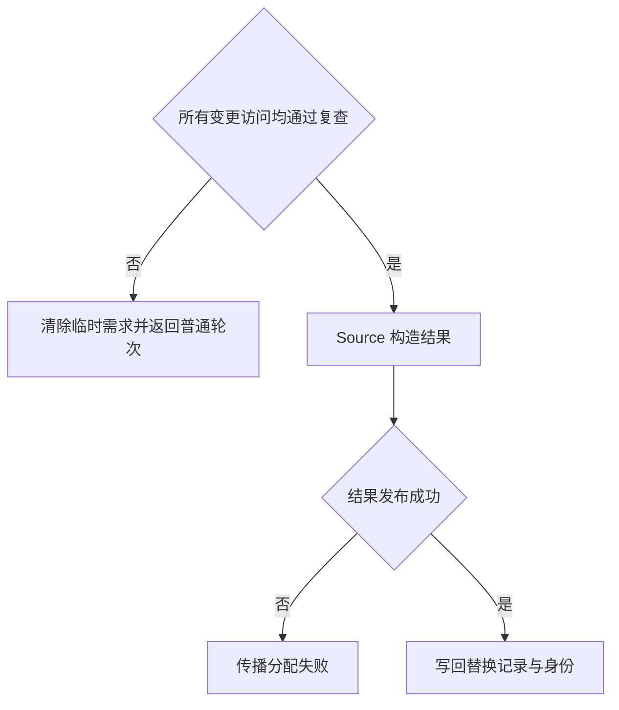

# 所有权快捷回放发布自举

## Intent

将快捷回放成功后的计划选择、保留和记录提交一并迁入 Source。计划交付前完成必要的所有权保留，失败时原回放记录仍可用。

## Data

正式路径已经由 Source 确定复查次序和比较静态事实。成功后仍由 Zig 在旧计划和替换计划之间逐段选择，再逐条复制并写入，最后更新回放记录与身份。普通访问的计划发布已能借用宿主目标列。

## Edges

原生函数及仅类型入口保留空计划。所有对外返回的数组使用调用方分配器，回放记录继续从记忆表借用载荷。发布完成前不能替换回放记录，提交时无新分配。失败仍由原有回退路径重跑轮次。

## Answer

验收覆盖有变更和无变更的常驻回放、旧记录与替换结果、回退后的独立冷生成，以及 Source 与种子的一致性。

### 实现

- Source 根据一次复查的比较结果推进或拒绝游标。复查失败由宿主进入现有恢复入口，清理需求事实后交给普通轮次。函数分析和缓存查找继续由宿主驱动。[复查推进](../../packages/genz/src/analysis/uniqueness/replay/shortcut/advance.rx)
- 一次 Source 调用借用旧计划和替换计划的列，按函数编号写入最终计划表。保留函数复用已有的向量与续期路径复制规则。内部内存模块为已有字节切片写入补齐三种整数切片写入，写入的是切片描述符。[计划填充](../../packages/genz/src/analysis/uniqueness/replay/shortcut/plans.zx) · [计划保留](../../packages/genz/src/analysis/uniqueness/replay/shortcut/retain_plan.zx)
- RX 在计划填充完成后提交已准备好的替换记录和身份。两部分的分配和写入次序由编排显式确定。宿主只负责借出列和取得最终结果。[发布编排](../../packages/genz/src/analysis/uniqueness/replay/shortcut/publish.rx) · [宿主列适配](../../packages/genz/src/zx/uniqueness/replay/shortcut/publication.zig)

### 正确性

Source 引导构建完成 25 步，初始种子完成 14 步。六组回归通过 134 个构建步骤及 303 项测试。735 个入口的 11,753 个生成文件与上一代逐字节一致，排除工具身份戳。所有权缓存正文逐字节相同，SHA-256 为 `cdf9fa7e0f33002a95dc097b2837de781d67e6e519a452fb97f89f7c0bbf3a23`。热重建与各自的冷生成一致。

六入口清单覆盖读取索引变更、去掉被调函数和还原。常驻生成各阶段的 22 个文件与独立冷生成一致，种子和候选对原始清单的 22 个文件也一致。另对 735 入口的清单副本执行四轮编辑和恢复，初次生成、首轮编辑和恢复后的文件指纹在两个工具之间一致。

直接调用实际生成的 Source 发布函数，在 12 个分配位置逐一注入失败。每次失败均保留原有记录及身份。成功运行只需要两份返回计划各自的六个数组，核对了旧记录、空计划、入口替换及续期路径独立存储。另向 Source 游标传入一次比较不符的结果，确认立即返回拒绝状态。

### 性能

macOS arm64，Zig 0.17.0，ReleaseSmall，16 分区。候选由上一代 `43d0def8e` 生成，固定基线沿用引导声明准备阶段。三套工具使用 Source 分析和生成，关闭常驻，对同一 735 入口清单交错测量三轮。

| 指标                     |  固定基线 |    上一代 |      候选 |
| ------------------------ | --------: | --------: | --------: |
| 冷生成墙钟               |    2.85 s |    2.56 s |    2.59 s |
| 冷生成 CPU               |   12.44 s |   12.16 s |   12.19 s |
| 冷生成进程树采样峰值 RSS | 885.88 MB | 713.93 MB | 709.66 MB |
| 冷生成单进程系统峰值 RSS | 925.55 MB | 726.65 MB | 795.16 MB |
| 热重建墙钟               |    2.22 s |    1.97 s |    1.96 s |
| 热重建 CPU               |    8.52 s |    8.24 s |    8.21 s |

针对冷生成的系统峰值差异，使用同一清单追加四轮冷生成配对。上一代和候选的单进程峰值中位数分别为 767.25 MB、749.29 MB。七轮合并后，墙钟为 2.59 秒和 2.58 秒，CPU 均为 12.18 秒，进程树采样峰值为 713.93 MB 和 709.08 MB。单进程系统峰值中位数为 737.69 MB 和 760.40 MB，样本区间分别为 725.06 至 812.63 MB 和 731.56 至 816.35 MB。两批系统峰值的差异方向不同，候选仍低于固定基线。

单独测量常驻编辑，每套工具在完成首次生成后连续做四轮修改与恢复。上一代及候选的编辑墙钟中位数分别为 179.06 ms 和 178.53 ms，恢复分别为 178.54 ms 和 177.53 ms。末次请求结束时的常驻进程 RSS 分别为 915.18 MB 和 917.23 MB。

### 自我审查

本批迁移了快捷计划的选择、保留和提交。逐次访问的缓存查找、函数分析与回退轮次仍由宿主调用。计划发布依照自举阶段的借用列契约写出，与普通轮次共享宿主计划表的布局。冷生成的系统峰值还受到未定位的轮次波动影响，本次实测覆盖同一输入的输出及常驻编辑开销。
