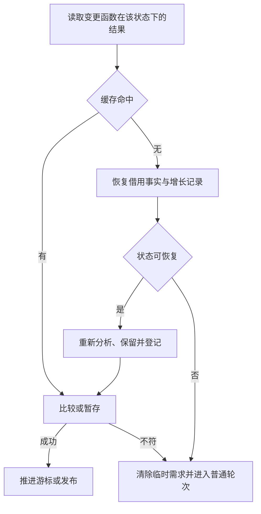

# 所有权快捷回放逐次复查自举

## Intent

由 Source 控制快捷回放对变更函数的逐次复查、重新计算与替换计划的写入。普通访问与快捷复查共用函数计算和 memo 登记的实现。

## Data

此前 Source 已控制游标推进、等价比较和快捷计划发布。每次复查仍由 Zig 决定清空工作区、查缓存、按旧状态重新分析、保留增长记录，以及把新计划追加到暂存列表。普通访问的函数计算与缓存登记持有相同的数据。[既有快捷回放发布](所有权快捷回放发布自举.md)

## Edges

结算和需求复查必须与原记录一致。计划复查逐条暂存结果，比较失败或无法恢复状态时进入原有回退轮次。暂存记录只在完整复查成功后发布。需求复查中沿用工作区的增长记录时，先保留到 memo 的分配器，再写缓存。常驻关闭时仍通过共享的普通访问路径生成。

## Answer

RX 的复查次序用既有 `staticSequence` 在引导器构建时展开。普通和快捷访问共用小型计算与结果登记接口，复查仍为增长记录提供独立工作区。替换计划由 ZX 追加并增长，行布局与原暂存记录相同，借用现有连续缓冲。宿主提供类型适配、工作区交接和旧种子入口。

[复查编排](../../packages/genz/src/analysis/uniqueness/replay/shortcut/visit/sequence.rx) · [计算入口](../../packages/genz/src/zx/uniqueness/program/visit/compute.zig) · [替换暂存](../../packages/genz/src/analysis/uniqueness/replay/shortcut/replacements/append.zx)

### 一致性与性能

Source 引导构建通过 25 步。冻结 735 入口的 11,753 个产物及 v18 所有权缓存正文逐字节一致，排除工具身份戳。缓存正文 SHA-256 为 `cdf9fa7e0f33002a95dc097b2837de781d67e6e519a452fb97f89f7c0bbf3a23`。暖重建与各自的冷生成一致。六入口常驻清单的初次生成、修改索引、删除调用和恢复分别生成 22 个与独立冷生成相同的文件。

用临时诊断引导器观察正式快捷回放的出口。仅修改读取索引时复查采用一个替换计划。把读取移到数组反转之后时，复查反馈不符并进入普通轮次。两次编辑及恢复的产物均与使用正式候选的独立冷生成一致。诊断输出未进入交付源码或性能测量。

初始种子构建通过 14 步，与候选在六入口清单的初始状态生成的 22 个文件逐字节一致。七组既有回归通过 290 个构建步骤及 635 项检查，覆盖静态所有权、函数分析及运行、缓存、字段效果、对象追加和聚合循环。

macOS arm64，Zig 0.17.0，ReleaseSmall，16 分区。候选由 `133eb370a` 引导，固定基线沿用引导声明准备阶段。三套工具都由 Source 引导，运行时执行 Source 分析与生成。关闭常驻，固定清单交错三轮，取中位数。

| 指标                     |  固定基线 |    上一代 |      候选 |
| ------------------------ | --------: | --------: | --------: |
| 冷生成墙钟               |    2.85 s |    2.59 s |    2.58 s |
| 冷生成 CPU               |   12.44 s |   12.18 s |   12.23 s |
| 冷生成进程树采样峰值 RSS | 889.75 MB | 699.89 MB | 698.93 MB |
| 冷生成单进程系统峰值 RSS | 973.59 MB | 725.63 MB | 736.26 MB |
| 热重建墙钟               |    2.21 s |    1.99 s |    1.96 s |
| 热重建 CPU               |    8.41 s |    8.28 s |    8.20 s |
| 无改动墙钟               |    0.04 s |    0.03 s |    0.03 s |

相对上一代，冷生成墙钟下降 0.01 秒，CPU 增加 0.05 秒，进程树采样峰值下降 0.97 MB，单进程系统峰值上升 10.63 MB。相对固定基线，冷生成墙钟和 CPU 分别减少 0.27 秒及 0.21 秒，进程树峰值下降 190.82 MB。

候选第一轮冷生成墙钟为 4.03 秒，随后为 2.58 和 2.52 秒。首轮推导、发射和写出合计 2.286 秒，上一代首轮合计 2.320 秒。额外墙钟落在这三个计时区间之外。

另在 735 入口的常驻进程内反复修改一处数值计算并恢复，共四轮。编辑墙钟中位数为 181.30 → 180.04 ms，恢复为 163.80 → 164.56 ms。末轮返回时的常驻 RSS 为 818.86 → 831.19 MB。两代的分析 arena 保留容量、发射 arena 容量和版本统计分别相同。初次生成、首次编辑和首次恢复的产物指纹一致。

### 自我审查

旧快捷复查现在只供初始种子使用。Source 决定普通和快捷访问的步骤顺序，Zig 侧还负责提供类型化函数分析入口、生命周期适配及外层游标循环。复查仍会把有效的新分析记录留在 memo 中，替换计划仅在整个快捷回放通过后交给已发布记录。末轮常驻 RSS 只是一次配对观察。冷暖数据覆盖 zxc 分析与代码写出。
